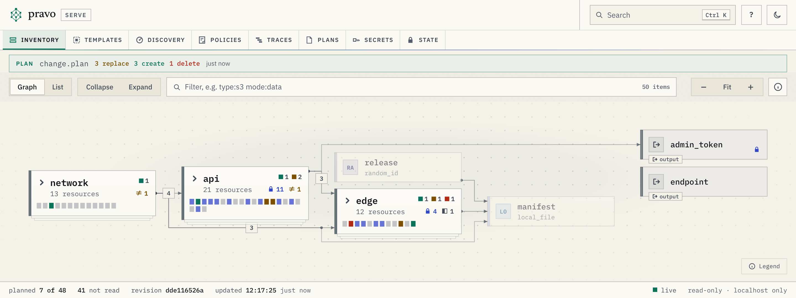

<p align="center">
  
</p>

<h1 align="center">pravo</h1>

<p align="center">
  <strong>Terraform, reimagined.</strong><br>
  Same providers, same plan/apply loop. Rebuilt for scale, speed, security and discoverability.
</p>

<p align="center">
  <a href="https://pravo.systems">Website</a> ·
  <a href="docs/how-to/quick-start.md">Quick start</a> ·
  <a href="docs/migrate/index.md">Migrate from OpenTofu or Terraform</a> ·
  <a href="docs/learn/index.md">Learn CUE and pravo</a> ·
  <a href="https://github.com/pravo-systems/pravo/releases">Releases</a>
</p>

pravo specifies infrastructure in [CUE](https://cuelang.org) and runs the OpenTofu providers you already use, unchanged. It keeps the plan and apply loop and rebuilds what surrounds it for a team: a state kept per resource, sealed and signed; plans that read only what a change reaches; and a viewer in the browser for the estate, its plans, its policies and its runs.

<picture>
  <source media="(prefers-color-scheme: dark)" srcset="docs/img/serve/readme-dark.png">
  
</picture>

<p align="center"><sub><code>pravo serve</code> with a saved plan over the graph. Each group counts what the plan creates, replaces and destroys inside it, and what the plan leaves alone is dimmed.</sub></p>

pravo is experimental. It drives real OpenTofu providers, and its behaviour is documented and tested end to end.

## Try it

```sh
curl -fsSL https://pravo.systems/install.sh | sh      # macOS and Linux
irm https://pravo.systems/install.ps1 | iex           # PowerShell on Windows
```

The archives, checksums and provenance attestations are on the [releases page](https://github.com/pravo-systems/pravo/releases). The [quick start](docs/how-to/quick-start.md) writes one file, plans it, applies it, changes it and destroys it in a few minutes, with no cloud account.

## A specification in CUE

A specification is the `.cue` files of one directory. This one writes a definition once and makes two instances of it:

```cue
package estate

import loc "pravo.dev/providers/hashicorp/local"

$local: loc.#Provider

// A definition: two fields and the file they render.
#Service: {
	name: string
	port: int & >=1024 & <=65535
	file: $local.#Resource.local_file & {
		filename: "\(name).env"
		content:  "PORT=\(port)\n"
	}
}

api: #Service & {name: "api", port: 8080}
web: #Service & {name: "web", port: 8081}
```

`pravo init` installs the provider and generates its CUE package. `pravo plan` prints what an apply would do, and `pravo apply` does it. The output is abridged where it shows `...`.

```text
$ pravo plan
pravo will perform the following actions:

  # api.file (local_file) will be created
  + api: file: {
  +     content:              "PORT=8080\n"
...
  +     filename:             "api.env"
  +     id:                   (known after apply)
    }

  # web.file (local_file) will be created
  + web: file: {
  +     content:              "PORT=8081\n"
...
  +     filename:             "web.env"
  +     id:                   (known after apply)
    }

Plan: 2 to add, 0 to change, 0 to destroy.
Graph: planned 2
```

Every value is checked against every constraint written for it before any provider starts. Set the port of `web` to `80` and the plan stops with exit status 6, naming the bound and both places in the file:

```text
$ pravo plan
Error: evaluating /home/you/estate:
web.port: invalid value 80 (out of bound >=1024):
    /home/you/estate/main.cue:10:14
    /home/you/estate/main.cue:18:37
```

A definition that holds resources is how code is shared in pravo: it is used through instances and shared through CUE packages and CUE modules. pravo has no `module` block. [Reuse](docs/reference/spec-reuse.md) covers the rest.

## Built for teams

**See it.** `pravo serve` opens a read-only viewer on your machine: the graph of groups and resources, plans, history, state, secrets, policies, templates and traces in one place, with nothing to host. It listens on the loopback interface, needs the token that it prints, withholds sensitive values on the server and writes nothing. [Explore your estate](docs/how-to/explore-your-estate.md)

**Change one resource, read one resource.** A plan starts at your change, follows the recorded dependencies and reads only what the change reaches. Change one value in an estate of 2,001 resources, and OpenTofu reads all 2,001 from the cloud while pravo reads one. Applies that do not overlap run at the same time, started by different people, and an overlapping apply is refused, not queued. `pravo drift` finds drift in what no plan reached. [What a plan reaches](docs/concepts/what-a-plan-reaches.md)

**Sealed and signed state.** `pravo protect init --encrypt` encrypts the attributes, outputs and stored plans of a state to the readers that `.pravo/access/readers.txt` lists, and every change is a signed transaction. Addresses, types and dependencies stay readable, so the graph and the plans keep working. Keys carry the role reader, writer or admin, and the secrets a team shares live in the state as values with a history, never written to a record, a plan or a log. [Seal the state](docs/how-to/seal-the-state.md) · [Signatures and roles](docs/concepts/signatures-and-roles.md) · [Store secrets in the state](docs/how-to/store-secrets-in-the-state.md)

**Rules that are written down.** A policy is a `pravo.#Policy` that lives in the state and judges every plan. Policies are versioned and signed, each apply names the versions that judged it, and the policy studio in the viewer tries a rule on a plan before it is in force. [Constraints and policies](docs/concepts/policies.md)

**One specification, every environment.** `$environments` declares dev, staging and prod in the specification, and a row for each holds what differs. The resources are written once and never name an environment, `pravo validate` checks every environment before a merge, and each environment keeps a state of its own and its own readers file. `$after` says which environment an environment follows: every apply leaves a signed note of the release it ran, and `pravo promote` checks it before the next environment takes the release, so prod takes only what dev has run. [Run one specification in several environments](docs/how-to/environments.md) · [Promote a release](docs/how-to/promote-a-release.md)

**Self-service that stays code.** A platform team writes a pattern once, as a definition that embeds `pravo.#Template`. Anyone with a checkout fills in its form in the viewer and gets the CUE of a new instance, checked against the specification and every policy in force before it is pasted. One person prepares the plan with a reader key, and someone with a writer key applies it. An instance is worked out from its template, not copied, so a change to the template reaches every instance at the next plan. [Templates and self-service](docs/concepts/templates.md) · [Offer a template](docs/how-to/offer-a-template.md)

**Take over what exists.** `pravo discover` lists the objects that exist in a scope and sets them against the state, and `pravo discover adopt` writes the resource that brings an object under management. [Find what nothing manages](docs/how-to/find-what-nothing-manages.md)

**Where the time went.** Every run records its spans and the network requests that a provider makes while it works. The viewer shows them with nothing to set up, and any OpenTelemetry collector can receive them. [Traces](docs/concepts/traces.md)

## What stays the same

pravo replaces the OpenTofu language (HCL), the OpenTofu evaluator and the OpenTofu state format. It does not replace providers: it speaks the provider plugin protocol, versions 5 and 6, so the providers on the OpenTofu registry run as they are. `pravo init` downloads them from `registry.opentofu.org` into `~/.pravo` (`$PRAVO_HOME`).

[Migrate](docs/migrate/index.md) is a gated runbook: translate the HCL, convert the state file and plan until the plan is empty. Every step before your first apply leaves your infrastructure and your OpenTofu state as they are. pravo has no workspaces, no `-target` and no provisioners, and [Not in pravo](docs/reference/not-in-pravo.md) names what to use in their place.

## In CI, for agents and in your programs

- **GitHub Actions.** `pravo-systems/setup-pravo@v1` installs a pinned version and checks its checksum. `pravo-systems/pravo-action@v1` runs a plan, an apply, a drift check or a discovery and reports it on GitHub. [Run pravo in a pipeline](docs/how-to/ci.md)
- **Agents.** `pravo skill install` writes a skill to `~/.claude/skills/pravo`, built from these docs and embedded in the binary, so that an agent writes CUE and not HCL. `pravo mcp` serves the commands over the Model Context Protocol. [Let an agent plan and apply](docs/how-to/agents-and-mcp.md)
- **Programs.** With `--json`, a command prints a JSON document. The documents and the exit codes are the stable surface. `github.com/pravo-systems/pravo/pravo` is a Go package that opens a workspace, plans, applies, stores plans and checks drift; it is v0 and unstable, the state can live in a `pravo.Backend` that your program implements, and `examples/embed` uses it. [The library and the machine interface](docs/concepts/the-library-and-the-machine-interface.md)

## Build from source

Go 1.26 or newer builds pravo from a checkout. The binary needs neither Go nor OpenTofu to run.

```sh
go build -o bin/pravo ./cmd/pravo
export PATH="$PWD/bin:$PATH"
pravo version
```

The roots in `examples/` need no cloud account. They use `hashicorp/random`, `hashicorp/local`, `hashicorp/null` and `hashicorp/tls`, and the functions of `hashicorp/kubernetes`, which need no cluster.

```sh
cd examples/getting-started
pravo init
pravo plan
pravo apply
```

## Contributing

`ARCHITECTURE.md` describes how pravo is built. The documentation lives in `docs/` as Markdown, and `docs/AUTHORING.md` fixes its structure, its voice and its extensions.

```sh
go test ./...
go test -short ./...         # skips the tests that build the binary or run sitegen
golangci-lint run ./...      # with the Go version of go.mod

# ESLint and Stylelint for the viewer and the site
npm --prefix tools/_weblint ci
npm --prefix tools/_weblint run lint

# Run the commands of a page against the real binary and compare the output
go run ./tools/capture -check docs/how-to/quick-start.md

# Build the site into site/public, lint it and check every link
go run ./tools/sitegen -pravo-bin bin/pravo

# Make the pictures of the viewer, the one above included
go run ./tools/serveshots -bin bin/pravo -out docs/img/serve
```

`.github/workflows/ci.yml` runs on every push to `main` and on every pull request: formatting, vet and a build for every platform, the known vulnerabilities that the code reaches (`vulns.yml` asks again each day), the linters, the Go tests, the tools, every page of the documentation, the demos, the OpenTofu listings and the site. The job `ci` passes when all of them do, and is the one check to require.

<details>
<summary>Layout of the repository</summary>

| Path | Contents |
|---|---|
| `cmd/pravo/` | The command line, the JSON output and the MCP server. |
| `pravo/` | The public Go package: workspaces, plans, applies, stored plans, drift. |
| `internal/config/` | Loads a root; finds resources, providers and outputs; fingerprints a root. |
| `internal/convert/` | CUE values to provider values and back; known, unknown and null; reference analysis. |
| `internal/engine/` | Dependency graph, scheduler, plan, apply, saved and stored plans, policies. |
| `internal/state/` | The state store: records, transactions, locks; local and S3 backends. |
| `internal/plugin/` | Provider processes; plugin protocol 5 and 6 adapters; recording and replay. |
| `internal/tfplugin/` | Protocol definitions (`.proto`, MPL-2.0), generated messages, client stubs. |
| `internal/registry/` | Provider registry and container registry clients, download and cache. |
| `internal/schema/` | Provider schema model and the CUE generator. |
| `internal/tfstate/` | Converts an OpenTofu state file to state records. |
| `internal/ui/`, `internal/plog/`, `internal/telemetry/` | Plan rendering, the debug log, OpenTelemetry. |
| `internal/serve/` | The read-only viewer behind `pravo serve`: the server, the JSON contract in `api.go` and the interface in `web/`. |
| `internal/fakes3/` | In-memory S3-compatible server for tests. |
| `tools/sitegen/` | Documentation site generator, its HTML contract and the contrast check. |
| `tools/capture/` | Runs the examples in the documentation and compares their output. |
| `tools/hclcheck/` | Runs the OpenTofu listings of the documentation through `tofu fmt`, `init` and `validate`. |
| `tools/_weblint/` | ESLint and Stylelint for the viewer and the site. The underscore keeps the Go tools out of its `node_modules`. |
| `tools/serveshots/` | Applies the estates in `scenarios/`, starts `pravo serve` and makes the screenshots of the documentation with headless Chrome. |
| `tools/skillgen/` | Builds the skill for agents from `docs/`. |
| `tools/protogen/`, `tools/fakes3/`, `tools/fakeoci/` | Protocol message generator; an in-memory S3 bucket and an in-memory container registry for trying state and CUE modules. |
| `docs/` | Documentation sources. |
| `site/` | Site configuration, landing page, style sheet, scripts, recorded landing data. |
| `examples/` | Runnable roots, and `examples/embed`, a program that uses the Go package. |
| `templates/module/` | Template repository for a CUE module that other repositories fetch by version. |

</details>

## License

Apache-2.0. The protocol definitions under `internal/tfplugin/proto` are copied from the terraform-plugin-go repository and are licensed MPL-2.0. pravo is an independent project, affiliated with neither the OpenTofu project nor HashiCorp.
