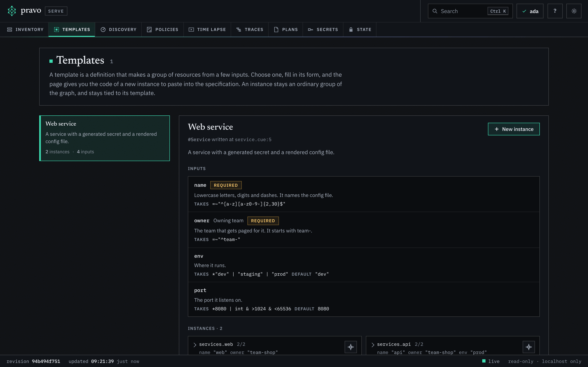
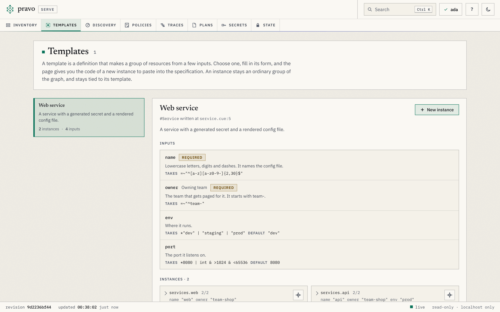
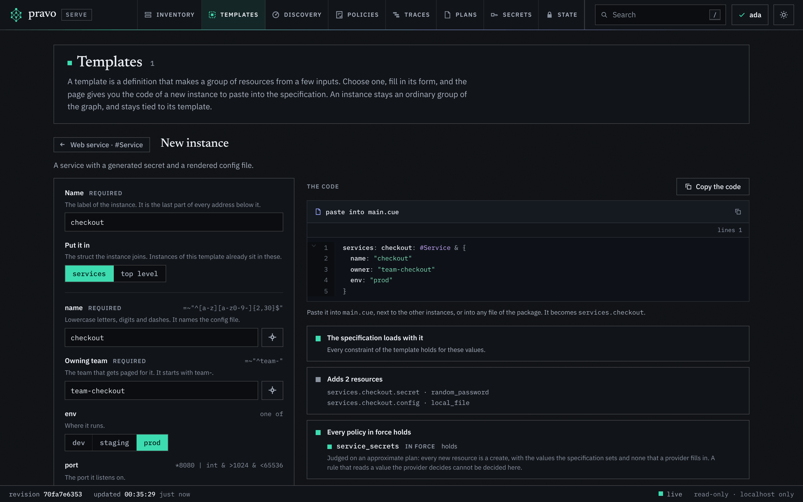
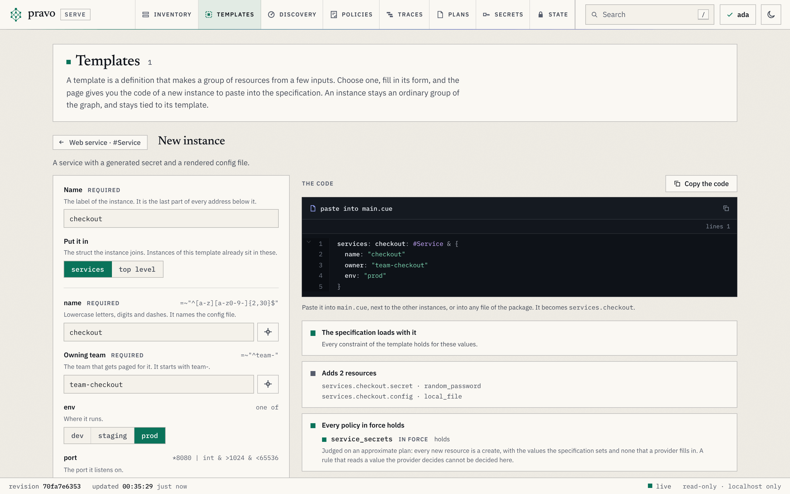
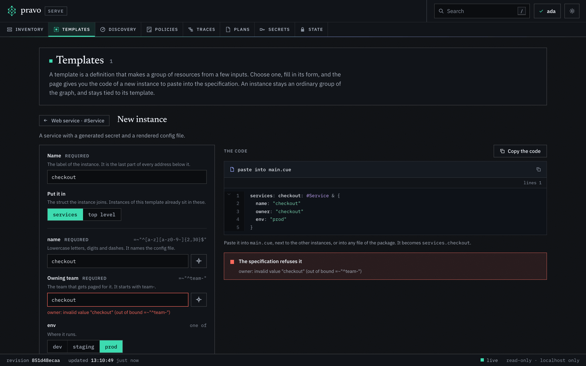
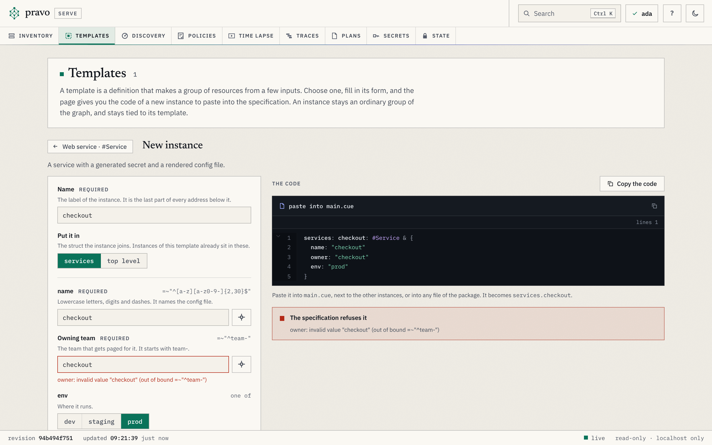
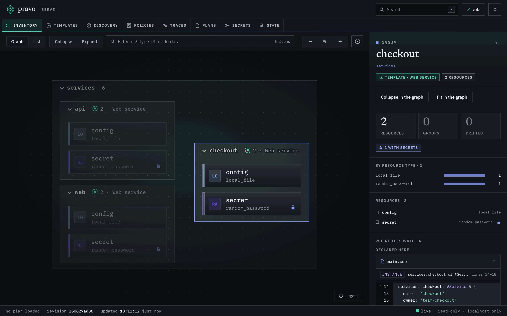
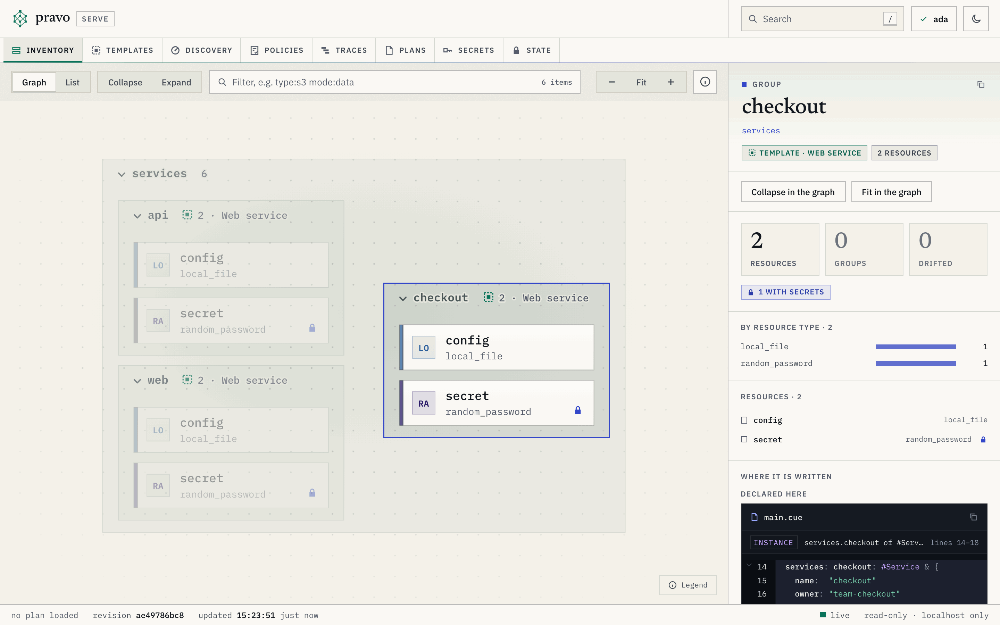

A platform team can offer a pattern, such as a web service, as a template. You ask for a new one by filling in a form: the viewer checks what you type against the specification and the policies, and gives you the CUE of the new instance to paste. Then the request is a change like any other. You plan it, and with a reader key you store the plan; a writer applies it. You never need the right to change the estate yourself. [Templates and self-service](../concepts/templates.md) explains the model.

> [!NOTE]
> The examples run on a local state, sealed with `--allow-local`, and the three people are three identity directories on one machine: ada, an admin, wrote the template and its policy; dan is a writer; eve, a reader, asks for the service. `PRAVO_CONFIG_DIR` picks one. The root is the one that [Offer a template to your team](offer-a-template.md) ends with.

```sh run hidden
mkdir -p estate/.pravo/access
cat > estate/main.cue <<'EOF'
package estate

import (
	loc "pravo.dev/providers/hashicorp/local"
	rnd "pravo.dev/providers/hashicorp/random"
)

$local:  loc.#Provider & {$version: "~> 2.5"}
$random: rnd.#Provider & {$version: "~> 3.6"}

// The name of an instance is its key, so two instances cannot write one file.
services: [Name=string]: #Service & {name: Name}
services: web: #Service & {name: "web", owner: "team-shop"}
services: api: #Service & {name: "api", owner: "team-shop", env: "prod"}
EOF
cat > estate/service.cue <<'EOF'
package estate

import "pravo.dev/pravo"

#Service: pravo.#Template & {
	$template: {
		name:        "service"
		title:       "Web service"
		description: "A service with a generated secret and a rendered config file."
		inputs: {
			name: {}
			owner: {label: "Owning team", description: "The team that gets paged for it. It starts with team-."}
			env: {}
			port: {}
		}
	}
	// Lowercase letters, digits and dashes. It names the config file.
	name: string & =~"^[a-z][a-z0-9-]{2,30}$"
	// The team that answers for the service.
	owner: string & =~"^team-[a-z0-9-]+$"
	// Where it runs.
	env: *"dev" | "staging" | "prod"
	// The port it listens on.
	port: *8080 | int & >1024 & <65536

	secret: $random.#Resource.random_password & {length: 24}
	config: $local.#Resource.local_file & {
		filename: "out/\(name).env"
		content:  "OWNER=\(owner)\nENV=\(env)\nPORT=\(port)\n"
	}
}
EOF
cat > estate/policy.cue <<'EOF'
package estate

import "pravo.dev/pravo"

service_secrets: pravo.#Policy & {
	description: "The password of every Web service has special characters."
	rule: changes: [...{
		type: string
		template?: {name: string, instance: string}
		if template != _|_ {
			if template.name == "service" && type == "random_password" {
				after: special: true
			}
		}
	}]
}
EOF
pravo -C estate id new --name ada > /dev/null
PRAVO_CONFIG_DIR=people/dan pravo -C estate id new --name dan > /dev/null
PRAVO_CONFIG_DIR=people/eve pravo -C estate id new --name eve > /dev/null
{
  echo "$(pravo -C estate id show | tail -n 1 | sed 's/^ *//') role:admin"
  echo "$(PRAVO_CONFIG_DIR=people/dan pravo -C estate id show | tail -n 1 | sed 's/^ *//') role:writer"
  echo "$(PRAVO_CONFIG_DIR=people/eve pravo -C estate id show | tail -n 1 | sed 's/^ *//') role:reader"
} > estate/.pravo/access/readers.txt
pravo -C estate init > /dev/null
pravo -C estate protect init --encrypt --yes --allow-local > /dev/null
pravo -C estate protect roles --yes > /dev/null
pravo -C estate apply --auto-approve > /dev/null
```

## 1. Open the catalog

Start the viewer in the root, as yourself, and press `m` for the Templates section:

```sh
PRAVO_CONFIG_DIR=people/eve pravo -C estate serve
```

The catalog lists the templates of the root, each with its title, its description and how many instances it has. Open one to read its inputs, with the constraint and the default of each, and its instances, with the values each sets. The instances show what a finished request looks like.

:::figure The Templates section with the Web service open.
<a class="shot shot-dark" href="../img/serve/templates-catalog-dark.png"></a>
<a class="shot shot-light" href="../img/serve/templates-catalog-light.png"></a>
:::

## 2. Fill in the form

New instance opens the form. Give the instance a name, which is the last part of every address it makes, and choose where it goes: `services`, where the other instances are, or the top level. Then fill in the inputs. The name of the instance fills in the `name` input until you change it. A value that a choice offers is a row of buttons, and an input with a default shows it.

Beside each field, the picker lists the attributes of the estate, such as `services.web.config.filename`, with what the state holds for each now. A pick writes a reference, not a value, so the instance reads the attribute when it is applied.

:::figure The form for a new Web service called checkout, in prod. The three checks under the code all pass.
<a class="shot shot-dark" href="../img/serve/templates-form-dark.png"></a>
<a class="shot shot-light" href="../img/serve/templates-form-light.png"></a>
:::

## 3. Read the checks

Three checks follow every value as you type. Nothing is written while they run: the viewer loads the specification with the code laid over it in memory.

| Check | When it fails | What to do |
|---|---|---|
| The specification loads with it | A value breaks a constraint of the template, and the message of CUE is under the field. A name that an instance has already is refused on the name. | Change the value. The constraint is the template's: ask its authors if it is wrong. |
| Adds N resources | Never. It lists the addresses that the instance makes. | Read them. They are what the plan will create. |
| Policies | A policy in force would refuse the plan, and the card quotes its message. A rule that reads a value that a provider decides is not decided. | Change the value, or ask why the policy says no. The verdict that counts is the one at the plan. |

:::figure The same form with an owner that the template refuses. The message of CUE is under the field, and the other checks wait until the specification loads.
<a class="shot shot-dark" href="../img/serve/templates-refused-dark.png"></a>
<a class="shot shot-light" href="../img/serve/templates-refused-light.png"></a>
:::

## 4. Paste the code and plan it

Copy the code and paste it where the page says: into the file where the other instances are, or into any file of the package. Here it goes into a file of its own:

```cue file=estate/checkout.cue title="estate/checkout.cue"
package estate

services: checkout: #Service & {
	name:  "checkout"
	owner: "team-checkout"
	env:   "prod"
}
```

Plan it as yourself. A reader may plan:

```sh run
PRAVO_CONFIG_DIR=people/eve pravo -C estate plan | grep -E '^  # |^Policies|^Plan:'
```

```text out
  # services.checkout.secret (random_password) will be created
  # services.checkout.config (local_file) will be created
Plan: 2 to add, 0 to change, 0 to destroy.
Policies: 1 satisfied.
```

## 5. Hand it over

The plan has to be applied by someone who may change the state. Two ways fit most teams.

**A pull request.** Commit the file and open a pull request. The pipeline plans the change and shows the plan and the verdict of each policy on the pull request, and the team applies it as it applies every change. [Run pravo in a pipeline](ci.md) sets that up.

**A stored plan.** A stored plan applies only to the files it was made from, so commit your file first: the writer applies it from a checkout that has it. Then, with a reader key, store the plan in the state with the reason:

```sh run
PRAVO_CONFIG_DIR=people/eve pravo -C estate plan --store --actor eve --reason "the checkout service" 2>&1 | grep '^Stored'
```

```text out
Stored the plan as plan-<id>; unless it is applied it is removed after 7 days. To apply exactly these actions, run:
```

A writer lists the stored plans and reads this one. `plan show` names who stored it and why, and checks it against the state and the checkout:

```sh run
ID=$(pravo -C estate plan list | awk 'NR==1 {print $1}')
PRAVO_CONFIG_DIR=people/dan pravo -C estate plan show "$ID" | grep -E '^Stored plan|reason:'
```

```text out
Stored plan plan-<id> by eve, just now (pending)
  reason:  the checkout service
```

Then the writer applies it by its id. The apply is the plan that you made, judged again by the policies in force:

```sh run
ID=$(pravo -C estate plan list | awk 'NR==1 {print $1}')
PRAVO_CONFIG_DIR=people/dan pravo -C estate apply "$ID" --auto-approve | grep '^Apply complete'
```

```text out
Apply complete! Resources: 2 added, 0 changed, 0 destroyed. [txn <id>]
```

You prepared the change and someone with a writer key applied it. Nobody had to hand you the right to change the estate.

## 6. Give a secret by name

An input that the template marks as a secret never takes a value in the form. You choose where the secret is read from, the sealed state or an environment variable, and give its name; the code declares the secret and passes its value. When the sealed state does not hold it yet, the form gives the command to copy:

```sh
pravo secret set certificate/checkout/signing_key
```

[Store secrets in the sealed state](store-secrets-in-the-state.md) covers secrets, and [Inputs that are not typed in](../reference/spec-reuse.md#inputs-that-are-not-typed-in) the input.

## 7. Find the instance

After the apply the catalog counts three instances, and the card of `services.checkout` says that the state holds both of its resources. The icon button on the card opens the group in the Inventory, where an instance wears the dashed square of a template next to its count, and the inspector carries a tag that names its template and opens it:

:::figure The Inventory with services.checkout selected: the dashed square of a template on its lane, and the tag of the template in the inspector.
<a class="shot shot-dark" href="../img/serve/templates-instance-dark.png"></a>
<a class="shot shot-light" href="../img/serve/templates-instance-light.png"></a>
:::

The instance is ordinary code from now on. To change it, change its values in the file, and plan. When the platform team changes the template, the next plan changes your instance with every other.

## What next

- [Offer a template to your team](offer-a-template.md) is the page for the people who write templates.
- [The Templates section](../reference/viewer-sections.md#the-templates-section) lists the parts of the page.
- [Store a plan and apply it later](store-a-plan-and-apply-it-later.md) covers stored plans.
