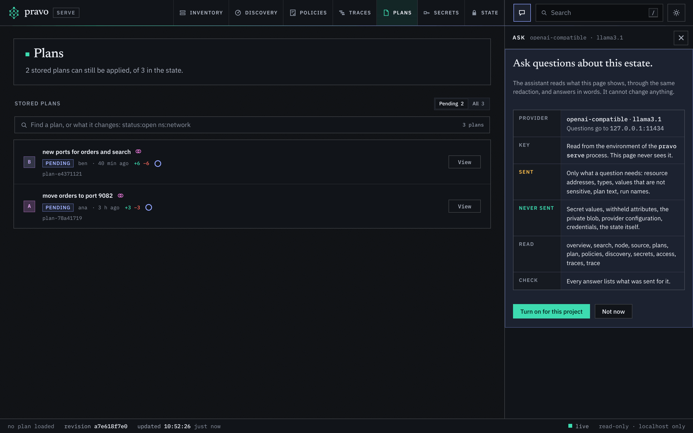
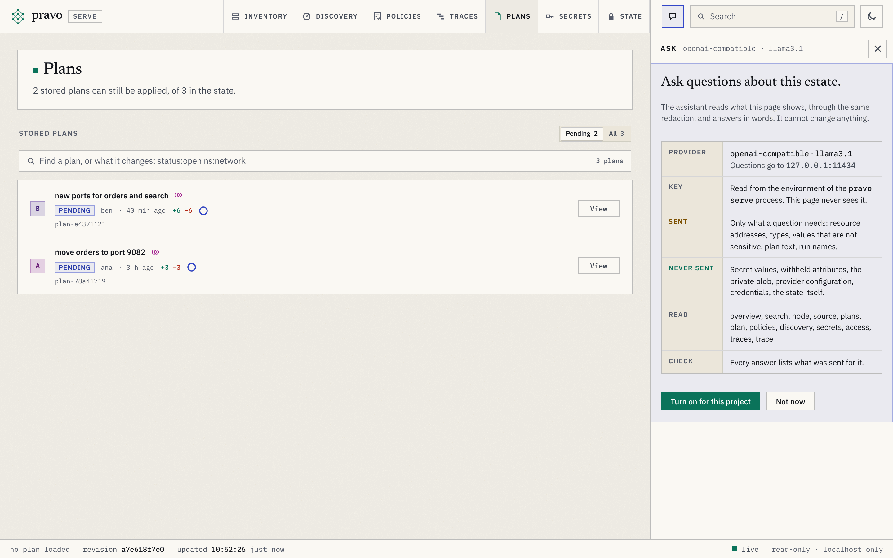
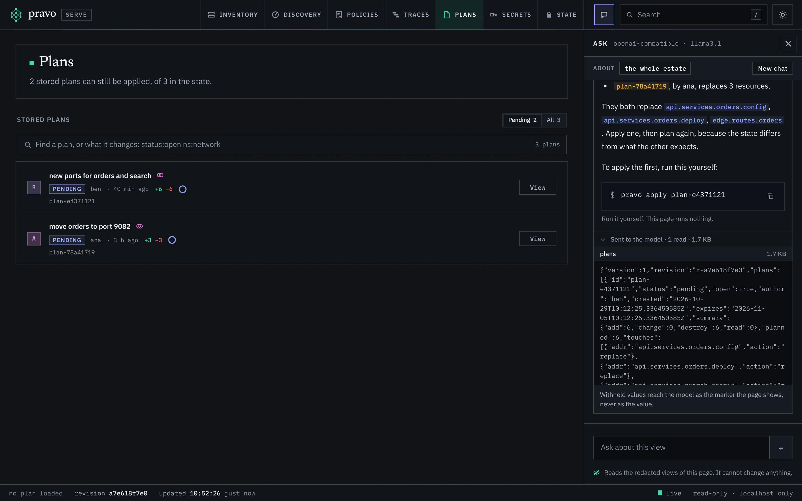
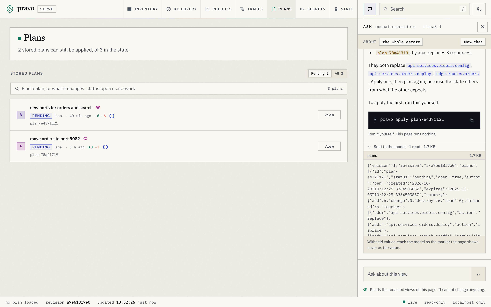

The viewer can answer a question in words: why a resource is replaced, what a change reaches, which plans wait for an approval, what the last run did. A language model writes the answer, and it can only read what the viewer already shows. It is off unless you turn it on. [The assistant](../concepts/the-assistant.md) explains what it reads, what leaves the machine and what it can never do, and [`pravo serve`](../reference/serve.md#the-assistant) lists the flags. This page turns it on, asks, and checks what was sent.

`tools/capture` does not run this page, because it needs a key or a model that the documentation build does not have. The lines that `pravo serve` prints are from a run with the settings for a local model in step 1. The pictures are of the `platform` estate after three people stored a plan, and the model in them is a stand-in that `tools/serveshots` serves on the address of a local model. It makes one read of the stored plans and writes its answer from what that read returns, so the picture shows what the viewer really sent, and shows nothing of how a real model would phrase an answer.

## 1. Choose a provider

The assistant is set up with the environment. `PRAVO_CHAT` names the provider, and may add the model after a colon. Which provider you pick decides who receives what the assistant reads, so pick it for that.

For Anthropic, the key comes from `ANTHROPIC_API_KEY`:

```sh
export PRAVO_CHAT=anthropic:claude-sonnet-5-5
export ANTHROPIC_API_KEY=...
```

For any service that speaks the OpenAI chat protocol, such as OpenRouter, name `openai-compatible` and the endpoint. The key is `PRAVO_CHAT_API_KEY`, and the model is the name that the service lists:

```sh
export PRAVO_CHAT=openai-compatible:anthropic/claude-sonnet-4.5
export PRAVO_CHAT_ENDPOINT=https://openrouter.ai/api/v1
export PRAVO_CHAT_API_KEY=...
```

For a model on this machine, such as one that Ollama serves, the endpoint is a loopback address, and a local endpoint may need no key:

```sh
export PRAVO_CHAT=openai-compatible:llama3.1
export PRAVO_CHAT_ENDPOINT=http://localhost:11434/v1
```

`PRAVO_CHAT_MODEL` sets the model apart from the provider, for a shell that exports the provider once and changes the model often. A key alone turns nothing on, since `ANTHROPIC_API_KEY` is in many shells for other tools. An endpoint has to be `https`, or `http` on this machine, and a redirect to another host is refused, so that a key cannot be sent anywhere that you did not name.

Nothing here is a flag, and nothing is in the specification: the assistant is a choice of the person who runs the viewer, and the key stays in the environment of the process. `--chat`, `--chat-model` and `--chat-endpoint` override the environment for one run, and `--chat off`, or `PRAVO_CHAT=off`, turns it off for one run.

## 2. Start the viewer

```sh
pravo serve
```

```text
pravo serve: chat on: openai-compatible llama3.1 via localhost:11434 (reads only, sends the viewer's redacted views)
pravo serve: http://127.0.0.1:36435/?token=66487aacf2fdb54d0a49cca328098a39
```

The first line is printed only when the assistant is on. It names the provider, the model and the host that questions go to. Without it, the page has no Ask control, the server has no route for it and nothing connects to a provider.

## 3. Read the notice

Press `c`, or choose the speech-bubble button in the bar. The first time, in each browser, the panel shows a notice instead of a chat: the provider, the model and the host; that the key is read from the environment of `pravo serve` and never reaches the page; what is sent, what is never sent, which reads the model has, and that every answer lists what was sent for it. Choose Turn on for this project to go on. The choice is kept in the browser, and not in the state or in the project, so that another browser asks again.

:::figure The notice that the panel shows the first time in a browser, over the Plans section of the platform estate.
<a class="shot shot-dark" href="../img/serve/ask-notice-dark.png"></a>
<a class="shot shot-light" href="../img/serve/ask-notice-light.png"></a>
:::

## 4. Ask

The panel takes the place of the inspector at the right of every section. It shows what the question is about: the resource that is selected, the plan that is open, or the whole estate. A cross on the resource takes it out, and a question then does not assume it. Two buttons above the box offer a question to start from: for the whole estate, what needs attention and what changed last, and for a selected resource, what reaches it and why it is like this. Type a question and press Enter, or Shift-Enter for a new line.

While the model works, the panel lists each read as it happens, `node api.services.billing`, `plan plan-…`, so that you can see what it is looking at. The answer replaces the list. A name in backticks is a link when the estate has it: a resource opens in the Inventory and a stored plan in the Plans section. A name that the estate does not have is plain text, so that an address the model made up is visibly not a resource.

A command that would help is written in a box with a button that copies it, and under it, `Run it yourself. This page runs nothing.` The assistant has no way to run a command, and neither has the page.

:::figure An answer about the stored plans. The names are links, the command is a box to copy, and the line under it says what was sent.
<a class="shot shot-dark" href="../img/serve/ask-answer-dark.png"></a>
<a class="shot shot-light" href="../img/serve/ask-answer-light.png"></a>
:::

Esc closes the panel, with the conversation kept. New chat, at the right of the line that names what the question is about, ends the conversation and clears the panel for another. Reloading the page does the same: the page keeps the conversation, and the server and the state keep nothing of it.

## 5. See what was sent

Under each answer, a line reads `Sent to the model`, with how many reads the answer made and how many kilobytes they came to. Open it, and each read is a row that opens to the exact text that was sent to the provider for it. Where a value is withheld, the text holds the marker that the page shows and not the value. A read that was refused says so.

:::figure The read behind the answer, opened: the tool, its size and the text that went to the provider.
<a class="shot shot-dark" href="../img/serve/ask-sent-dark.png"></a>
<a class="shot shot-light" href="../img/serve/ask-sent-light.png"></a>
:::

Use this to check a claim, and to decide whether the estate is one that you are willing to send to the provider: the addresses, the types, the values that are not sensitive, the text of plans and the names of runs are in the text.

## 6. Limits and failures

A question makes at most twelve reads and sends the model at most 128 KiB of them, a conversation holds at most 40 turns and a turn at most 4000 characters, and four questions run at once. When a limit is reached, the panel says so in one line. When the provider answers with an error or cannot be reached, the panel shows the provider's message and a Try again button, and the conversation stays.

The model can be wrong. It reads the viewer's views, which leave out the values they withhold and the things the viewer does not show, and it can misread them. Check an answer against the node it names, and treat the text of tags, descriptions and plan reasons as something that the model reads and does not obey: the assistant has no tool that writes, so the worst that text can do is mislead an answer.

## Recap

- `PRAVO_CHAT` names the provider and the model, `PRAVO_CHAT_ENDPOINT` an endpoint, and `ANTHROPIC_API_KEY` or `PRAVO_CHAT_API_KEY` the key. The assistant is off until the provider is named.
- The Ask panel, key `c`, sits in the right-hand column of every section, shows what the question is about and answers with links to the resources and plans of the estate.
- Every answer lists, under Sent to the model, each read and the text that went to the provider.
- The assistant reads and never writes. A command it suggests is a box to copy.

## What next

- [The assistant](../concepts/the-assistant.md) says what it reads, how values are withheld and what it can never do.
- [`pravo serve`](../reference/serve.md#the-assistant) lists the flags, and [The API of the viewer](../reference/viewer-api.md) the two routes.
- [Explore an estate in a browser](explore-your-estate.md) walks through the sections that a question can be about.
