`pravo serve` shows the specification, the state and a saved plan of one root as a graph in a browser. It reads and never writes. This page starts the viewer, reads the graph, finds a resource, opens and closes namespaces, reads the source of a resource, overlays a plan, reads the plans that your team stored, finds drift and shares a view. [The viewer](../concepts/the-viewer.md) explains what the viewer shows, and [`pravo serve`](../reference/serve.md) lists its flags, keys and parameters.

The pictures come from the `platform` estate. It has 47 resources in three namespaces, `network`, `api` and `edge`, built from the `random`, `local` and `null` providers, so it needs no cloud account. `api.services.billing` is an instance of the definition `#Service`, which a second package, `kit`, defines. The estate is in `tools/serveshots/scenarios/platform` of the pravo source tree, and the steps work in any root.

The pictures of steps 6, 8 and 10 were taken after three edits: a resource added to the specification, a resource removed from it and a port changed. Those pictures count 48 resources. One is declared and not created yet, and one is recorded and not declared.

## 1. Start the viewer

Run `pravo serve` in the root. It starts a server on the loopback interface, prints the address and opens it in the default browser.

```sh
pravo serve
```

The address carries a token. The first request sets a cookie and redirects to a page without the token, so the token does not stay in the address bar. The server accepts requests from this machine only, and every request for data needs the cookie. A page that is opened without the token asks for the address that `pravo serve` printed. `--no-open` prints the address and opens nothing, `--port N` picks the port, and `--json` prints the address as one line of JSON for a script.

Stop the viewer with Ctrl-C. It has written nothing, so there is nothing to clean up. A page that stays open says that the viewer is not answering. A new run makes a new token, so that page asks for the new address.

## 2. Read the graph

:::figure The platform estate as the viewer opens it, in the theme of the site. The filter box is in the toolbar, the graph fills the window and draws the namespaces that fit as lanes and the others as cards, and nothing is selected, so there is no inspector.
<a class="shot shot-dark" href="../img/serve/overview-dark.png">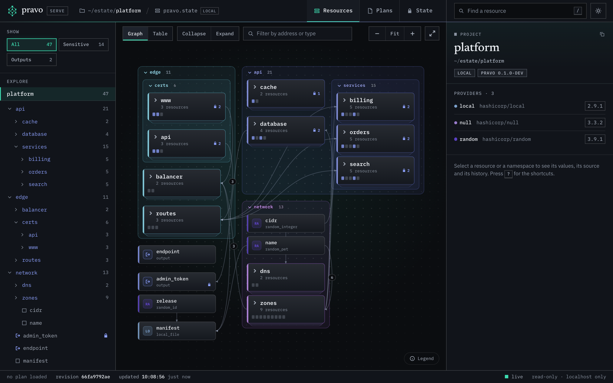</a>
<a class="shot shot-light" href="../img/serve/overview-light.png">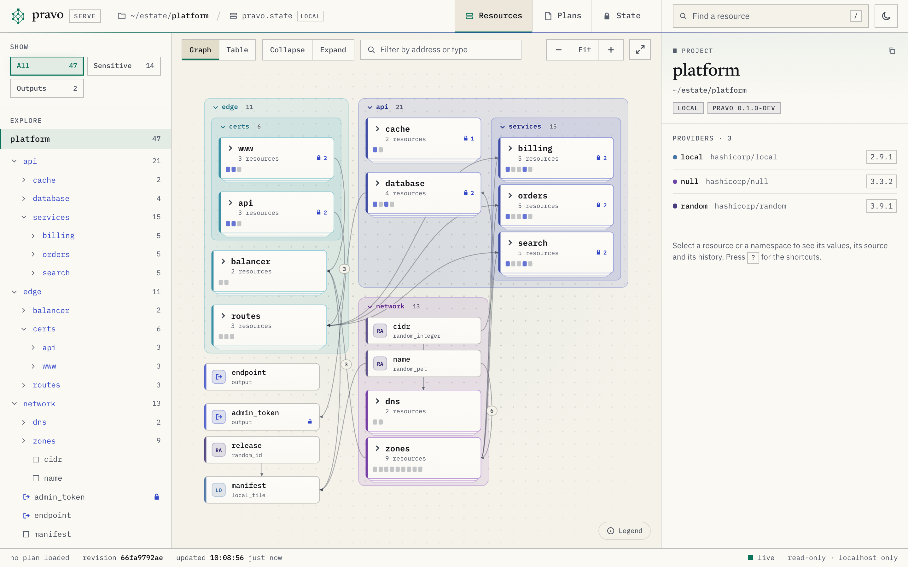</a>
:::

The page has a bar at the top, a toolbar, and the graph below. The bar names the project directory and the state, opens the search, says that the page is read-only and where it is served, and switches the theme. The toolbar switches between Graph and List, closes and opens the namespaces, holds the filter box and has the zoom buttons. The inspector comes in at the right when you select a resource or a namespace, and goes when you clear the selection, as in the picture it is not there. The button at the right of the toolbar, or `i`, shows the project in it.

The graph has one box for each resource and one lane for each open namespace. A lane is titled with the name of its namespace and the number of resources below it. A namespace that is closed is a card: its name, its resource count, the marks on its resources and one small cell for each resource. An arrow runs from a dependency to the resource that uses it, so data flows along the arrows. Select a resource, and its dependencies and dependents stay bright while the rest of the graph dims. Lines to what it depends on are blue, and lines to what uses it are amber. Rest the pointer on a box for a moment, or move to it with the arrow keys, and a small card gives its address, its type, its marks and how many dependencies and dependents it has.

An output of the root is drawn as a card like a resource: an arrow that leaves a door in the tile, the name, the word output under it, and a lock when the value is withheld. It sits in the namespace that holds it, and arrows run into it from the resources and the other outputs that its value reads. Select a resource, and the outputs that read it stay bright with the rest of its dependents. An output is not a resource, so it is not in the count that a namespace shows.

The legend at the foot of the graph names only the marks that the graph shows: the colours of the actions that a loaded plan has, the two kinds of line, the lock of a sensitive value and the mark of a drifted one. The toolbar above the graph says how many boxes it draws when that differs from the number of resources. Drag to move the picture, turn the wheel or pinch to zoom, and use the minus, Fit and plus buttons for the same. When the drawing is larger than the window, a small map appears in the corner: click or drag in it to move.

The inspector heads with the name of the resource, the namespaces that it sits in, each a link, its type and its provider. A strip under the head has the cells Record, Revision and Refreshed, Lock when a lock holds the resource, and Plan when a plan is loaded. The Record cell says `in sync`, `drifted`, `gone`, `declared only` or `orphan`. The tabs are State, Source, Schema and History, and Change when a plan is loaded. For an output the head says Output, the strip has the cells Value and Record, and the tabs are State and Source: the State tab shows the description, the value or a locked mark where the value is withheld, what the output reads and the outputs that read it.

The State tab lists the attributes in three groups, Configured, Sensitive and Computed, in the order that the provider schema gives them, each with its type and whether it is required, optional or computed. The Computed group stays closed until you turn on the switch named computed. A filter box above the groups matches names and values. Under the attributes are what the resource depends on, what uses it, everything that a change to it can reach, with a button, Show in graph, that draws the reach, and the record: its revision and the times of its last read and its last apply. The Schema tab lists the attribute definitions of the resource type with the descriptions that the provider gives. The History tab lists the transactions that wrote the resource.

The button at the right of the toolbar, or `i`, shows the project in the inspector: the state location, its lineage and record count, the providers and the policies. Each provider is listed with its source and version, and with its instances, in their colours, when the root configures it more than once. An output is a node of the graph: select it to see its value. A sensitive output has no value. Select a namespace, in the graph or the list, and the inspector shows its counts, its resource types, its sub-namespaces and the places where it is written.

The status bar at the foot shows the state that the viewer reads. It says whether a plan is loaded, the revision of the data, when the viewer last read it and whether the connection that pushes changes is live.

## 3. Find a resource

Press `/`, or Ctrl-K or Cmd-K, to open the palette, or choose the search button in the bar. Type a part of an address, a type or the name of a namespace. The palette lists the namespaces, the resources and the outputs that match, in groups of their own, the up and down arrows move, and Enter goes to the one that is highlighted. With no text, it lists the top-level namespaces and, when a plan is loaded, the resources that it changes. A find opens the namespaces that hide the result, selects it and moves the camera to it, so the picture can change a good deal. The button Back to where you were, at the top left of the graph, returns to the picture from before the find: the namespaces that were open, the selection and the camera. So do Esc, while the result is still selected, and the Back button of the browser. Forward goes to the result again.

:::figure The palette with the query `billing`. It lists the namespace `api.services.billing` and the six resources whose addresses contain the word.
<a class="shot" href="../img/serve/palette-dark.png">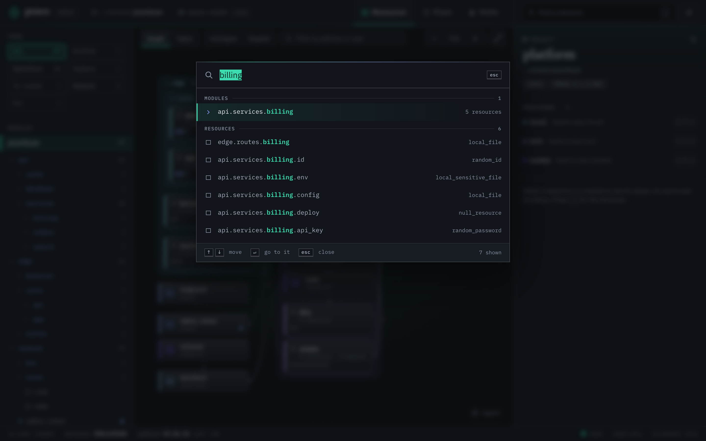</a>
:::

The filter box in the toolbar narrows what the graph and the list show to the matches, and says how many it found; while it is empty, it says how many resources there are. A word matches the address, the type, the action of the plan and the mode, and every word must match. A term names a column and what it is to hold: `entity:data`, `type:aws_s3_bucket`, `provider:aws`, `instance:aws.west`, `status:drifted`, `plan:create`, `ns:api.services`, `field:settings.region=eu` and `refreshed:>1d`.

The entity says what a node is: `resource`, `data` for a data source, `ephemeral`, `output` or `env` for an environment variable that the specification reads. Every node is one of them, and the mode of the block, which `mode:` matches, says less: an output and a variable have none of their own. The status is `drifted` (drifted or gone), `gone`, `orphan` (recorded and not declared any more), `declared` (declared and not recorded yet), `locked` or `sensitive` (it holds withheld values). The plan is `any` for every resource that the loaded plan changes, or the action itself: `create`, `update`, `replace`, `delete` or `read`. `type`, `provider` and `addr` match the whole value, so `type:aws_s3_bucket` is the buckets and not the other `aws_s3_bucket_` types, and a `*` stands for any run of characters (`type:aws_s3*`, `type:*_bucket`). `provider:aws` matches the provider type aws, whatever its instance, and `instance:aws.west` that provider instance (`west` is the name of an instance of the provider aws). `ns` matches a namespace and everything below it, `refreshed` takes a number of minutes, hours, days or weeks, where `>1d` is older than a day. A comma between values means either one (`entity:data,ephemeral`), a minus before the column means the others (`-entity:output`), and the terms and the words together mean all of them. A word with a colon that names no column is a word.

`field` looks into the values of the records: `field:settings.region=eu` is every node whose `settings.region` is `eu`, `field:tags.env=prod` follows a path through blocks and maps, `field:rule.*.cidr=10.*` takes any element of a list, and `field:region=eu` with a name and no dots finds a field of that name at any depth. A path alone, `field:zones`, matches the nodes that hold it, and a path also matches what lies below it, so `field:zones=eu-1` finds a list that holds `eu-1`. Case does not matter, a value is matched whole, and a `*` stands for any run of characters. A value with a space or a comma goes in double quotes, as in `field:tags.team="platform core"` or `field:note="a,b"`; the quotes are not part of the value, and the magnifier in the inspector writes them for you. Quotes work in a plain word too: `"two words"` is one word.

`value` is `field` without the path, for when you have an id, an arn or a url and want to know where it is used: `value:vpc-0abc123` finds every node that holds that value in any field, and `value:*inventory*` every node that holds a value with that in it. A value is matched whole, so a `*` is how to look for a part of one. It is the same as `field:*=vpc-0abc123`. The server does the search, over the values that the Inspector would show: a withheld value is never found, and neither is its name, and a record that is sealed, or whose provider schema is not cached, has no values to search. In the State tab of the inspector, a magnifier at the end of an attribute with a plain value, such as `retention_in_days = 30`, filters for the nodes that hold the same (shift hides them, and alt writes `value:` so that the value is found under any name). While a `field` or `value` term is in the filter, the State tab marks the values that it is about, opens the groups that hold them, and shows the computed values that it would hide.

A menu under the box says what there is to filter by. Click into the empty box, or press the down arrow, and it lists the filters that the estate has something for, each with how many nodes it leaves (`entity:data 6`, `status:drifted 2`, and `plan:any` while a plan is laid over the graph), and then the columns. Type, and it offers the columns that your word begins, and after the colon the values that the estate holds. The counts are of what the rest of the filter leaves, so they narrow as you add terms: after `ns:api`, `type:` offers the types below `api` and how many of each. The arrow keys move in the menu, Enter takes the choice, Tab takes it too once a word is begun, and Escape closes it.

Each term also shows as a pill under the toolbar, and the cross on a pill takes that term out of the text. In the list, the Type, Provider, Mode and Plan cells of a row show a + and a − when the pointer is over them: + adds the value to the filter, and − hides the rows that hold it. The graph and the inspector filter the same way: a click on the badge of a card (`data`, `ephemeral`, `output` or `env`) shows only that kind, a click on the provider tile of a card shows only that provider, and in the inspector the kind, the type and the provider above the tabs do the same. Shift with the click hides them instead. The text is the filter: it is in the address of the page, so a link carries it. The list shows only the matches, with the namespaces that hold them open, while the graph dims the rest.

## 4. Open and close namespaces

A graph of a hundred boxes is too much to read, so the page opens the estate at a size that you can read: namespaces that hold a change or a mark first, then the larger ones, as far as the drawing stays legible. [The viewer](../concepts/the-viewer.md#the-first-view) describes the choice. The namespaces that it did not open are cards.

:::figure The platform with `network` and `edge` closed by a link. Each is one card with the number of its resources, and the arrows that cross them end at the cards.
<a class="shot shot-dark" href="../img/serve/namespaces-collapsed-dark.png">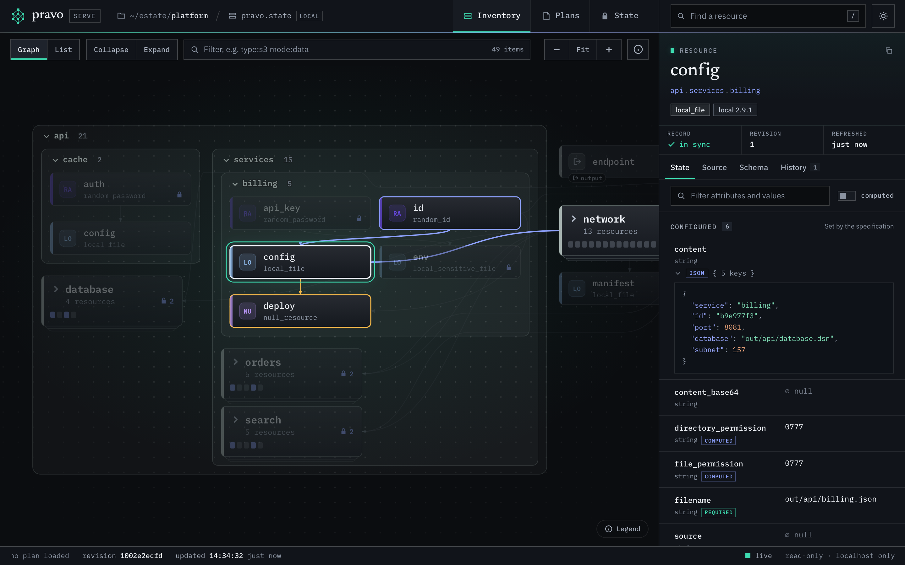</a>
<a class="shot shot-light" href="../img/serve/namespaces-collapsed-light.png">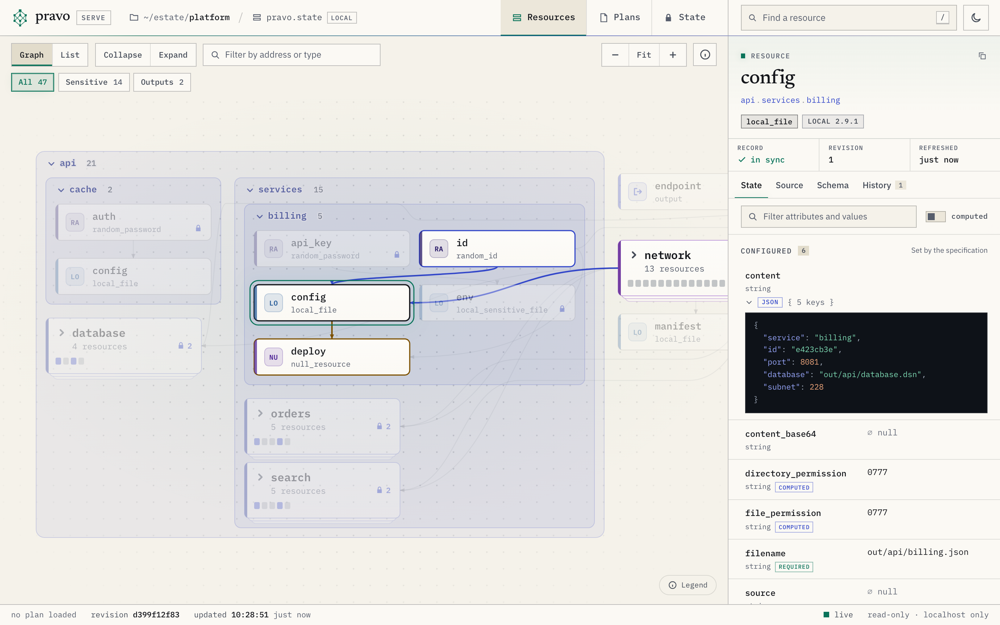</a>
:::

Click a card to open the namespace. The view moves to it, and the Zoom out button, or Esc, closes it again and returns to the view that you had. To close an open namespace, click the arrow in the title of its lane, or double-click the title. Collapse all and Expand all act on every namespace, and `[` and `]` do the same from the keyboard. A selection inside a namespace that you close moves to the namespace. `0` goes back to the first view: the namespaces that were open when the page loaded, no cluster open and the whole graph in the window.

Closing hides detail and removes no resource. The list still has the resources of a closed namespace. Selecting one in the list, in the palette or through the address opens the namespaces that hide it.

A large estate needs the same step many times. The `fleet` estate has 143 resources in three regions, each with a production and a staging environment. Here one region is open and the others are cards, and the namespace `eu.prod` is selected.

:::figure The `fleet` estate with the region `eu` open and its production environment selected. The three services of the production environment are open beside its secret and its manifest, and its pool of nodes is a card. The staging environment and the regions `us` and `ap` are cards.
<a class="shot" href="../img/serve/namespaces-expanded-dark.png">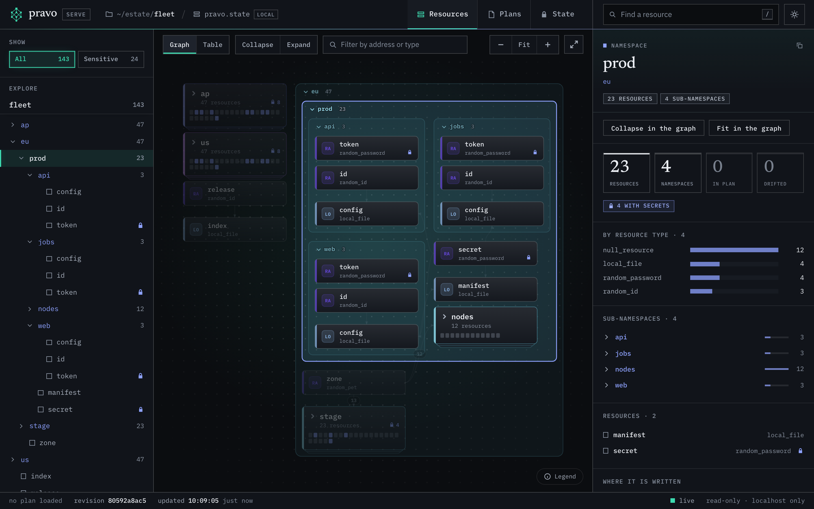</a>
:::

A namespace that holds eight or more resources of one type draws them as one cluster: a box that names the type and the count. Click the box to open the cluster and list its members in place, in their namespace. The control under the members, `group of 12`, closes it again.

:::figure The pool `eu.prod.nodes` open in place. Its twelve resources of the type `null_resource` are listed in the namespace, and `n04` is selected.
<a class="shot" href="../img/serve/clusters-dark.png">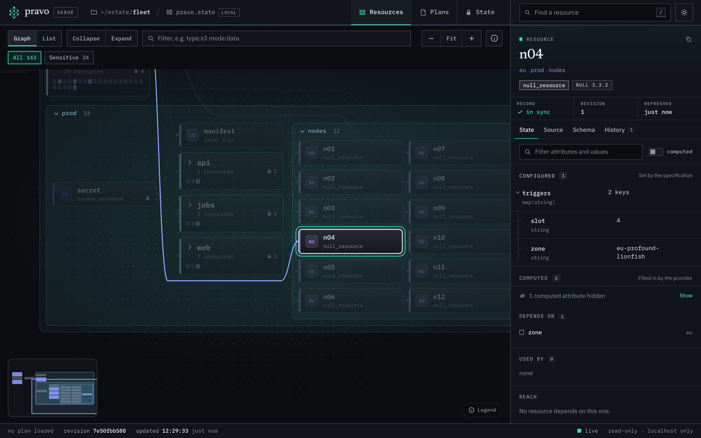</a>
:::

## 5. Read the source of a resource

Select a resource and open the Source tab. It shows the lines that write the resource. A resource that comes from a definition has two places: the definition, and the instance that fills it in.

:::figure The Source tab of `api.services.billing.config`. The first block is the definition in `kit/kit.cue`, and the second is the instance in `api.cue`.
<a class="shot shot-dark" href="../img/serve/source-dark.png">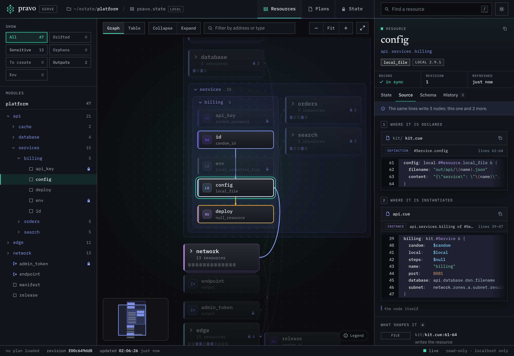</a>
<a class="shot shot-light" href="../img/serve/source-light.png">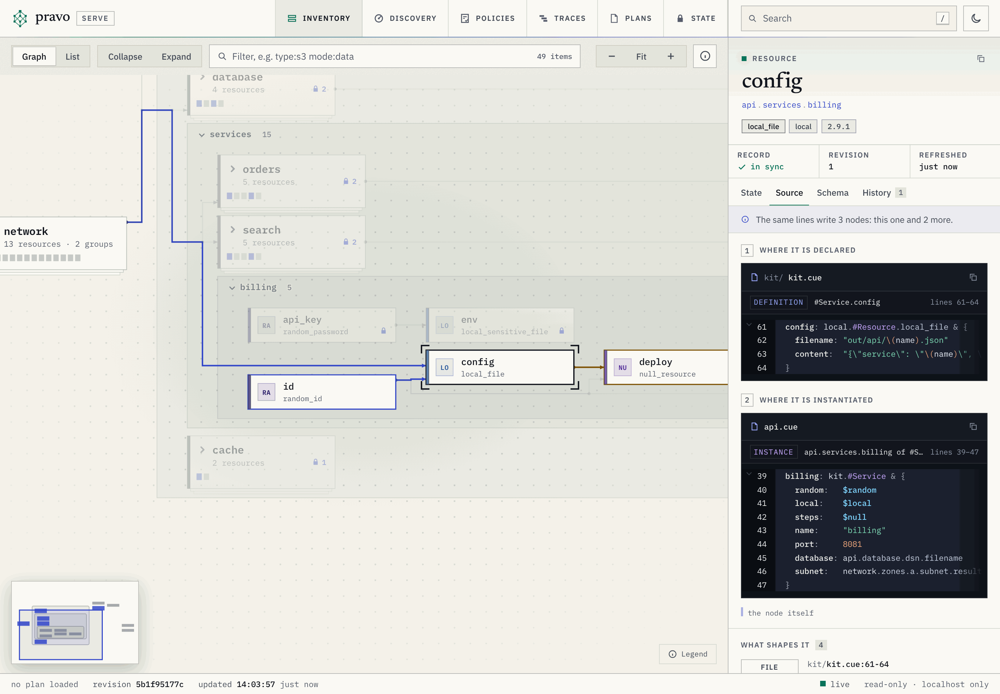</a>
:::

The two files that the figure shows are these. The lines of `config` are marked in the definition, and `billing` is marked in the file that instantiates it.

:::tabs The files behind the Source tab
```cue title="platform/kit/kit.cue" hl="21-24"
// #Service is one service of the api: an identity, a key that the service
// presents to the database, its rendered configuration and the step that
// deploys it. The key is sensitive, so the file that holds it is too.
#Service: {
	random!: rnd.#Provider
	local!:  loc.#Provider
	steps!:  nul.#Provider

	name!:     string
	port!:     int & >1024 & <65536
	database!: string
	subnet!:   int

	id: random.#Resource.random_id & {byte_length: 4}

	api_key: random.#Resource.random_password & {
		length:  32
		special: false
	}

	config: local.#Resource.local_file & {
		filename: "out/api/\(name).json"
		content:  "{\"service\": \"\(name)\", \"id\": \"\(id.hex)\", \"port\": \(port), \"database\": \"\(database)\", \"subnet\": \(subnet)}\n"
	}

	env: local.#Resource.local_sensitive_file & {
		filename: "out/api/\(name).env"
		content:  "SERVICE=\(name)\nAPI_KEY=\(api_key.result)\n"
	}

	deploy: steps.#Resource.null_resource & {
		triggers: {
			config_hash: config.content_sha256
			service_id:  id.hex
		}
	}
}
```

```cue title="platform/api.cue" hl="5-13"
api: {
	...
	// Each service is an instance of the definition in kit/kit.cue.
	services: {
		billing: kit.#Service & {
			random:   $random
			local:    $local
			steps:    $null
			name:     "billing"
			port:     8081
			database: api.database.dsn.filename
			subnet:   network.zones.a.subnet.result
		}
		...
	}
}
```
:::

The definition is the part of the estate that several resources share, so the tab says how many nodes the same lines write. A line that assigns a string literal to a sensitive attribute is masked, and the line carries a mark. A file that changed after the state was written carries a note, since its lines may differ from what created the resource. Under the blocks, What shapes it lists the files, the cached modules, the tags and the policies that contribute to the resource. The tab shows only files that the evaluation loaded.

## 6. Overlay a saved plan

The viewer does not make a plan. Save one with `pravo plan --out`, and start the viewer with it.

```sh
pravo plan --out change.plan
pravo serve --plan change.plan
```

A resource that the plan changes carries a badge and a ring in the colour of its action, and the legend names create, update, replace, delete and not read. A resource that the plan did not run reads `not read`. The filter `plan:any` shows the resources that the plan changes, and the status bar says how many of the resources the plan ran, as `planned 7 of 48`, and how many it did not read. With nothing selected, the inspector shows the summary of the plan: the resources to add, change, destroy and read, the blast radius, the file and when it was made. A plan that cannot be applied, because the specification or the state changed after it was made, is marked stale and shown with the reasons.

:::figure The platform with a saved plan, with `network` and `edge` closed. The port of `orders` changed, which replaces its configuration, its deploy step and its route. The Change tab of `api.services.orders.config` shows the action, the reasons and the attribute that forces the replacement.
<a class="shot shot-dark" href="../img/serve/plan-dark.png"></a>
<a class="shot shot-light" href="../img/serve/plan-light.png"></a>
:::

The Change tab lists the reasons that the plan gives, the attributes that force a replacement and each attribute that changes with its value before and after. A value that the viewer withholds is withheld in the plan too. A value that is not known until the apply reads `known after apply`.

## 7. See what your team has planned

`pravo plan --store` writes a plan into the state, so that a teammate can read it before anyone applies it. [Share a plan before you apply it](share-a-plan-before-you-apply-it.md) follows two people through it. The viewer reads the state, so it lists those plans without a flag. The pictures of this step come from a state in which `ana` and `ben` stored plans for the same resources, and `ci` stored one that expired.

```sh
pravo plan --store --actor ana --reason "move orders to port 9082"
pravo serve
```

The Plans tab of the bar, or `p`, lists the plans of the state. Each row is one plan, newest first: the initials of the author, the note that the author wrote with the plan (`--reason`) as the title, or the id when there is none, the status, the author, the age, the id under a note, and the counts of resources to add, change and destroy, with the imports and the moves of the plan. Pending lists the plans that can be applied. A mark of two rings on a row says that another plan changes one of the same resources.

The finder above the list narrows it, by what a plan is and by what it changes. Click in the box and the menu offers filters with the number of plans that each leaves: `status:open`, `by:ana`, `action:delete`, `overlap:any`. Type `ns:network` and the list keeps the plans that change something in the namespace `network`, and each row names the first of those changes. A term about a change, such as `action:delete type:aws_db_instance`, needs one change that has all of them. Click a row to open its detail, which lists every resource that the plan changes with the action, the type and whether it was applied, and has chips for the actions, namespaces and types that add a term to the finder. A click on a change shows that resource on the graph with the plan laid over it. The text of the finder is in the address, so a link shares it.

Click a row to open it. It shows the reason, what overlaps, when the plan expires, the command that made it and the command that applies it, with a button that copies it. A second click, or Esc, closes it. The button View on a row lays the plan over the graph, as a saved plan is in step 6, and goes to Inventory. The graph shows its actions, the Change tab shows its attributes, and a strip under the bar names it. The button with the cross in the strip stops showing the plan.

:::figure The Plans section. The plan of `ana` is the one laid over the resources, so its row says Viewing and is tinted. Each row carries the status, the author, the age, the counts and a ring for the time that is left.
<a class="shot" href="../img/serve/plans-list-dark.png">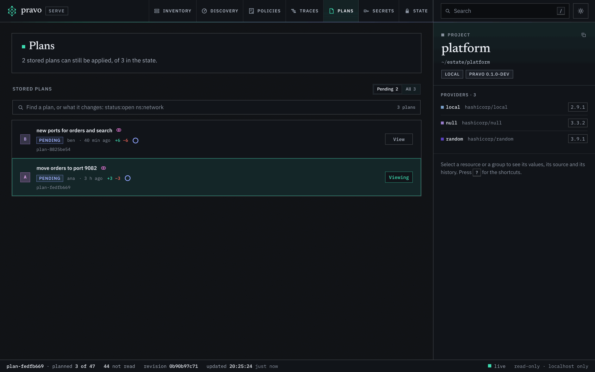</a>
:::

:::figure The platform with the plan of `ana` laid over the graph. The plan of `ben` also replaces what writes `orders`, so those resources carry two discs and a ring, and the strip under the bar names the plan that is laid over them.
<a class="shot shot-dark" href="../img/serve/plans-dark.png"></a>
<a class="shot shot-light" href="../img/serve/plans-light.png"></a>
:::

Look for the discs before you apply. Each disc on a resource is the initial of the author of a plan that can be applied and changes it. Click a disc to go to the Plans page with that plan open under its row. A resource with two discs and a ring is one that two people have planned and not applied. A plan that has applied its change on a resource has no disc there. Applying one of the plans makes the other stale, or partly stale when its other changes can still be applied, because the resource is then at another revision. The Plans cell of the resource, above the tabs, lists the plans, and a click on a disc lays that plan over the graph. The legend names `plan author` and `overlap`.

A chip that says `partly stale` marks a plan that the state moved on under in some of its changes. The row lists the conflicts, one reason each, and the command that ends in `--only` with the changes that can still be applied. Copy that command, and not `pravo apply ID`, which the whole plan is refused by. A resource whose change conflicts keeps the disc of the plan and draws no ring. The Plans cell says that the plan cannot apply the change, and the Change tab gives the reason.

The viewer applies nothing and has no control that approves or removes a plan. Copy the command, and run it in a checkout that has the files the plan was made from. The status that the list shows comes from the state alone. `pravo apply` also compares the configuration and the providers, and refuses the plan when they differ.

Choose All to list the plans that cannot be applied: the stale, the applied and the expired, until a collection removes them. A plan that cannot be applied has no command to copy, and none of its resources carries a disc.

:::figure The plan of `ci`, which expired two days ago, laid over the graph. The strip names it and has no ring, since an expired plan has no time left.
<a class="shot" href="../img/serve/plan-expired-dark.png"></a>
:::

Leave the viewer open and the list follows the state. A plan that a teammate stores gets a row, and a notice names it. The status of a plan changes when an apply from it records progress, and when something else changes a resource it expects. A plan that is collected leaves the list, and a plan that expires without an apply moves to All. When the plan that is laid over the graph is collected, a notice says so and the graph shows no plan.

`pravo serve --plan ID` starts the viewer with a stored plan laid over the graph. Give the same `-t` and `-T` that you give to `pravo plan list`. The fragment of the address names the plan: `plan=plan-2f9c1a4e` lays that plan, and `plan=none` takes off the one that `--plan ID` laid. [The viewer](../concepts/the-viewer.md#stored-plans) explains what each mark means, and [`pravo serve`](../reference/serve.md#stored-plans) lists the keys and the endpoints.

## 8. Find drift

`pravo drift` reads every resource and marks the records whose real object differs or is gone. The viewer shows the marks. Filter by `status:drifted` to see only those resources; the menu of the filter box offers it.

```sh
pravo drift
```

:::figure The Drifted filter. The file behind `network.dns.records` was edited outside pravo, and the file behind `api.cache.config` was deleted. The provider `local` reports both as gone.
<a class="shot" href="../img/serve/drift-dark.png">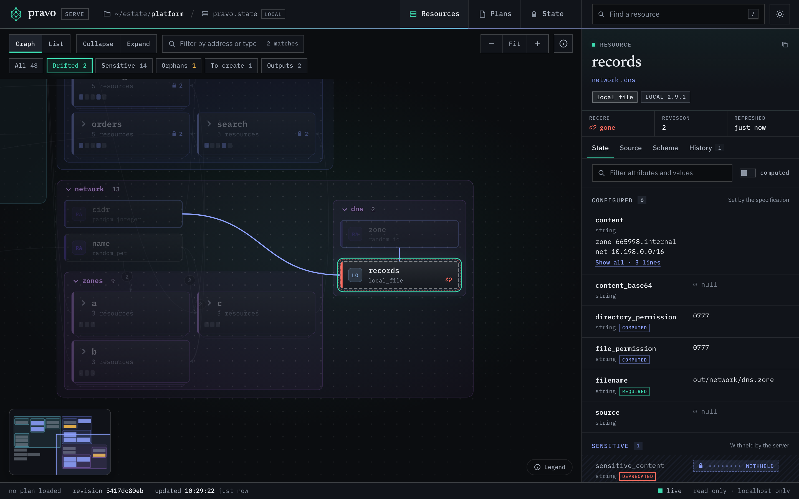</a>
:::

The viewer reads the marks from the state. It does not read the real objects, so it shows the drift that a command found and does not look for more. Run `pravo drift` again, and the viewer updates when the state changes: a notice says that the state changed and how many resources differ, and the resources that changed flash once.

## 9. See what the viewer withholds

Select a resource that holds a secret. The State tab lists its sensitive attributes in the Sensitive group, with a name and a type and a locked mark where the value would be. Hover over the mark, or move the keyboard focus to it, for the reason.

:::figure The State tab of `api.database.dsn`, the file that holds the connection string of the database. The attributes `content` and `content_base64` are listed and have no value.
<a class="shot" href="../img/serve/sensitive-dark.png">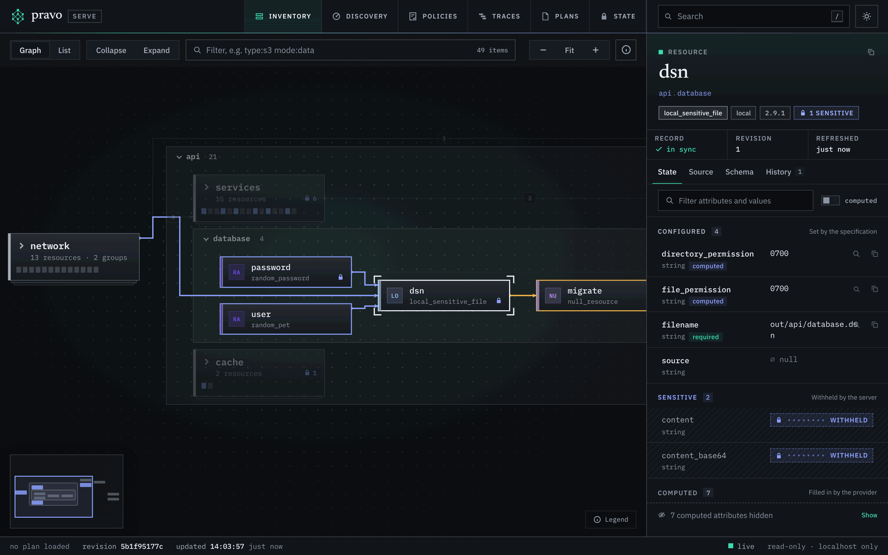</a>
:::

The server removes the value before it answers. The page never has it, and a copy of the page's data holds no secret. The server also withholds a value that contains a secret although the schema does not mark it: `api.cache.config` is a plain file that embeds the password of the cache, and its content is withheld too. [The viewer](../concepts/the-viewer.md#withheld-values) lists the rules.

## 10. Share a view by link

The viewer keeps its view in the fragment of the address: the selected resource or namespace, the tab, the namespaces that you opened or closed, the filter, the search text, the view and the theme that you chose. Copy the address to share the view.

```text
http://127.0.0.1:PORT/#/?sel=api.services.billing.config&tab=source&collapse=network,edge&theme=dark
```

A link reproduces the view on a viewer that shows the same estate. The fragment is everything after `#`. Send it, and the other person pastes it after the address of their own viewer, because each viewer has its own port and token. The table in [`pravo serve`](../reference/serve.md#the-address-of-a-view) lists every parameter.

`motion=off` turns every animation off. Use it when you take a picture. The pictures on this page were taken from such links by `tools/serveshots`.

The theme button in the bar, or `t`, switches between the light and the dark theme. Without a `theme` parameter the viewer follows the system and the last choice that you made in the page.

The List button of the toolbar switches from the graph to a list, and `g` switches between the two. The list has a row for each resource and each output, grouped by namespace. A row for a namespace opens and closes it, in the list and in the graph together, and says how many resources are below it, what a plan does to them and how many have drifted. The switch Grouped and Flat of the toolbar turns the grouping off, and the flat list has the whole address in the first column. The columns are Name, Type, Provider, Mode, Status, Plan and Refreshed. The Mode of an output is `output`. A data source has a round mark before its address and an ephemeral resource a dashed one, so the kind reads even when the narrow list leaves out Mode. The Plan column shows what the loaded plan does to the resource, and it is left out when no plan is loaded. Grouped, the first column holds the name and the namespace is the row above; flat, it holds the address. Provider is the provider instance that the resource uses, such as `aws` or `aws.west`. The graph and the list colour each instance, in the tile of a card and in the dot in front of the name: the instances of one estate get different colours, up to twelve of them, and the same instance has the same colour in both. A narrow list leaves out Mode. Click a heading to sort by it, and click it again to reverse the order. The up and down arrows move the selection, and the left and right arrows close and open a namespace. While a filter or a search is on, the namespaces that hold a match are open. The filters apply to the list as they do to the graph, and the filter box also matches the action and the mode.

:::figure The List view of the same estate, grouped by namespace. The statuses show `gone` for `api.cache.config` and `orphan` for `edge.balancer.reload`.
<a class="shot" href="../img/serve/list-dark.png">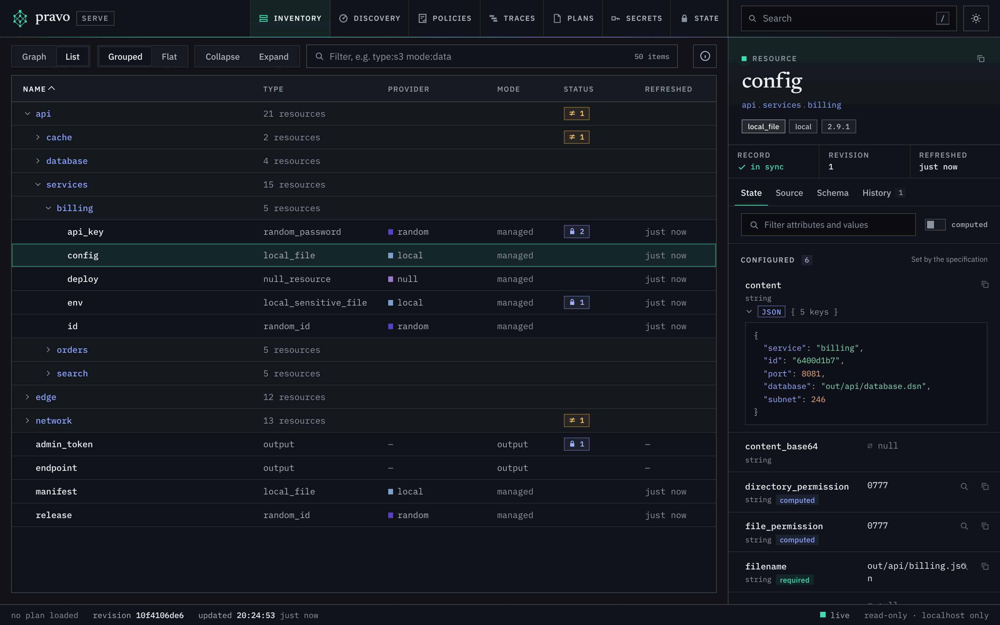</a>
:::

Below 1100 pixels the inspector is a panel under the graph. The panel button at the right of the toolbar shows or hides it, and the button in the corner of the panel makes it taller.

:::figure A window of 900 pixels. The graph keeps the top of the window, and the inspector is a panel under it.
<a class="shot" href="../img/serve/narrow-dark.png">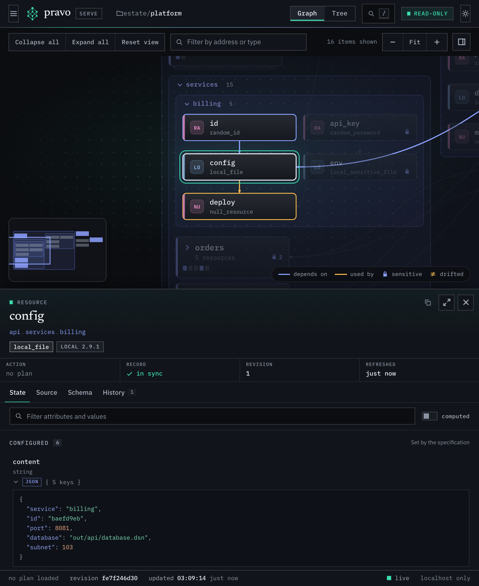</a>
:::

## 11. Use it in a container or over SSH

The viewer listens on the loopback interface of the machine that runs it, and no flag changes that. A browser on another machine cannot reach it directly.

To view an estate on a remote host, forward a port over SSH. Start the viewer on the host with a fixed port, and forward the same port number to your machine, so that the address that the browser sends is the address that the server expects.

```sh
ssh -L 8700:127.0.0.1:8700 host
pravo serve --no-open --port 8700
```

The server compares the `Host` header of each request with its own address and answers 421 to any other. A forward from port 9000 to port 8700 sends `localhost:9000` and is refused. Use the same number on both sides.

Copy the address with the token from the output of the viewer, and open it in the browser on your machine. A request without the cookie that the token sets is answered with 401, so a link without the token shows nothing.

In a container, the viewer listens on the loopback interface of the container. A port that the container runtime publishes is reached through another interface, so publishing it does not reach the viewer. Run the viewer in a network namespace that the browser can reach, or forward over SSH from the host that runs the container.

## 12. See who can read the state

The State tab of the bar, or `a`, opens the State section. It is for a state that is sealed to a list of readers ([Seal the state](seal-the-state.md) shows how), and it explains a state that is not: the banner says whether the state is sealed, and the first suggestion is the one that seals it.

For a sealed state, start the viewer with your identity:

```text
pravo serve --identity ada
```

Without `--identity` the viewer finds an identity as the other commands do. If it has a passphrase, the command asks for it on the terminal before it listens. If you hold no identity, or the identity is not a reader of the state, the viewer starts anyway: it lists every resource and shows no value, and the State section says why. `--identity none` shows what a person with no key sees.

The view has these parts, from the top:

- The banner, with a sentence for the state, the format, the backend and the location.
- You: who the viewer is reading as, and whether that identity is a reader.
- Readers: the readers of the store and of the readers file, side by side. A mark says whether each is in the file and in the store. The button next to a key or a fingerprint copies it.
- Readers file: whether the file matches the store. When it differs, the view names the readers that are in the file and not in the store, and the ones that are in the store and not in the file. When the file lists readers and the state is not sealed, the verdict is `state not sealed`: the repository expects a seal that the state does not have: it has not been sealed yet, or its `meta.json` was changed. The first suggestion then checks the state with `pravo protect status`.
- Records: how many are sealed, how many cannot be opened with your identity, and the groups of data keys.
- Suggested changes: cards, the next step open. Copy a command with its button and run it in a terminal; the viewer does not. A step that edits the readers file shows the line to add or remove, and the button copies the line only. Words in angle brackets are for you to fill in.

The view updates when the readers file or the state changes. Edit the file in your checkout and the verdict changes within a second or two.

## Recap

- `pravo serve` shows the specification, the state and an optional saved plan as namespaces and resources. It reads and writes nothing.
- The first view opens the namespaces that fit. Click a card to open a namespace, and open a cluster to see its members.
- The Source tab shows the definition and the instance that write a resource. The Change tab shows what a saved plan changes.
- The Plans section lists the plans that your team stored in the state. A disc on a resource names who plans to change it, and a ring marks two plans on one resource. The viewer copies the command that applies a plan and applies nothing.
- A value that is sensitive, or has a secret's name, or contains a secret, never reaches the page.
- The State section shows who can read a sealed state and whether the readers file matches the store. It suggests commands, and the viewer runs none.
- The fragment of the address holds the view, so a link reproduces it. Press `?` in the viewer for the shortcuts.

Next: [`pravo serve`](../reference/serve.md) lists the flags, the keys and the endpoints. [The viewer](../concepts/the-viewer.md) explains what each mark means.
