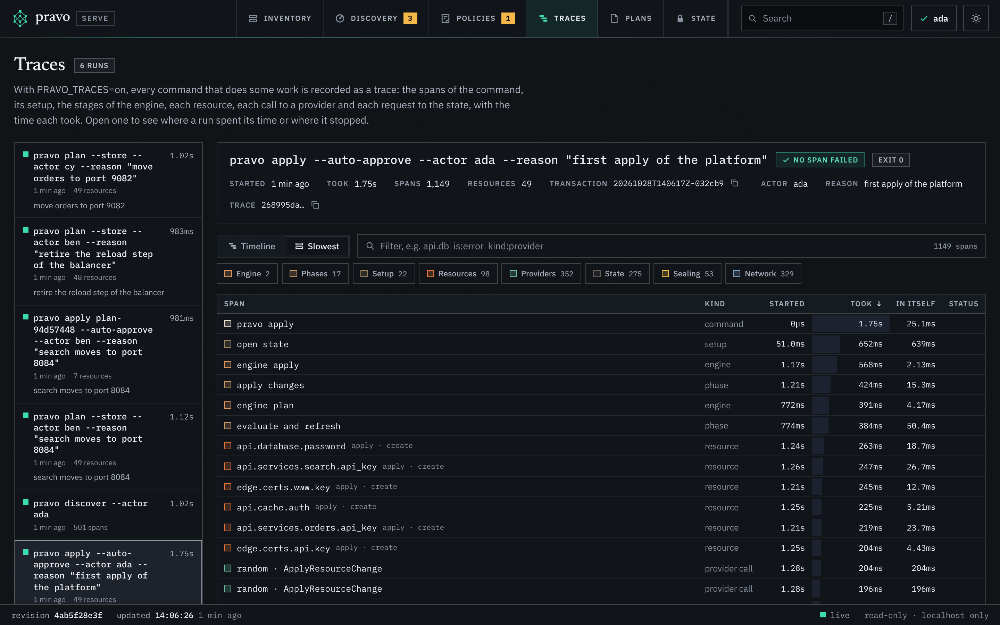

`pravo serve` shows one root in a browser: the specification, the state, the plans that people stored in the state, the policies in force, the discoveries and the runs that pravo recorded. It reads and never writes. This page starts the viewer and walks through its six sections, one task at a time. [The viewer](../concepts/the-viewer.md) explains what the viewer makes of what it reads, [The sections of the viewer](../reference/viewer-sections.md) lists every part of every section, and [`pravo serve`](../reference/serve.md) lists the flags.

The pictures come from the `platform` estate. It has 47 resources in three groups, `network`, `api` and `edge`, built from the `random`, `local` and `null` providers, so it needs no cloud account. `api.services.billing` is an instance of the definition `#Service`, which a second package, `kit`, defines. The estate is in `tools/serveshots/scenarios/platform` of the pravo source tree, and the steps work in any root. The pictures of the plans and of the drift were taken after three edits, a resource added, a resource removed and a port changed, and count 48 resources: one is declared and not created yet, and one is recorded and not declared. The pictures of the history, the traces and the members come from the same estate in a bucket, sealed to three people.

## 1. Start the viewer

Run `pravo serve` in the root. It starts a server on the loopback interface, prints the address and opens it in the default browser.

```sh
pravo serve
```

The address carries a token. The first request sets a cookie and redirects to a page without the token, so the token does not stay in the address bar. The server accepts requests from this machine only, and every request for data needs the cookie. A page that is opened without the token asks for the address that `pravo serve` printed. `--no-open` prints the address and opens nothing, `--port N` picks the port, and `--json` prints the address as one line of JSON for a script.

Stop the viewer with Ctrl-C. It has written nothing, so there is nothing to clean up. A page that stays open says that the viewer is not answering. A new run makes a new token, so that page asks for the new address.

## 2. Read the graph

:::figure The platform estate as the viewer opens it. The bar at the top switches between the six sections, the filter box is in the toolbar, the graph fills the window and draws the groups that fit as lanes and the others as cards, and nothing is selected, so there is no inspector.
<a class="shot shot-dark" href="../img/serve/overview-dark.png"></a>
<a class="shot shot-light" href="../img/serve/overview-light.png"></a>
:::

The bar at the top names the project and switches between the sections: Inventory, Plans, Discovery, Policies, Traces and State. A tab carries a number when something in it waits for you, such as objects that ask to be adopted or policies that the next apply changes. The bar also opens the search, switches the theme and, for a sealed state, names the identity the page is read as. The toolbar under it belongs to the Inventory: Graph or List, Collapse and Expand for every group, the filter box and the zoom buttons. The inspector comes in at the right when you select a resource or a group, and goes when you clear the selection; the button at the right of the toolbar, or `i`, shows the project in it. A status bar at the foot says which plan is laid over the graph, the revision of the data, when the viewer last read it and whether the connection that pushes changes is live.

The graph has one box for each resource and one lane for each open group. A lane is titled with the name of its group and the number of resources below it. A group that is closed is a card: its name, its resource count, the marks on its resources and one small cell for each resource. An arrow runs from a dependency to the resource that uses it, so data flows along the arrows, from left to right. Select a resource, and its dependencies and dependents stay bright while the rest of the graph dims. Rest the pointer on a box for a moment, or move to it with the arrow keys, and a small card gives its address, its type, its marks and how many dependencies and dependents it has.

An output of the root is drawn as a card like a resource, with the output glyph in the tile and the word output under the name, and a lock when its value is withheld. It sits in the group that holds it, and arrows run into it from the resources and the other outputs that its value reads. An output is not a resource, so it is not in the count that a group shows.

The legend at the foot of the graph names only the marks that the graph shows. The toolbar says how many boxes the graph draws when that differs from the number of resources. Drag to move the picture, turn the wheel or pinch to zoom, and use the minus, Fit and plus buttons for the same. When the drawing is larger than the window, a small map appears in the corner: click or drag in it to move.

The inspector heads with the name of the resource, the groups that it sits in, each a link, its type and its provider. A strip under the head has the cells Action, Record, Lock, Revision, Refreshed and Plans, each when it applies. The Record cell says `in sync`, `drifted`, `gone`, `declared only` or `orphan`. The tabs are State, Source, Schema and History, and Change when a plan is laid over the graph. The State tab lists the attributes in three groups, Configured, Sensitive and Computed, in the order that the provider schema gives them, each with its type and whether it is required, optional or computed. Under the attributes are what the resource depends on, what uses it, everything that a change to it can reach, with a button that draws the reach in the graph, and the record: its revision and the times of its last read and its last apply. Select a group, in the graph or the list, and the inspector shows its counts, its resource types, its subgroups and the places where it is written. [The inspector](../reference/viewer-sections.md#the-inspector) lists every cell and tab.

## 3. Find a resource

Press `/`, or Ctrl-K or Cmd-K, to open the palette, or choose the search button in the bar. Type a part of an address, a type or the name of a group. The palette lists the groups, the resources and the outputs that match, in groups of their own; the up and down arrows move, and Enter goes to the one that is highlighted. Below the resources it also lists the stored plans, the recorded runs and transactions and the objects that discoveries found, which Enter opens in their own sections, and the actions of the page, such as switching the theme or going to Traces, each with its shortcut. Type `>` first to list the actions alone. A find opens the groups that hide the result, selects it and moves the camera to it, so the picture can change a good deal. The button Back to where you were, at the top left of the graph, returns to the picture from before the find, and so do Esc, while the result is still selected, and the Back button of the browser.

:::figure The palette with the query `billing`. It lists the group `api.services.billing` and the six resources whose addresses contain the word.
<a class="shot" href="../img/serve/palette-dark.png"></a>
:::

The filter box in the toolbar narrows what the graph and the list show to the matches, and says how many it found. A word matches the address, the type, the action of the plan and the mode, and every word must match. A term names a column and what it is to hold: `entity:data`, `type:aws_s3_bucket`, `provider:aws`, `instance:aws.west`, `status:drifted`, `plan:create`, `ns:api.services`, `field:settings.region=eu`, `value:vpc-0abc123` and `refreshed:>1d`. A comma between values means either one, a minus before the column means the others, a `*` stands for any run of characters, and a value with a space or a comma goes in double quotes. `field` and `value` are searched by the server over the values that the inspector would show, so a withheld value is never found. [Filters](../reference/viewer-sections.md#filters) lists every column.

A menu under the box says what there is to filter by. Click into the empty box, or press the down arrow, and it lists the filters that the estate has something for, each with how many nodes it leaves, and then the columns. Type, and it offers the columns that your word begins, and after the colon the values that the estate holds, with their counts. Each term also shows as a pill under the toolbar, and the cross on a pill takes that term out. In the list, the cells of a row show a + and a − when the pointer is over them: + adds the value to the filter, and − hides the rows that hold it. The text is the filter: it is in the address of the page, so a link carries it.

## 4. Open and close groups

A graph of a hundred boxes is too much to read, so the page opens the estate at a size that you can read: groups that hold a change or a mark first, then the larger ones, as far as the drawing stays legible. [The viewer](../concepts/the-viewer.md#the-first-view) describes the choice. The groups that it did not open are cards.

:::figure The platform with `network` and `edge` closed by a link. Each is one card with the number of its resources and groups, and the arrows that cross them end at the cards.
<a class="shot shot-dark" href="../img/serve/groups-collapsed-dark.png"></a>
<a class="shot shot-light" href="../img/serve/groups-collapsed-light.png"></a>
:::

Click a card to open the group. The view moves to it, and the Zoom out button, or Esc, closes it again and returns to the view that you had. To close an open group, click the arrow in the title of its lane, or double-click the title. Collapse and Expand act on every group, and `[` and `]` do the same from the keyboard. A selection inside a group that you close moves to the group. `0` goes back to the first view: the groups that were open when the page loaded, no cluster open and the whole graph in the window.

Closing hides detail and removes no resource. The list still has the resources of a closed group. Selecting one in the list, in the palette or through the address opens the groups that hide it.

A large estate needs the same step many times. The `fleet` estate has 143 resources in three regions, each with a production and a staging environment. Here one region is open and the others are cards, and the group `eu.prod` is selected.

:::figure The `fleet` estate with the region `eu` open and its production environment selected. The three services of the production environment are open beside its secret and its manifest, and its pool of nodes is a card. The staging environment and the regions `us` and `ap` are cards.
<a class="shot" href="../img/serve/groups-expanded-dark.png"></a>
:::

A group that holds eight or more resources of one type draws them as one cluster: a box that names the type and the count. Click the box to open the cluster and list its members in place, in their group. The control under the members, `group of 12`, closes it again.

:::figure The pool `eu.prod.nodes` open in place. Its twelve resources of the type `null_resource` are listed in the group, and `n04` is selected.
<a class="shot" href="../img/serve/clusters-dark.png"></a>
:::

## 5. Read the source of a resource

Select a resource and open the Source tab. It shows the lines that write the resource. A resource that comes from a definition has two places: the definition, and the instance that fills it in.

:::figure The Source tab of `api.services.billing.config`. The first block is the definition in `kit/kit.cue`, and the second is the instance in `api.cue`.
<a class="shot shot-dark" href="../img/serve/source-dark.png"></a>
<a class="shot shot-light" href="../img/serve/source-light.png"></a>
:::

The two files that the figure shows are these. The lines of `config` are marked in the definition, and `billing` is marked in the file that instantiates it.

:::tabs The files behind the Source tab
```cue title="platform/kit/kit.cue" hl="21-24"
// #Service is one service of the api: an identity, a key that the service
// presents to the database, its rendered configuration and the step that
// deploys it. The key is sensitive, so the file that holds it is too.
#Service: {
	random!: rnd.#Provider
	local!:  loc.#Provider
	steps!:  nul.#Provider

	name!:     string
	port!:     int & >1024 & <65536
	database!: string
	subnet!:   int

	id: random.#Resource.random_id & {byte_length: 4}

	api_key: random.#Resource.random_password & {
		length:  32
		special: false
	}

	config: local.#Resource.local_file & {
		filename: "out/api/\(name).json"
		content:  "{\"service\": \"\(name)\", \"id\": \"\(id.hex)\", \"port\": \(port), \"database\": \"\(database)\", \"subnet\": \(subnet)}\n"
	}

	env: local.#Resource.local_sensitive_file & {
		filename: "out/api/\(name).env"
		content:  "SERVICE=\(name)\nAPI_KEY=\(api_key.result)\n"
	}

	deploy: steps.#Resource.null_resource & {
		triggers: {
			config_hash: config.content_sha256
			service_id:  id.hex
		}
	}
}
```

```cue title="platform/api.cue" hl="5-13"
api: {
	...
	// Each service is an instance of the definition in kit/kit.cue.
	services: {
		billing: kit.#Service & {
			random:   $random
			local:    $local
			steps:    $null
			name:     "billing"
			port:     8081
			database: api.database.dsn.filename
			subnet:   network.zones.a.subnet.result
		}
		...
	}
}
```
:::

The definition is the part of the estate that several resources share, so the tab says how many nodes the same lines write. A line that assigns a string literal to a sensitive attribute is masked, and the line carries a mark. A file that changed after the state was written carries a note, since its lines may differ from what created the resource. Under the blocks, What shapes it lists the files, the cached modules, the tags and the policies that contribute to the resource. The tab shows only files that the evaluation loaded.

## 6. Read the history of a resource

The History tab lists the transactions that wrote the resource, newest first: applies, imports and moves, and a read that found the object changed outside pravo. A plan only reads the node and is not listed. Each entry has the kind, the action, the time, the command, the reason, the actor and the revisions of the record before and after, and under it the attributes that the transaction altered, with the value before and after, redacted as the changes of a plan are. An apply that ran from a stored plan names the plan, and the name opens the plan over the graph while the state still holds it. In a sealed state each entry also says who signed the transaction, as the readers file judges the signature.

:::figure The History tab of a resource in a sealed state: two transactions by two people, each signed, the newer one applied from a stored plan.
<a class="shot" href="../img/serve/history-dark.png"></a>
:::

The palette finds a transaction by its id, its command line, its reason or its actor, and opens the run that made it in the Traces section when the run was recorded.

## 7. Overlay a saved plan

The viewer does not make a plan. Save one with `pravo plan --out`, and start the viewer with it.

```sh
pravo plan --out change.plan
pravo serve --plan change.plan
```

A resource that the plan changes carries a badge and a ring in the colour of its action, and the legend names create, update, replace, delete and not read. A resource that the plan did not run reads `not read`. The filter `plan:any` shows the resources that the plan changes, and the status bar says how many of the resources the plan ran, as `planned 7 of 48`, and how many it did not read. With nothing selected, the inspector shows the summary of the plan: the resources to add, change, destroy and read, the blast radius, the file and when it was made. A plan that cannot be applied, because the specification or the state changed after it was made, is marked stale and shown with the reasons.

:::figure The platform with a saved plan. The port of `orders` changed, which replaces its configuration, its deploy step and its route. The Change tab of `api.services.orders.config` shows the action, the reasons and the attribute that forces the replacement.
<a class="shot shot-dark" href="../img/serve/plan-dark.png"></a>
<a class="shot shot-light" href="../img/serve/plan-light.png"></a>
:::

The Change tab lists the reasons that the plan gives, the attributes that force a replacement and each attribute that changes with its value before and after. A value that the viewer withholds is withheld in the plan too. A value that is not known until the apply reads `known after apply`.

## 8. See what your team has planned

`pravo plan --store` writes a plan into the state, so that a teammate can read it before anyone applies it, and a policy can ask that others approve it. [Store a plan and apply it later](store-a-plan-and-apply-it-later.md) follows two people through it. The viewer reads the state, so it lists those plans without a flag. The pictures of this step come from a state in which `ana` and `ben` stored plans for the same resources, and `ci` stored one that expired.

```sh
pravo plan --store --actor ana --reason "move orders to port 9082"
pravo serve
```

The Plans tab of the bar, or `p`, lists the plans of the state, newest first: the initials of the author, the note that the author wrote with the plan (`--reason`) as the title, or the id when there is none, the status, the author, the age, and the counts of resources to add, change and destroy, with the imports, the moves and the policies of the plan. Pending lists the plans that can be applied, and All adds the stale, the applied and the expired until a collection removes them. A mark of two rings on a row says that another plan changes one of the same resources. A ring at the end of the row is the time that is left.

:::figure The Plans section. The plan of `ana` is the one laid over the resources, so its row says Viewing and is tinted. Each row carries the status, the author, the age, the counts and a ring for the time that is left.
<a class="shot" href="../img/serve/plans-list-dark.png"></a>
:::

The finder above the list narrows it, by what a plan is and by what it changes. Click in the box and the menu offers filters with the number of plans that each leaves: `status:open`, `by:ana`, `action:delete`, `overlap:any`. Type `ns:network` and the list keeps the plans that change something in the group `network`, and each row names the first of those changes. A term about a change, such as `action:delete type:aws_db_instance`, needs one change that has all of them. The text of the finder is in the address, so a link shares it.

Click a row to open it. It shows the reason, what overlaps, the policies it changes, when the plan expires, the command that made it and the command that applies it, with a button that copies it. A second click, or Esc, closes it. The button View on a row lays the plan over the graph, as a saved plan is in step 7, and goes to Inventory. The graph shows its actions, the Change tab shows its attributes, and a strip under the bar names it. The cross in the strip takes the plan off.

:::figure The platform with the plan of `ana` laid over the graph. The plan of `ben` also replaces what writes `orders`, so those resources carry two discs and a ring, and the strip under the bar names the plan that is laid over them.
<a class="shot shot-dark" href="../img/serve/plans-dark.png"></a>
<a class="shot shot-light" href="../img/serve/plans-light.png"></a>
:::

Look for the discs before you apply. Each disc on a resource is the initial of the author of a plan that can be applied and changes it. Click a disc to go to the Plans section with that plan open under its row. A resource with two discs and a ring is one that two people have planned and not applied: applying one of the plans makes the other stale, or partly stale when its other changes can still be applied, because the resource is then at another revision. The Plans cell of the resource, above the tabs, lists the plans. The legend names `plan author` and `overlap`.

A chip that says `partly stale` marks a plan that the state moved on under in some of its changes. The row lists the conflicts, one reason each, and the command that ends in `--only` with the changes that can still be applied. Copy that command, and not `pravo apply ID`, which the whole plan is refused by.

The viewer applies nothing and has no control that approves or removes a plan. Copy the command, and run it in a checkout that has the files the plan was made from. The status that the list shows comes from the state alone: `pravo apply` also compares the configuration and the providers, and checks the approvals that a policy asks for, and refuses the plan when something is missing.

:::figure The plan of `ci`, which expired, laid over the graph with every group closed. The strip names it and has no ring, since an expired plan has no time left, and the cards count the changes of the plan inside them.
<a class="shot" href="../img/serve/plan-expired-dark.png"></a>
:::

Leave the viewer open and the list follows the state. A plan that a teammate stores gets a row, and a notice names it. The status of a plan changes when an apply from it records progress, and when something else changes a resource it expects. A plan that is collected leaves the list, and a plan that expires without an apply moves to All. `pravo serve --plan ID` starts the viewer with a stored plan laid over the graph, with the same `-t` and `-T` that you give to `pravo plan list`, and the parameter `plan=` of the address names one. [The Plans section](../reference/viewer-sections.md#the-plans-section) lists the columns of the finder and the parts of a row.

## 9. Find drift

`pravo drift` reads every resource and marks the records whose real object differs or is gone. The viewer shows the marks. Filter by `status:drifted` to see only those resources; the menu of the filter box offers it.

```sh
pravo drift
```

:::figure The graph filtered by `status:drifted`. The file behind `network.dns.records` was edited outside pravo, and the file behind `api.cache.config` was deleted. The provider `local` reports both as gone.
<a class="shot" href="../img/serve/drift-dark.png"></a>
:::

The viewer reads the marks from the state. It does not read the real objects, so it shows the drift that a command found and does not look for more. Run `pravo drift` again, and the viewer updates when the state changes: a notice says that the state changed and how many resources differ, and the resources that changed flash once.

## 10. See what the viewer withholds

Select a resource that holds a secret. The State tab lists its sensitive attributes in the Sensitive group, with a name and a type and a locked mark where the value would be. Hover over the mark, or move the keyboard focus to it, for the reason.

:::figure The State tab of `api.database.dsn`, the file that holds the connection string of the database. The attributes `content` and `content_base64` are listed and have no value.
<a class="shot" href="../img/serve/sensitive-dark.png"></a>
:::

The server removes the value before it answers. The page never has it, and a copy of the page's data holds no secret. The server also withholds a value that contains a secret although the schema does not mark it: `api.cache.config` is a plain file that embeds the password of the cache, and its content is withheld too. [The viewer](../concepts/the-viewer.md#withheld-values) lists the rules.

## 11. See the policies in force, and try a rule

The Policies tab of the bar, or `o`, lists the policies of the state: the ones in force, as the signed versions the state keeps, and the ones that the next apply adds, changes or removes, which the viewer reads from the specification. The tab carries the number of policies that the next apply changes. A row opens the policy: its version, its digest, who signed it, when, how many applies it judged, the rule as CUE, and its versions on a rail, each with the change it made and the transactions it judged.

:::figure A policy in force: its facts, its text as CUE and its one version, signed by the admin who applied it.
<a class="shot" href="../img/serve/policies-dark.png"></a>
:::

A policy whose text in the specification differs from the version in force is `pending`: the section shows the change line by line, the command that applies it, and a button that tries the new text in the studio.

:::figure A pending policy: the specification declares other text than the version in force, and the next apply writes version 2.
<a class="shot" href="../img/serve/policy-pending-dark.png"></a>
:::

The switch at the top right of the section, or `s`, opens the policy studio. Write a rule in the editor, which completes the fields of the plan document as you type, and read two answers beside it. Resources holds the rule against every resource that exists, as if a plan updated it to what it holds now, and says which would be refused and why: those are the resources that are not consistent with the rule today. Plans holds the rule against one plan, a stored plan or a plan file that you drop on the page, and shows the plan in full with the part of it that broke the rule. Both follow the editor after a short pause. The studio writes nothing: the state, the plans and the policies are as they were, and a rule you like goes into the specification and is applied. [`pravo policy test`](../reference/policy.md) gives the same verdicts on the command line.

:::figure The policy studio with a blank policy that allows no destroy, tried on the resources: all 49 pass.
<a class="shot" href="../img/serve/studio-dark.png"></a>
:::

[Write and roll out policies](policies.md) writes a rule, tests it and applies it, and [The Policies section](../reference/viewer-sections.md#the-policies-section) lists the parts of the register and the studio.

## 12. Read a recorded run

Record the runs of the project by setting `PRAVO_TRACES=on` in the environment of the commands. Each command that does some work then leaves its trace in `.pravo/traces` when it ends, and the Traces tab of the bar, or `r`, lists them, newest first. Nothing is recorded without the variable, and the section says so when it is empty.

```sh
export PRAVO_TRACES=on
pravo apply
pravo serve
```

A run opens as a timeline: the command across the top, under it the setup, the engine and its stages, and under those each resource with the calls to its provider, the requests to the state and the network calls that a provider made or that pravo made to a state kept on the network. The width of a bar is how long that work took. A span that failed is red, and the first red span is where the run stopped. Click a bar to select it and read its path, its timing, its attributes and the lines of the debug log that were attached to it; double-click it to fit the timeline to it. The filter box narrows the spans: `kind:provider`, `is:error`, `provider:aws`, `type:aws_s3*`, or a word of a name.

:::figure The Traces section with six recorded runs, and the first apply open as a timeline.
<a class="shot" href="../img/serve/traces-dark.png"></a>
:::

:::figure A network call selected in the timeline of an apply from a stored plan: the request that wrote the progress of the plan to the state store, with its timing and its attributes under the timeline.
<a class="shot" href="../img/serve/trace-span-dark.png"></a>
:::

The switch Slowest shows the same spans as a table, longest first, with the time each spent in itself: a resource that took four seconds, of which the provider call took 3.9, has little in itself, and a command with a large figure spent its time between its parts.

:::figure The slowest spans of the same run as a table, longest first.
<a class="shot" href="../img/serve/traces-slowest-dark.png"></a>
:::

A trace holds addresses, types, actions, counts, timings and error messages, and never an attribute value, so a recorded run is as private as the project that holds it. [Record what a run does](record-what-a-run-does.md) turns recording on for a project and a pipeline, and [Traces](../concepts/traces.md) explains what each kind of span is.

## 13. Share a view by link

The viewer keeps its view in the fragment of the address: the section, the selected resource or group, the tab, the groups that you opened or closed, the filter, the plan laid over the graph, the policy or the run that is open, and the theme that you chose. Copy the address to share the view.

```text
http://127.0.0.1:PORT/#/?sel=api.services.billing.config&tab=source&collapse=network,edge&theme=dark
```

A link reproduces the view on a viewer that shows the same estate. The fragment is everything after `#`. Send it, and the other person pastes it after the address of their own viewer, because each viewer has its own port and token. [Keys and links of the viewer](../reference/viewer-keys-and-links.md#the-address-of-a-view) lists every parameter. `motion=off` turns every animation off; the pictures on this page were taken from such links by `tools/serveshots`. The theme button in the bar, or `t`, switches between the light and the dark theme, and `?` opens the sheet of shortcuts.

The List button of the toolbar switches from the graph to a list, and `g` switches between the two. The list has a row for each resource and each output, grouped by group or flat. A row for a group opens and closes it, in the list and in the graph together, and says how many resources are below it, what a plan does to them and how many have drifted. The columns are Name, Type, Provider, Mode, Status, Plan and Refreshed, and a click on a heading sorts by it.

:::figure The List view of the same estate, grouped. The statuses show `gone` for `api.cache.config` and `orphan` for `edge.balancer.reload`.
<a class="shot" href="../img/serve/list-dark.png"></a>
:::

Below 1100 pixels the inspector is a panel under the graph. The panel button at the right of the toolbar shows or hides it, and the button in the corner of the panel makes it taller.

:::figure A window of 900 pixels. The graph keeps the top of the window, and the inspector is a panel under it.
<a class="shot" href="../img/serve/narrow-dark.png"></a>
:::

## 14. Use it in a container or over SSH

The viewer listens on the loopback interface of the machine that runs it, and no flag changes that. A browser on another machine cannot reach it directly.

To view an estate on a remote host, forward a port over SSH. Start the viewer on the host with a fixed port, and forward the same port number to your machine, so that the address that the browser sends is the address that the server expects.

```sh
ssh -L 8700:127.0.0.1:8700 host
pravo serve --no-open --port 8700
```

The server compares the `Host` header of each request with its own address and answers 421 to any other. A forward from port 9000 to port 8700 sends `localhost:9000` and is refused. Use the same number on both sides.

Copy the address with the token from the output of the viewer, and open it in the browser on your machine. A request without the cookie that the token sets is answered with 401, so a link without the token shows nothing.

In a container, the viewer listens on the loopback interface of the container. A port that the container runtime publishes is reached through another interface, so publishing it does not reach the viewer. Run the viewer in a network namespace that the browser can reach, or forward over SSH from the host that runs the container.

## 15. See who can read the state

The State tab of the bar, or `a`, opens the State section: where the state is kept, whether it is sealed, who holds a key that opens it and with which role, and what needs doing. For a state that is not sealed, the banner says what that means, and the card under To do gives the steps that seal it.

:::figure The State section of a state that is not sealed: the banner says what that means, and the card under To do gives the steps that seal it.
<a class="shot" href="../img/serve/state-unsealed-dark.png"></a>
:::

For a sealed state ([Seal the state](seal-the-state.md) shows how), start the viewer with your identity:

```text
pravo serve --identity ada
```

Without `--identity` the viewer finds an identity as the other commands do. If it has a passphrase, the command asks for it on the terminal before it listens. If you hold no identity, or the identity is not a reader of the state, the viewer starts anyway: it lists every resource and shows no value, and the State section says why. `--identity none` shows what a person with no key sees.

The section has these parts, from the top. The banner says whether the state is sealed, how many records it holds, where it is kept and who sealed it last. You says which key the viewer reads as. Needs attention is the one place that says whether something is wrong: `all clear` with what was checked, or each problem as a flagged block with a button that opens the card that says what to do: an access list that disagrees with the state, roles that are not locked in, a record that was written by someone who may not change the state, only one member who can open the state. Members lists the people and the jobs that hold a key, with the role of each, `admin`, `writer` or `reader`, and whether they have access, are on the list and not let in yet, or are off the list and still hold a key; a row opens to the cards that change the role of that member or remove their access. To do holds the cards for the rest, each with its steps: a command with a button that copies it, or a line to add to the readers file.

:::figure The State section of a sealed state with three members: the roles, the all clear, and the rows of the members.
<a class="shot" href="../img/serve/members-dark.png"></a>
:::

The viewer runs none of the commands and edits no file. Copy a command and run it in a terminal; a step that edits the readers file shows the line, and you add it. The view updates when the readers file or the state changes, so an edit in your checkout shows within a second or two. [Give people roles](give-people-roles.md) walks through the roles, and [The State section](../reference/viewer-sections.md#the-state-section) lists every part and every suggestion.

## Recap

- `pravo serve` shows the specification, the state, the stored plans, the policies, the discoveries and the recorded runs of one root. It reads and writes nothing.
- The first view opens the groups that fit. Click a card to open a group, and open a cluster to see its members.
- The Source tab shows the definition and the instance that write a resource, the History tab who changed it, and the Change tab what a plan changes.
- The Plans section lists the plans that your team stored in the state. A disc on a resource names who plans to change it, and a ring marks two plans on one resource. The viewer copies the command that applies a plan and applies nothing.
- The Policies section shows the rules in force and what the next apply writes, and the studio tries a rule on the resources and on a plan before it is stored.
- The Traces section draws a recorded run as a timeline, with the provider calls and the network calls under each resource.
- A value that is sensitive, or has a secret's name, or contains a secret, never reaches the page.
- The State section shows who can read a sealed state, with which role, and what needs doing. It suggests commands, and the viewer runs none.
- The fragment of the address holds the view, so a link reproduces it. Press `?` in the viewer for the shortcuts.

Next: [The sections of the viewer](../reference/viewer-sections.md) lists every part of every section, and [The viewer](../concepts/the-viewer.md) explains what each mark means.
