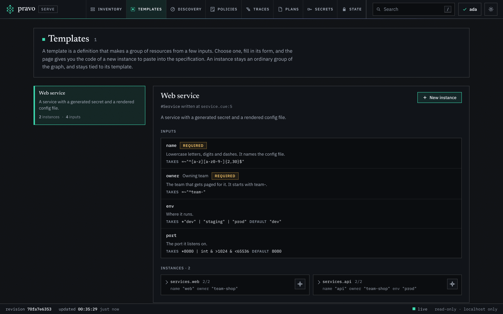
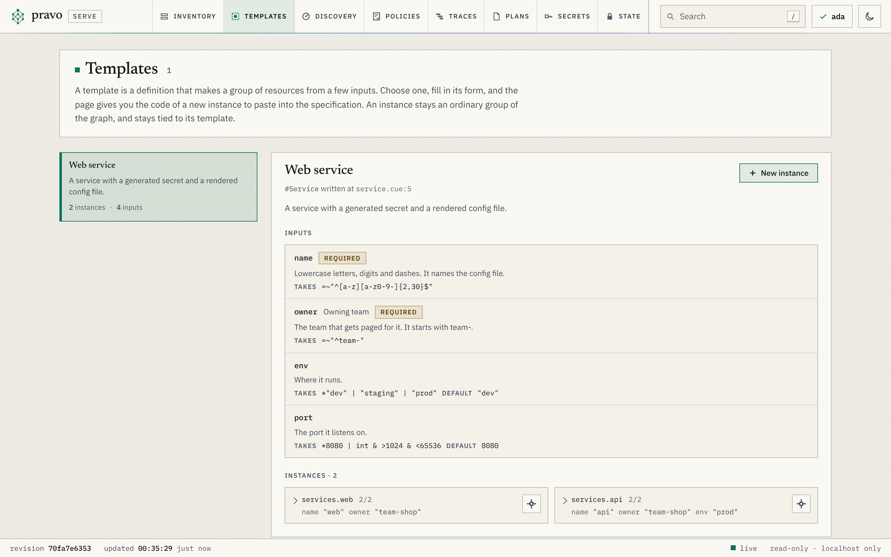

A platform team writes a pattern once, and everyone else asks for a copy of it by filling in a form. In pravo the pattern is a definition with resources, and the form comes from the definition: a definition that embeds `pravo.#Template` is listed in the Templates section of the viewer, which asks for its inputs and gives the CUE of a new instance to paste. This page turns a definition into a template, makes its form say what each input is for, holds its instances to a policy, and changes it for every instance at once. [Templates and self-service](../concepts/templates.md) explains the model, and [Make a new instance from a template](add-an-instance-from-a-template.md) is the page for the people who fill in the form.

pravo has no module block. A template is an ordinary definition, used through instances and shared through a package: [Reuse](../reference/spec-reuse.md) covers the rest.

## 1. Start from a definition

Work in an empty directory. The root is `estate/`. `#Service` is a web service: a generated password and a rendered config file. One instance, `services.web`, exists.

```cue file=estate/main.cue title="estate/main.cue"
package estate

import (
	loc "pravo.dev/providers/hashicorp/local"
	rnd "pravo.dev/providers/hashicorp/random"
)

$local:  loc.#Provider & {$version: "~> 2.5"}
$random: rnd.#Provider & {$version: "~> 3.6"}

services: web: #Service & {name: "web", owner: "team-shop"}
```

```cue file=estate/service.cue title="estate/service.cue"
package estate

#Service: {
	// Lowercase letters, digits and dashes. It names the config file.
	name: string & =~"^[a-z][a-z0-9-]{2,30}$"
	// The team that answers for the service.
	owner: string & =~"^team-"
	// Where it runs.
	env: *"dev" | "staging" | "prod"
	// The port it listens on.
	port: *8080 | int & >1024 & <65536

	secret: $random.#Resource.random_password & {length: 24}
	config: $local.#Resource.local_file & {
		filename: "out/\(name).env"
		content:  "OWNER=\(owner)\nENV=\(env)\nPORT=\(port)\n"
	}
}
```

```sh run
pravo -C estate init > /dev/null
pravo -C estate apply --auto-approve | grep '^Apply complete'
```

```text out
Apply complete! Resources: 2 added, 0 changed, 0 destroyed. [txn <id>]
```

## 2. Mark it as a template

Embed `pravo.#Template` and give the template a `name`, which identifies it, a `title` and a `description`, which the catalog shows:

```cue file=estate/service.cue title="estate/service.cue" hl="3,5-10"
package estate

import "pravo.dev/pravo"

#Service: pravo.#Template & {
	$template: {
		name:        "service"
		title:       "Web service"
		description: "A service with a generated secret and a rendered config file."
	}
	// Lowercase letters, digits and dashes. It names the config file.
	name: string & =~"^[a-z][a-z0-9-]{2,30}$"
	// The team that answers for the service.
	owner: string & =~"^team-"
	// Where it runs.
	env: *"dev" | "staging" | "prod"
	// The port it listens on.
	port: *8080 | int & >1024 & <65536

	secret: $random.#Resource.random_password & {length: 24}
	config: $local.#Resource.local_file & {
		filename: "out/\(name).env"
		content:  "OWNER=\(owner)\nENV=\(env)\nPORT=\(port)\n"
	}
}
```

The marker changes nothing in a plan. It is an ordinary field that passes into every instance, so `services.web` now carries it, and the resources keep their addresses:

```sh run
pravo -C estate plan | grep -o '^No changes[^.]*\.'
pravo -C estate eval -e 'services.web.$template.name'
```

```text out
No changes.
"service"
```

Without more, the form asks for every field of the definition that holds no resource, `name`, `owner`, `env` and `port`, in the order of the source, with the comment above each as its help.

## 3. Order and label the inputs

`$template.inputs` is one struct with an entry for each input that the form asks for, in the order of its keys. An entry may give a `label`, which the form shows in place of the field name, and a `description`, which it shows in place of the comment. An empty entry says nothing more:

```cue file=estate/service.cue title="estate/service.cue" hl="10-15"
package estate

import "pravo.dev/pravo"

#Service: pravo.#Template & {
	$template: {
		name:        "service"
		title:       "Web service"
		description: "A service with a generated secret and a rendered config file."
		inputs: {
			name: {}
			owner: {label: "Owning team", description: "The team that gets paged for it. It starts with team-."}
			env: {}
			port: {}
		}
	}
	// Lowercase letters, digits and dashes. It names the config file.
	name: string & =~"^[a-z][a-z0-9-]{2,30}$"
	// The team that answers for the service.
	owner: string & =~"^team-"
	// Where it runs.
	env: *"dev" | "staging" | "prod"
	// The port it listens on.
	port: *8080 | int & >1024 & <65536

	secret: $random.#Resource.random_password & {length: 24}
	config: $local.#Resource.local_file & {
		filename: "out/\(name).env"
		content:  "OWNER=\(owner)\nENV=\(env)\nPORT=\(port)\n"
	}
}
```

```sh run
pravo -C estate validate
```

```text out
Success! 2 resources, 0 data sources, 0 ephemeral, 0 function calls, 0 outputs across 2 providers.
```

An entry is closed, so a misspelt key is an error of `pravo validate` with its line. A key that names no input of the definition cannot be an error of CUE, because the definition is open; the page of the template in the viewer lists it under problems.

An entry can also ask for a control that the type alone does not give: `choices` offers the values that a node of the state holds, `entity` picks an existing resource and writes a reference to it, `as: "text"` is a text area, and `as: "secret"` asks where a secret comes from and never takes its value. [Inputs that are not typed in](../reference/spec-reuse.md#inputs-that-are-not-typed-in) shows each.

## 4. Let the constraints refuse bad values

The constraints of the definition are the validation of the form. The viewer evaluates the specification with the new code laid over it, so a value that breaks a constraint is refused in the form with the message that `pravo validate` prints. The same constraint refuses an instance that someone writes by hand:

```cue file=estate/api.cue title="estate/api.cue" status=conflict
package estate

services: api: #Service & {name: "API", owner: "team-shop", env: "prod"}
```

```sh run exit=6
pravo -C estate validate
```

```text out
Error: evaluating ./estate:
services.api.name: invalid value "API" (out of bound =~"^[a-z][a-z0-9-]{2,30}$"):
    ./estate/service.cue:18:17
    ./estate/api.cue:3:34
    ./estate/service.cue:18:8
```

The path is the field of the instance, the value is what it was given, and the rule is the pattern of the template, with the line of each. With a name in lowercase the instance is valid:

```cue file=estate/api.cue title="estate/api.cue"
package estate

services: api: #Service & {name: "api", owner: "team-shop", env: "prod"}
```

```sh run
pravo -C estate apply --auto-approve | grep '^Apply complete'
```

```text out
Apply complete! Resources: 2 added, 0 changed, 0 destroyed. [txn <id>]
```

## 5. Open the catalog

`pravo serve` starts the viewer, and the key `m` opens the Templates section. It lists the template with its title, its description and how many instances and inputs it has, and the page of the template lists each input with what it takes and each instance with the values it sets. New instance opens the form.

```sh
pravo -C estate serve
```

:::figure The Templates section of this root, with the Web service open: its inputs in the order of the marker, the label of owner, and the two instances.
<a class="shot shot-dark" href="../img/serve/templates-catalog-dark.png"></a>
<a class="shot shot-light" href="../img/serve/templates-catalog-light.png"></a>
:::

## 6. Hold the instances to a policy

An instance may set fields that the template leaves open. `secret: special: false` is valid CUE: the template does not say what `special` is, so the instance may. A policy holds every instance to what the template means, whatever an instance adds, and it is judged at the plan of every change, typed or pasted. A policy is kept in a sealed state, so seal it first:

```sh run
mkdir -p estate/.pravo/access
pravo -C estate id new --name ada | grep '^  ada ssh' | sed 's/^  //' > estate/.pravo/access/readers.txt
pravo -C estate protect init --encrypt --yes --allow-local > /dev/null
pravo -C estate protect status | grep '^Sealed'
```

```text out
Sealed       on · format 3 · 1 reader (ada) · recovery none
```

Each change of a plan names the template instance that holds its node, as `template: {name, instance}`, so the rule picks out the passwords of the instances of `service` without matching addresses:

```cue file=estate/policy.cue title="estate/policy.cue"
package estate

import "pravo.dev/pravo"

service_secrets: pravo.#Policy & {
	description: "The password of every Web service has special characters."
	rule: changes: [...{
		type: string
		template?: {name: string, instance: string}
		if template != _|_ {
			if template.name == "service" && type == "random_password" {
				after: special: true
			}
		}
	}]
}
```

```sh run
pravo -C estate apply --auto-approve | grep -E '^(Policies|Apply complete)'
```

```text out
Policies: +1 new, ~0 changed, -0 removed.
Policies: +1 new, ~0 changed, -0 removed.
Apply complete! Resources: 0 added, 0 changed, 0 destroyed. [txn <id>]
```

An instance that turns the special characters off is refused at the plan, with the path of the change and the line of the rule:

```cue file=estate/api.cue title="estate/api.cue"
package estate

services: api: #Service & {name: "api", owner: "team-shop", env: "prod", secret: special: false}
```

```sh run
pravo -C estate plan 2>&1 | grep -A6 '^Error'
```

```text out
Error: the plan violates the policy service_secrets@1 (sha256:<digest>):
changes.0.after.special: conflicting values true and false:
    plan:1:N
    service_secrets:7:2
    service_secrets:9:3
    service_secrets:11:14
```

The form of the viewer tries every policy in force on an approximate plan while the person types, so this refusal shows there before anything is pasted. [Writing policies](../reference/policies-writing.md#rules-for-the-instances-of-a-template) has more rules of this kind.

```cue file=estate/api.cue title="estate/api.cue"
package estate

services: api: #Service & {name: "api", owner: "team-shop", env: "prod"}
```

## 7. Change the template for every instance

An instance is built from the template, not copied from it, so a change to the template reaches every instance at the next plan. Add the name of the service to the config file:

```sh run
sed -i.bak 's|content:  "OWNER|content:  "NAME=\\(name)\\nOWNER|' estate/service.cue && rm estate/service.cue.bak
grep 'content:' estate/service.cue
pravo -C estate plan | grep -E '^  # |^Plan:'
```

```text out
		content:  "NAME=\(name)\nOWNER=\(owner)\nENV=\(env)\nPORT=\(port)\n"
  # services.api.config (local_file) must be replaced
  # services.web.config (local_file) must be replaced
Plan: 2 to add, 0 to change, 2 to destroy.
```

The plan replaces the config file of both instances, because `local_file` replaces a file whose content changes, and leaves their passwords alone. Store it with `pravo plan --store`, so that a writer applies the plan that was read, as [Store a plan and apply it later](store-a-plan-and-apply-it-later.md) shows.

## 8. Share the template between roots

A template in the root is listed in the catalog of that root. To share one between roots, put the definition in a package, as [Share code between roots in one repository](share-code-between-roots.md) does, or publish it in a CUE module, as [Publish a CUE module](publishing-a-module.md) does. A root lists such a template once a definition of the root embeds it:

```cue
#Service: kit.#Service
```

A template that a CUE module publishes changes for a root when the root takes the new version, so dev can take a change before prod does.

## What next

- [Make a new instance from a template](add-an-instance-from-a-template.md) is the page for the people who fill in the form.
- [Templates](../reference/spec-reuse.md#templates) lists every field of `$template` and of `$template.inputs`.
- [The Templates section](../reference/viewer-sections.md#the-templates-section) lists the parts of the page.
- [C8, Self-service from a template](../learn/c08-self-service-from-a-template.md) follows a team of three through a request.
