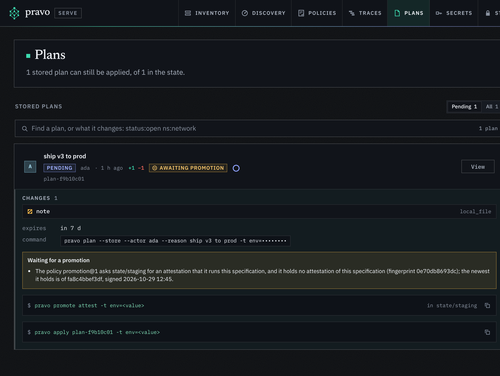
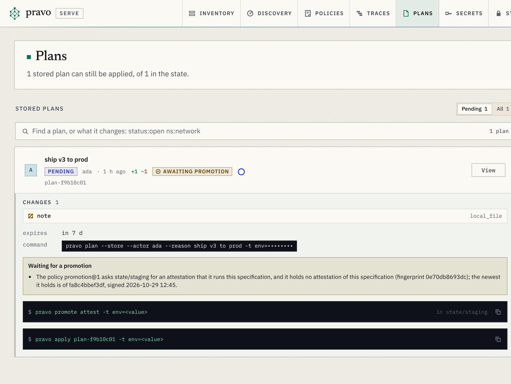
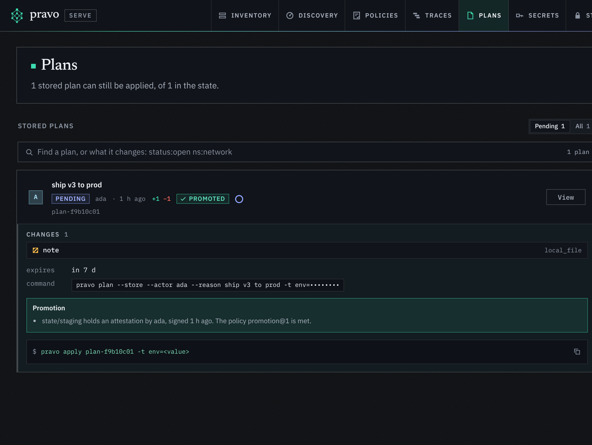
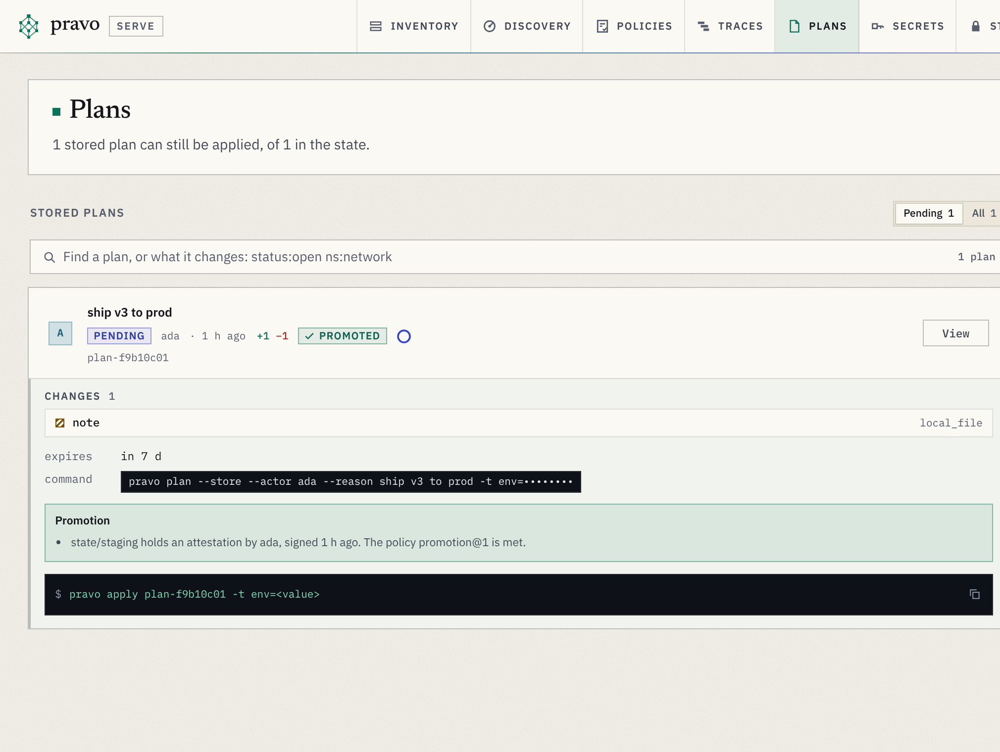

A specification that works in staging can still be wrong for production, and the way to find out is to run it in staging first. Nothing in a pipeline makes sure of that order unless something checks it: a person who applies in the wrong place, or a job that runs with the wrong tag, is enough. Promotion makes the order part of the state. Staging says which specification it runs, a key that the production policy trusts signs that statement, and the production apply refuses a specification without it.

The statement is an attestation. It is a small signed object in the state of staging, and it names the specification by its fingerprint. The policy in the state of production reads it, and decides whether the key and the age are what it asks for. Nothing else is shared between the two states: they stay separate, with their own readers, locks and logs.

> [!NOTE]
> The two states are local directories under `state/`, sealed with `--allow-local` so that the page needs no bucket. In a team the states are buckets, and the person who attests is usually a pipeline job or a release manager, not the person who applies in production.

## 1. Write one specification for both environments

The root selects its environment with the tag `env`, and the tag `image` stands for what changes between releases. The state path follows the environment. In production only, the root declares a policy: a rule with `promote`, which asks staging for an attestation.

```cue file=main.cue title="main.cue"
package estate

import (
	"pravo.dev/pravo"
	loc "pravo.dev/providers/hashicorp/local"
)

env:   *"dev" | "staging" | "prod" @tag(env)
image: *"1.0" | string @tag(image)

$settings: pravo.#Settings & {state: path: "state/\(env)"}
$local: loc.#Provider

app: $local.#Resource.local_file & {
	filename: "app-\(env).txt"
	content:  "image \(image)\n"
}

if env == "prod" {
	promotion: pravo.#Policy & {
		description: "Production takes a specification that staging has run and ada vouched for."
		rule: promote: {
			from: state: path: "state/staging"
			signers: ["SHA256:<ada's key>"]
			vary: ["env"]
		}
	}
}
```

`from` is the state that comes before: it has the same fields as `state` in `$settings`, so a bucket works as well as a directory. `signers` are the fingerprints of the keys that may vouch, as `ssh-keygen -l` and `pravo id show` print them. `vary` names the tags that may differ between the two environments. The other tags have to be the same, and this page returns to that in step 6.

The placeholder is ada's fingerprint. Ada takes it from her identity:

```sh run hidden
pravo id new --name ada > /dev/null
mkdir -p .pravo/access
pravo id show | tail -n 1 | sed 's/^ *//' > .pravo/access/readers.txt
pravo init -t env=staging > /dev/null
```

```sh run
KEY=$(pravo id show | awk '/signing/ {print $3}')
sed -i.bak "s|SHA256:<ada's key>|$KEY|" main.cue && rm main.cue.bak
grep signers main.cue
```

```text out
			signers: ["SHA256:<key>"]
```

## 2. Seal both states and apply once

An attestation is a signature, so both states are sealed to ada. Ada applies in each environment. The policy reaches the state of production with this first apply, and it is in force from then on: a plan that adds a policy is not judged by it.

```sh run
for env in staging prod; do
  pravo protect init --encrypt --yes --allow-local -t env=$env > /dev/null
  pravo apply --auto-approve -t env=$env | grep -E '^(Policies|Apply complete)'
done
```

```text out
Apply complete! Resources: 1 added, 0 changed, 0 destroyed. [txn <id>]
Policies: +1 new, ~0 changed, -0 removed.
Policies: +1 new, ~0 changed, -0 removed.
Apply complete! Resources: 1 added, 0 changed, 0 destroyed. [txn <id>]
```

Until production has applied once, nothing there asks for a promotion. The first apply of a root cannot be gated by a policy that the apply itself brings, so a new production state starts with one deliberate apply, and everything after that goes through the gate.

## 3. A new specification reaches staging first

Release 1.1: the image tag moves.

```sh run
sed -i.bak 's/"1.0" | string/"1.1" | string/' main.cue && rm main.cue.bak
pravo apply --auto-approve -t env=staging | grep '^Apply complete'
```

```text out
Apply complete! Resources: 1 added, 0 changed, 1 destroyed. [txn <id>]
```

Staging now runs the new specification. Every transaction records the fingerprint of the specification it applied, and the digests of the tags, as part of what the transaction signs. A plan in production says what that means for it:

```sh run
pravo plan -t env=prod | grep -E '^(Policies|Promotion|Plan:)'
```

```text out
Plan: 1 to add, 0 to change, 1 to destroy.
Policies: 1 satisfied.
Promotion: not yet. The policy promotion@1 asks state/staging for an attestation, and it holds no attestation of this specification (fingerprint <fingerprint>). An apply is refused until then.
```

The plan is not refused, because planning changes nothing: it says what the apply will find. The apply is refused, with exit code 5:

```sh run
pravo apply --auto-approve -t env=prod > apply.out 2>&1; echo "exit=$?"
sed -n '/^Error/,$p' apply.out
```

```text out
exit=5
Error: the policy promotion@1 asks state/staging for an attestation of this specification, and it holds no attestation of this specification (fingerprint <fingerprint>). Vouch for it there with "pravo promote attest", after the apply that put the specification there
```

An admin gets no way round it: promotion is not an approval, and the admin exemption of [approvals](approve-a-plan.md#7-what-an-admin-may-skip) does not reach it.

## 4. Vouch for it in staging

Staging runs release 1.1 and the checks that matter have passed. Ada attests. The command plans the specification against the state first, and signs only if the plan changes nothing: a state that does not run the specification cannot be vouched for.

```sh run
pravo promote attest -t env=prod > attest.out 2>&1; echo "exit=$?"
sed -n '/^Error/,$p' attest.out
pravo promote attest -t env=staging --note "smoke tests passed"
```

```text out
exit=5
Error: this state does not run the specification yet: a plan against it has 1 to add, 0 to change and 1 to destroy. Apply it first, with the same -t, then vouch for it
Attested: ./state/staging runs the specification <fingerprint>.

The policy of the state after this one pins this key and this state:
  signers: ["SHA256:<key>"]
  lineage: "<lineage>"
```

The first command is the guard: production does not run 1.1, so there is nothing to sign there. The second signs. The lines at the end are what the production policy pins: the key, which the policy already holds, and optionally the lineage of the state of staging, which ties the attestation to that state and to no other one with the same path.

```sh run
pravo promote list -t env=staging
```

```text out
SPECIFICATION  SIGNED  BY   TRANSACTION
<fingerprint>   <ago>  ada  <txn>  current
```

## 5. Apply in production

```sh run
pravo plan -t env=prod | grep -E '^Promotion'
pravo apply --auto-approve -t env=prod | grep '^Apply complete'
```

```text out
Promotion: state/staging holds an attestation by ada, signed <ago>, so this specification may reach this state.
Apply complete! Resources: 1 added, 0 changed, 1 destroyed. [txn <id>]
```

The attestation belongs to this specification only. A change to any file of the root, or to `cue.mod/module.cue`, is another specification, and production refuses it until staging has run it and a key has vouched again:

```sh run
sed -i.bak 's/"1.1" | string/"1.2" | string/' main.cue && rm main.cue.bak
pravo apply --auto-approve -t env=prod > apply.out 2>&1; echo "exit=$?"
sed -n '/^Error/,$p' apply.out | fold -s -w 110
```

```text out
exit=5
Error: the policy promotion@1 asks state/staging for an attestation of this specification, and it holds no
attestation of this specification (fingerprint <fingerprint>); the newest it holds is of <fingerprint>, signed
<time>. Vouch for it there with "pravo promote attest", after the apply that put the specification
there
```

## 6. The tags that may differ

Both environments run the same files, but the tags are not part of the fingerprint: `-t env=staging` and `-t env=prod` give the same one. The attestation therefore records a digest of each tag that staging applied with, and the policy compares them with the tags of the production apply. The ones in `vary` may differ. Every other tag has to be equal, so that production cannot take `image=3.0` on the strength of staging having run `image=2.0`.

```sh run
pravo apply --auto-approve -t env=staging -t image=2.0 | grep '^Apply complete'
pravo promote attest -t env=staging -t image=2.0 > /dev/null
pravo apply --auto-approve -t env=prod -t image=3.0 > apply.out 2>&1; echo "exit=$?"
sed -n '/^Error/,$p' apply.out | fold -s -w 110
pravo apply --auto-approve -t env=prod -t image=2.0 | grep '^Apply complete'
```

```text out
Apply complete! Resources: 1 added, 0 changed, 1 destroyed. [txn <id>]
exit=5
Error: the policy promotion@1 asks state/staging for an attestation of this specification, and the
specification is the same, but the tag image has another value than when it was applied before. Vouch for it
there with "pravo promote attest", after the apply that put the specification there
Apply complete! Resources: 1 added, 0 changed, 1 destroyed. [txn <id>]
```

The attestation keeps digests, not values, so a tag that holds a secret does not leak into the state of staging. Tags that always differ, such as a region, go in `vary` beside `env`.

## 7. Soak time and expiry

Two more fields say how old an attestation has to be. `min_age` is a soak time: production takes the specification only after the attestation has stood for that long, which makes staging run it for a while first. `max_age` is an expiry: an attestation older than that stops counting, so that a specification that was vouched for last month is not applied on the strength of it today. Both are durations with `ms`, `s`, `m`, `h` or `d`.

```cue
rule: promote: {
	from: state: path: "state/staging"
	signers: ["SHA256:..."]
	vary: ["env"]
	min_age: "48h"
	max_age: "14d"
}
```

The age counts from the moment the key signed. Attesting again replaces the attestation of that key for that specification, and starts the time again.

## 8. In the viewer

A stored plan that waits for a promotion says so in the Plans section of [the viewer](explore-your-estate.md#8-see-what-your-team-has-planned), and shows the command that ends the wait. The viewer never attests: it shows what `pravo apply` would find.

:::figure A stored plan in production, waiting for staging, and the same plan after the attestation.
<a class="shot shot-dark" href="../img/promote/waiting-detail-dark.png"></a>
<a class="shot shot-light" href="../img/promote/waiting-detail-light.png"></a>
<a class="shot shot-dark" href="../img/promote/promoted-detail-dark.png"></a>
<a class="shot shot-light" href="../img/promote/promoted-detail-light.png"></a>
:::

## What a promotion does not do

- Attesting is a command, not a side effect of an apply. A pipeline attests after the checks that matter have passed, and a person who applies in staging does not promote by doing so.
- There is no command that withdraws an attestation. `max_age` ends one, and a state that does not run the specification any more is shown by the newest attestation it holds.
- It says that staging ran this specification, and not that staging still does. A change to staging after the attestation is visible in the transaction log, and the attestation names the transaction that it was made after.
- The tags are the layout. Roots that keep an environment in a directory of its own have different files in each, so no fingerprint is shared. The attestation has a `kind`, `config-fingerprint/v1`, so that another kind can vouch for something else.
- Two environments do not share a registry: the production policy names its upstream, and so does every further environment. A chain of three is two policies.
- A state that is not sealed holds no attestations, because it has no signatures.

## What next

- [Run one specification in several environments](environments.md) sets up the tag and the state paths.
- [Approve a plan](approve-a-plan.md) is the other gate: a person's approval of a stored plan, which a rule can ask next to a promotion.
- [Write and roll out policies](policies.md) tests a rule on fixtures before it is in force.
- [`pravo promote`](../reference/promote.md) is the reference for the commands, and [the plan document](../reference/policies-plan-document.md) for the fields of `promote`.
