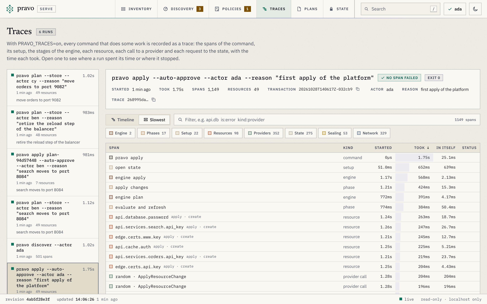

A run of pravo is a tree of spans: the command, the stages of its engine, each resource, each call to a provider, each request to the state, and each request that went over the network. With `PRAVO_TRACES=on`, a command keeps that tree in the project, and the viewer shows it as a timeline. No collector, no account, no agent. This page turns the recording on, reads a run, finds where a failed run stopped, looks at the network calls, and ends with a collector for the team that has one.

Work in an empty directory. The root is `local/`, two resources, a name and a file that holds it. A second root, `bucket/`, comes in step 5.

```cue file=local/main.cue title="local/main.cue"
package traced

import (
	rnd "pravo.dev/providers/hashicorp/random"
	loc "pravo.dev/providers/hashicorp/local"
)

$random: rnd.#Provider & {$version: "~> 3.6"}
$local: loc.#Provider & {$version: "~> 2.5"}

server: $random.#Resource.random_pet & {length: 2}

note: $local.#Resource.local_file & {
	filename: "out/note.txt"
	content:  "\(server.id)\n"
}
```

## 1. Turn the recording on

Nothing is recorded until you ask. `PRAVO_TRACES=on` in the environment of a command keeps its trace, and `export PRAVO_TRACES=on` keeps it for every command of the session.

```sh run
pravo -C local init > /dev/null
PRAVO_TRACES=on pravo -C local apply --auto-approve | grep '^Apply complete'
ls local/.pravo/traces
```

```text out
Apply complete! Resources: 2 added, 0 changed, 0 destroyed. [txn <id>]
<trace id>-<span id>.json
```

The file is named by the trace and its first span, and it is written in the directory the command ran in. It holds every span of the run with its name, its timing, its attributes and the lines of the debug log that were attached to it, and no attribute value: not a password, not an id, not the content of the file. A command that did no work, `pravo version` or `pravo state log`, writes nothing. The directory keeps the newest 100 runs and has a `.gitignore` that ignores the whole of it.

## 2. Read it in the viewer

```sh
pravo -C local serve
```

Press `r`, or open Traces from the bar. The runs are listed newest first, with the command, the age, how long it took and the resources it handled, and a red mark for a run in which a span failed. The newest is open: its head says the exit code, the transaction an apply wrote, the actor and the reason, and under it the timeline draws the run.

:::figure The Traces section with the first apply of an estate open as a timeline: the state is opened, the engine plans, then applies, each resource holds the calls to its provider, and each request to the state store holds the network call it made.
<a class="shot shot-dark" href="../img/serve/traces-dark.png"></a>
<a class="shot shot-light" href="../img/serve/traces-light.png"></a>
:::

Time runs across and nesting runs down. The command is the top bar, the engine and its stages under it, a resource under the stage that handled it, and under the resource the calls to its provider. The width of a bar is how long it took. Two bars in one row ran one after the other, and two rows ran at the same time. Click a bar for the detail of the span: the path from the command down to it, its timing, its attributes, its events and its slowest parts. Double-click to fit the timeline to it, drag to move along the run, and hold Ctrl or Cmd and scroll to zoom. [The keys of the timeline](../reference/viewer-keys-and-links.md#in-the-timeline) list the rest.

## 3. Find where the time went

Switch to Slowest. The spans become a table, longest first, with a column `In itself`: the time a span spent in no part of its own. A resource that took four seconds, of which its provider call took 3.9, has little in itself. A stage with a large figure spent its time between its parts, waiting on a lock or on the state.

:::figure The slowest spans of a run as a table, longest first, with the time each spent in itself.
<a class="shot shot-dark" href="../img/serve/traces-slowest-dark.png"></a>
<a class="shot shot-light" href="../img/serve/traces-slowest-light.png"></a>
:::

The kinds under the filter box narrow the view to one kind of span, `Providers` or `State`, and the box takes the terms of the Inventory's filter: `kind:provider`, `provider:random`, `type:local_file`, `is:error`, or a word from the name of a span. The file answers the same questions from the shell. The spans of the apply, counted by their kind:

```sh run
jq -r '.spans[].name | split(" ")[0]' local/.pravo/traces/*.json | sort | uniq -c
```

```text out
      4 config
      2 engine
     17 phase
      1 pravo
     18 provider
      4 resource
     11 setup
     22 state
```

## 4. Read a run that failed

Make the directory of the file a file, so that the provider cannot write there, and change the length of the name, so that the apply has to write the file again. `-refresh=false` keeps the plan from reading the file first, so that the run fails where a failed apply usually fails: at the call that writes.

```sh run
rm -r local/out && touch local/out
sed -i.bak 's/length: 2/length: 3/' local/main.cue && rm local/main.cue.bak
PRAVO_TRACES=on pravo -C local apply --auto-approve -refresh=false > apply.out 2>&1; echo "exit=$?"
grep '^Error' apply.out
F=$(ls -t local/.pravo/traces/*.json | head -n 1)
jq -r '.spans[] | select(.status == "error") | .name' "$F"
```

```text out
exit=1
Error: note: Create local file error: An unexpected error occurred while writing the file
pravo apply
engine apply
phase apply changes
resource note
provider ApplyResourceChange
```

In the viewer the run is marked `failed`, the spans that failed are red, and `is:error` in the filter box keeps only them. The deepest red span is where the run stopped: the call to the provider, under the resource, under the stage. The error text is on the span, as the command printed it.

## 5. See the requests that went over the network

A provider that talks to a cloud sends requests over the network, and so does pravo when the state is in a bucket. With `PRAVO_TRACES=on`, each one is a span: the method, the host and the path, the status, the sizes and the time. Never a header, a body or a query string, so no credential is in a trace. The root `bucket/` keeps its state in the in-memory bucket:

```cue file=bucket/main.cue title="bucket/main.cue"
package bucket

import (
	"pravo.dev/pravo"
	rnd "pravo.dev/providers/hashicorp/random"
)

$settings: pravo.#Settings & {
	state: pravo.#S3State & {
		backend:    "s3"
		bucket:     "traced-state"
		prefix:     "demo"
		region:     "us-east-1"
		endpoint:   "http://127.0.0.1:9000"
		path_style: true
	}
}

$random: rnd.#Provider & {$version: "~> 3.6"}

server: $random.#Resource.random_pet & {length: 2}
```

`pravo state probe` checks the bucket once, before the first write, so that the checks do not land in the trace of the apply.

```sh run
pravo -C bucket init > /dev/null
pravo -C bucket state probe > /dev/null
PRAVO_TRACES=on pravo -C bucket apply --auto-approve | grep '^Apply complete'
F=$(ls -t bucket/.pravo/traces/*.json | head -n 1)
jq -r '.spans[] | select(.name | startswith("network ")) | .name' "$F" | sort | uniq -c
jq -r '.spans[] | select(.name | startswith("network PUT")) | .attrs["url.path"]' "$F" | sort -u
```

```text out
Apply complete! Resources: 1 added, 0 changed, 0 destroyed. [txn <id>]
      2 network DELETE 127.0.0.1
     11 network GET 127.0.0.1
      7 network PUT 127.0.0.1
/traced-state/demo/locks/server.lock
/traced-state/demo/meta.json
/traced-state/demo/outputs.json
/traced-state/demo/outputs.lock
/traced-state/demo/resources/server.json
/traced-state/demo/txn/<txn>.json
```

Each request sits under the `state` span that made it, so a slow lock shows as a slow `PUT` under the span that created it, and a request of a provider sits under the provider call that was running:

:::figure A network call selected in the timeline of an apply: the request that wrote the progress of a stored plan to the state store, with the path from the command down to it, its timing and its attributes under the timeline.
<a class="shot shot-dark" href="../img/serve/trace-span-dark.png"></a>
<a class="shot shot-light" href="../img/serve/trace-span-light.png"></a>
:::

The requests of a provider are seen because pravo starts each provider with a proxy of its own and a certificate authority made for the run, named in the environment variables that HTTP clients honour. Nothing in the provider changes. A provider that talks to an emulator on `localhost` is not seen, since a Go program sends nothing to a loopback address through a proxy, and [Network calls of a provider](../reference/telemetry.md#network-calls-of-a-provider) lists the other cases. `PRAVO_TRACES_NET=off` keeps the runs and leaves the network out of them.

## 6. Keep the runs where you want them

- `PRAVO_TRACE_DIR` keeps the runs in another directory, for a root that is read-only or for the runs of several roots in one place. `pravo serve` reads it when the variable is set in its own environment.
- The directory keeps the newest 100 runs. A run of more than 20,000 spans keeps every command, engine, stage and resource span, leaves out the provider calls, the network calls and the requests to the state that end after that, and says how many in its `dropped` field.
- A failure to write the file never fails the command and prints nothing. The recording is a side of the run, not a condition of it.

## 7. Send the spans to a collector

A recorded run holds the same spans that pravo's OpenTelemetry exporter sends. For a team that has a collector, set the standard variable and nothing else, `OTEL_EXPORTER_OTLP_ENDPOINT=https://collector.example.com:4318`, and any backend that speaks OTLP gets every run. The export is on the side: a collector that is down costs one warning on standard error, at most five seconds, and never the exit code. In a pipeline, `TRACEPARENT` in the environment makes the command a child of the job's span, so the trace of the pipeline shows pravo's work inside it.

When an exporter is on, the trace id is written where you already look, on every transaction in the state and in every plan document, so a run in the collector is found from the state and the other way round. The console exporter shows it without a collector. Put the directory back first, so that the apply succeeds:

```sh run
rm local/out
OTEL_TRACES_EXPORTER=console pravo -C local apply --auto-approve 2> spans.jsonl | grep '^Apply complete'
jq -r 'select(.Name == "pravo apply") | .SpanContext.TraceID' spans.jsonl > from-the-trace
pravo -C local state log --json | jq -r '.[0].trace_id' > from-the-state
diff from-the-trace from-the-state && echo "the transaction carries the trace id of the run"
```

```text out
Apply complete! Resources: 1 added, 0 changed, 0 destroyed. [txn <id>]
the transaction carries the trace id of the run
```

[Telemetry](../reference/telemetry.md) lists every variable, every span and its attributes, and the metrics.

## 8. What a trace never holds

Addresses, types, actions, counts, outcomes and timings are recorded. Attribute values never are: not a value of the configuration, not a value of the state, not an id a provider returned, not an output. Error messages are recorded as they are printed, so a provider that quotes a value in its own error text puts it in the span, and the viewer masks it as it masks every text it shows. The path of a network request can name an object, such as the key of an object in a bucket, so a recorded run is as private as the project that holds it, and no more.

## Recap

- `PRAVO_TRACES=on` keeps the trace of every command that did some work in `.pravo/traces`, newest 100, ignored by git.
- The Traces section of `pravo serve` draws a run as a timeline, lists its slowest spans, and marks the span that failed. The file is JSON, and `jq` reads it.
- With the recording on, each request over the network is a span under the request or the provider call that made it, with the method, the host, the path and the status, and never a header, a body or a query.
- `OTEL_EXPORTER_OTLP_ENDPOINT` sends the same spans to a collector, and the trace id lands on the transaction.

## What next

- [Traces](../concepts/traces.md) explains the shape of a run and what a span is.
- [Find out why a run fails](debugging.md) uses the trace with `-v`, `pravo why` and `pravo drift`.
- [The Traces section](../reference/viewer-sections.md#the-traces-section) lists every part of the view, and [Telemetry](../reference/telemetry.md) every span and attribute.
