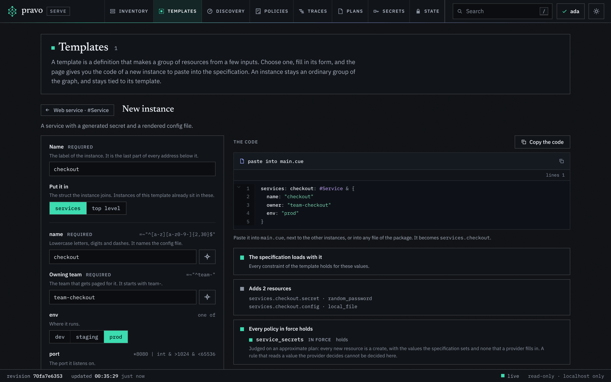
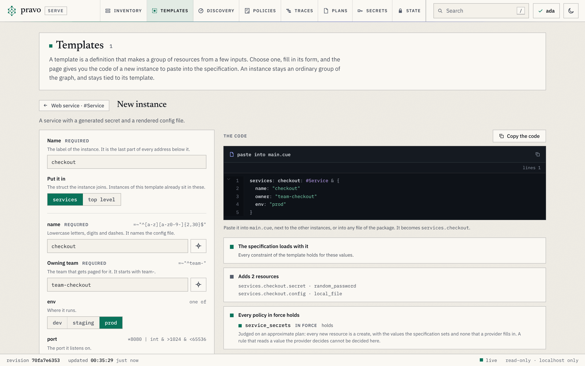

Eve's team needs a new service. The platform team has a pattern for one, and in the OpenTofu world there are two ways to get it. Eve opens a ticket, and someone who may change the estate writes the code for her. Or she copies a block from a directory where a service lives, edits the values, and finds out which values there are by reading the code that the block calls. Either way the pattern is a copy, and a later improvement of the pattern reaches only the copies that someone goes back to.

```hcl title="a request, in OpenTofu"
# read ./modules/service to learn the inputs
module "checkout" {
  source = "./modules/service"
  name   = "checkout"
  owner  = "team-checkout"
}
```

pravo has no module block. A pattern is a definition, and a new service is an instance of it, as [B6](b06-reuse-providers-credentials.md) showed. This lesson adds two things. A definition that says it is a template is a form in the viewer, so Eve asks for a service by filling in fields, and the viewer checks her values before anything is pasted. And Eve's key does not have to change the estate: she prepares the plan with a reader key, and Dan applies it with a writer key. The team of [C4](c04-readers-writers-admins.md) plays every part: Ada, an admin, owns the template, Eve reads, and Dan writes.

## A definition the team already uses

Work in an empty directory. The root is `team/`: one definition, `#Service`, a password and a config file for each service, and one instance of it, `services.web`. The state is local and sealed to Ada, Dan and Eve with their roles pinned, as C3 and C4 did it, and Ada applied it once. The setup runs those steps for you.

```cue file=team/service.cue title="team/service.cue"
package team

#Service: {
	// Lowercase letters, digits and dashes. It names the config file.
	name: string & =~"^[a-z][a-z0-9-]{2,30}$"
	// The team that answers for the service.
	owner: string & =~"^team-"
	// Where it runs.
	env: *"dev" | "staging" | "prod"

	secret: $random.#Resource.random_password & {length: 24}
	config: $local.#Resource.local_file & {
		filename: "out/\(name).env"
		content:  "OWNER=\(owner)\nENV=\(env)\n"
	}
}
```

```cue file=team/main.cue title="team/main.cue"
package team

import (
	loc "pravo.dev/providers/hashicorp/local"
	rnd "pravo.dev/providers/hashicorp/random"
)

$local:  loc.#Provider & {$version: "~> 2.5"}
$random: rnd.#Provider & {$version: "~> 3.6"}

services: web: #Service & {name: "web", owner: "team-shop"}
```

```sh run hidden
mkdir -p team/.pravo/access
pravo -C team id new --name ada > /dev/null
PRAVO_CONFIG_DIR=people/dan pravo -C team id new --name dan > /dev/null
PRAVO_CONFIG_DIR=people/eve pravo -C team id new --name eve > /dev/null
{
  echo "$(pravo -C team id show | tail -n 1 | sed 's/^ *//') role:admin"
  echo "$(PRAVO_CONFIG_DIR=people/dan pravo -C team id show | tail -n 1 | sed 's/^ *//') role:writer"
  echo "$(PRAVO_CONFIG_DIR=people/eve pravo -C team id show | tail -n 1 | sed 's/^ *//') role:reader"
} > team/.pravo/access/readers.txt
pravo -C team init > /dev/null
pravo -C team protect init --encrypt --yes --allow-local > /dev/null
pravo -C team protect roles --yes > /dev/null
pravo -C team apply --auto-approve > /dev/null
```

```sh run
pravo -C team state list
pravo -C team protect status | grep '^Roles'
```

```text out
services.web.config
services.web.secret
Roles        on · 1 admin · 1 writer · 1 reader · pinned, version 1 in the state · you are an admin
```

## Mark it as a template

Ada makes `#Service` a template: it embeds `pravo.#Template` and names itself in the marker `$template`. The inputs are the fields that a person fills in. Their order, their labels and their descriptions are the form's; their types, defaults and constraints are already in the definition.

```cue file=team/service.cue title="team/service.cue" hl="5-15"
package team

import "pravo.dev/pravo"

#Service: pravo.#Template & {
	$template: {
		name:        "service"
		title:       "Web service"
		description: "A service with a generated secret and a rendered config file."
		inputs: {
			name: {}
			owner: {label: "Owning team", description: "The team that gets paged for it. It starts with team-."}
			env: {}
		}
	}
	// Lowercase letters, digits and dashes. It names the config file.
	name: string & =~"^[a-z][a-z0-9-]{2,30}$"
	// The team that answers for the service.
	owner: string & =~"^team-"
	// Where it runs.
	env: *"dev" | "staging" | "prod"

	secret: $random.#Resource.random_password & {length: 24}
	config: $local.#Resource.local_file & {
		filename: "out/\(name).env"
		content:  "OWNER=\(owner)\nENV=\(env)\n"
	}
}
```

:::predict `services.web` is an instance of `#Service`, and `#Service` now has a field it did not have. What does the next plan do to `services.web`?
Ask what a plan is made of.

::reveal
Nothing. A plan is made of resources, and `$template` is not one. The marker passes into every instance by unification, which is how the viewer, a plan and a policy know which template an instance came from, and it changes no attribute of any resource.
:::

```sh run
pravo -C team plan | grep '^No changes'
```

```text out
No changes. The specification matches the state. 2 records were not read, so a change made outside pravo would not show here; run pravo drift to compare them with the infrastructure.
```

## Hold every instance to a rule

A template can say what its own fields may be. It cannot stop an instance from setting a field that it leaves open: `secret: special: false` is valid CUE in any instance. A policy can, and since [C5](c05-write-a-plan-policy.md) Ada knows how to write one. Each change of a plan names the template instance that holds it, as `template: {name, instance}`, so the rule picks out the passwords of every instance of `service` without naming one address:

```cue file=team/policy.cue title="team/policy.cue"
package team

import "pravo.dev/pravo"

service_secrets: pravo.#Policy & {
	description: "The password of every Web service has special characters."
	rule: changes: [...{
		type: string
		template?: {name: string, instance: string}
		if template != _|_ {
			if template.name == "service" && type == "random_password" {
				after: special: true
			}
		}
	}]
}
```

A policy is put in force by the apply that adds it, signed by Ada:

```sh run
pravo -C team apply --auto-approve | grep -E '^(Policies|Apply complete)' | uniq
```

```text out
Policies: +1 new, ~0 changed, -0 removed.
Apply complete! Resources: 0 added, 0 changed, 0 destroyed. [txn <txn>]
```

Ada commits the three files. From here on the template is the platform team's offer, and the policy is its guarantee.

## Eve fills in the form

Eve has a checkout and a reader key. She starts the viewer as herself and presses `m` for the Templates section:

```sh
PRAVO_CONFIG_DIR=people/eve pravo -C team serve
```

The catalog lists `Web service`, its inputs and its one instance. New instance opens the form. Every field comes from the definition: the pattern of `name` and the prefix of `owner` are checked as she types, `env` is a row of three buttons with `dev` pressed, and the comments are the help under the fields. She calls the instance `checkout`, gives it to `team-checkout` and presses `prod`.

:::figure The form of a new Web service called checkout. The three checks under the code pass.
<a class="shot shot-dark" href="../img/serve/templates-form-dark.png"></a>
<a class="shot shot-light" href="../img/serve/templates-form-light.png"></a>
:::

The screenshot comes from the root of [Make a new instance from a template](../how-to/add-an-instance-from-a-template.md), whose template has a `port` as well. Under the code are three checks, run while Eve types. The first loads the specification with her code laid over it in memory, so a value the template refuses is refused here, with the message of CUE. The second lists the resources the instance adds. The third tries every policy in force on an approximate plan, and says that `service_secrets` holds before Eve pastes anything. The viewer writes nothing. It gives Eve the code.

## Break it: a value the template refuses

The form is a convenience, not the guard. The same checks bind code that someone types by hand. Eve pastes the code into a file of its own, then forgets the prefix of the team. The block carries `status=conflict`:

```cue file=team/checkout.cue title="team/checkout.cue" status=conflict hl="5"
package team

services: checkout: #Service & {
	name:  "checkout"
	owner: "checkout"
	env:   "prod"
}
```

```sh run
PRAVO_CONFIG_DIR=people/eve pravo -C team validate; echo "exit=$?"
```

```text out
Error: evaluating ./team:
services.checkout.owner: invalid value "checkout" (out of bound =~"^team-"):
    ./team/service.cue:19:18
    ./team/checkout.cue:5:9
    ./team/service.cue:19:9

exit=6
```

The constraint is Ada's, written once in the definition. It refuses the value in the form, in `pravo validate`, and at every plan, whoever runs it. Eve puts the prefix back:

```cue file=team/checkout.cue title="team/checkout.cue"
package team

services: checkout: #Service & {
	name:  "checkout"
	owner: "team-checkout"
	env:   "prod"
}
```

## Eve prepares, Dan applies

Eve may plan, and the policy in force judges the plan:

```sh run
PRAVO_CONFIG_DIR=people/eve pravo -C team plan | grep -E '^  # |^Plan:|^Policies'
```

```text out
  # services.checkout.secret (random_password) will be created
  # services.checkout.config (local_file) will be created
Plan: 2 to add, 0 to change, 0 to destroy.
Policies: 1 satisfied.
```

She may not apply it: her key is a reader's. What a reader writes is a stored plan, as in [C2](c02-store-a-plan.md). She commits the file, so that Dan's checkout has it, and stores the plan with the reason:

```sh run
PRAVO_CONFIG_DIR=people/eve pravo -C team plan --store --reason "the checkout service" 2>&1 | grep '^Stored'
```

```text out
Stored the plan as plan-<id>; unless it is applied it is removed after 7 days. To apply exactly these actions, run:
```

Dan reads it. `plan show` names the key that stored it and the reason, and compares the plan with his checkout and with the state:

```sh run
ID=$(pravo -C team plan list | awk 'NR==1 {print $1}')
PRAVO_CONFIG_DIR=people/dan pravo -C team plan show "$ID" | grep -E '^Stored plan|reason:'
PRAVO_CONFIG_DIR=people/dan pravo -C team apply "$ID" --auto-approve | grep '^Apply complete'
pravo -C team state log | grep -m1 'signed by'
```

```text out
Stored plan plan-<id> by eve, just now (pending)
  reason:  the checkout service
Apply complete! Resources: 2 added, 0 changed, 0 destroyed. [txn <txn>]
    signed by dan (verified)
```

The plan was prepared by one role and applied by another. Eve never held the right to change the estate, Dan applied exactly the actions that Eve's plan listed, the policy judged them again at the apply, and the state says who did which. Nobody approved anything in between: Dan's apply is the decision.

## Change the template

The platform team wants the name of the service in every config file. Ada changes the template once:

```sh run
sed -i.bak 's|content:  "OWNER|content:  "NAME=\\(name)\\nOWNER|' team/service.cue && rm team/service.cue.bak
grep 'content:' team/service.cue
```

```text out
		content:  "NAME=\(name)\nOWNER=\(owner)\nENV=\(env)\n"
```

:::predict Two instances use `#Service`: `web`, which Ada wrote, and `checkout`, which Eve asked for. Nobody touched either file. What does the next plan list?
Ask whether an instance is a copy of the template or something worked out from it.

::reveal
A change of both. `#Service & {...}` is a unification that CUE works out on every evaluation, so an instance is whatever the template says now, with its own values. Both config files get the new line, and `local_file` replaces a file whose content changes.
:::

```sh run
pravo -C team plan | grep -E '^  # |^Plan:'
```

```text out
  # services.checkout.config (local_file) must be replaced
  # services.web.config (local_file) must be replaced
Plan: 2 to add, 0 to change, 2 to destroy.
```

Nothing was regenerated and no instance was upgraded by hand. The passwords stay as they are, because nothing in them changed. Ada is an admin, so she may apply it herself:

```sh run
pravo -C team apply --auto-approve | grep '^Apply complete'
head -n 1 team/out/checkout.env
```

```text out
Apply complete! Resources: 2 added, 0 changed, 2 destroyed. [txn <txn>]
NAME=checkout
```

## Exercise

:::exercise Ask for a second service
As Eve, ask for an instance `search`, owned by `team-search`, in `staging`, and get it applied by Dan. Which file do you write, and which two commands run under which key?

::hint
The form gives the code, and the code is three lines inside `services: search: #Service & {...}`. Any file of the package will do.

::hint
Eve stores the plan with `pravo plan --store`. Dan applies it by its id, which `pravo plan list` prints first.

::solution
```cue file=team/search.cue title="team/search.cue"
package team

services: search: #Service & {
	name:  "search"
	owner: "team-search"
	env:   "staging"
}
```

```sh run
PRAVO_CONFIG_DIR=people/eve pravo -C team plan --store --reason "search" 2>&1 | grep '^Stored'
ID=$(pravo -C team plan list | awk 'NR==1 {print $1}')
PRAVO_CONFIG_DIR=people/dan pravo -C team apply "$ID" --auto-approve | grep '^Apply complete'
```

```text out
Stored the plan as plan-<id>; unless it is applied it is removed after 7 days. To apply exactly these actions, run:
Apply complete! Resources: 2 added, 0 changed, 0 destroyed. [txn <txn>]
```

```sh run check
pravo -C team state list | grep -q '^services.search.config$'
```
:::

## Clean up

```sh run
pravo -C team destroy --auto-approve | tail -n 1
```

```text out
Destroy complete! Resources: 0 added, 0 changed, 4 destroyed. [txn <txn>]
```

## Recap

- A definition that embeds `pravo.#Template` and names itself in `$template` is a form in the viewer. The fields, their defaults, constraints and comments are the form; `$template.inputs` orders and labels them.
- The constraints of the template refuse a bad value in the form, in `pravo validate` and at every plan. A policy holds every instance to a rule through `template.name`, whatever an instance adds.
- A reader prepares the plan of a new instance and stores it. A writer applies it by its id. The person who asks never needs the right to change the estate.
- An instance is worked out from its template, not copied. A change to the template reaches every instance at the next plan.

:::check
Eve's instance sets `secret: special: false`. The template does not mention `special`. Where is it refused, and why not earlier?
::answer
By the policy `service_secrets`, at the plan. `pravo validate` accepts it: the template leaves `special` open, so the value is valid CUE. The form would not catch it either, since it never writes a field that is not an input; the policy is the guard for code that anyone types.

What does Dan's apply of Eve's stored plan check that Eve's plan did not decide?
::answer
That the plan still fits: the configuration in his checkout, the providers and the records it used are those the plan was made from. The policies in force judge it again, and the transaction is signed by Dan's writer key.
:::

The how-to pages [Offer a template to your team](../how-to/offer-a-template.md) and [Make a new instance from a template](../how-to/add-an-instance-from-a-template.md) cover the two sides of the form in more depth, with inputs that pick from the estate and secrets given by name. [Templates and self-service](../concepts/templates.md) says what each check covers and what the viewer does not do. This is the last lesson of the track: the [index](index.md) says where to go from here.
