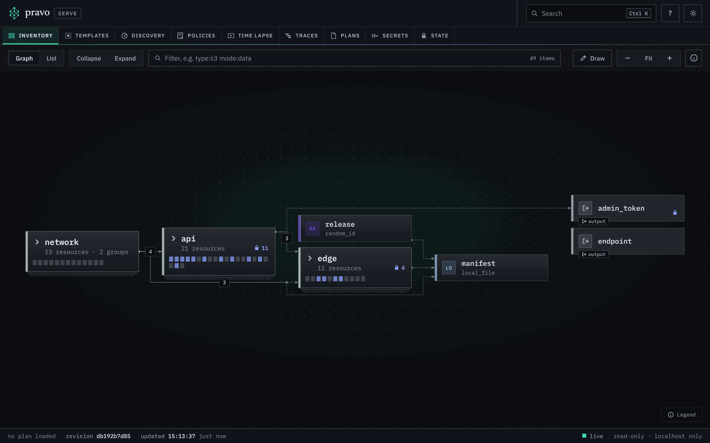
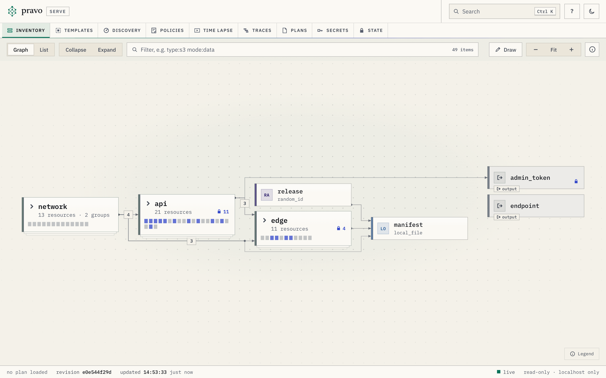

## Quick reference

| | |
|---|---|
| Synopsis | `pravo serve [flags]` |
| Changes infrastructure | No. With `--apply`, [the drawing board](#the-drawing-board) applies a plan of the saved files that it made and showed, when you press Apply. |
| Reads | The specification, the state, the plans stored in it, the runs of the discoveries stored in it, the policies in force, the runs that pravo recorded in `.pravo/traces` (or `$PRAVO_TRACE_DIR`), the provider schemas that are cached already and, with `--plan FILE`, a saved plan. For a state that is sealed, the readers file and the identity of the person who runs the command. |
| Writes | Nothing: no state record, no transaction, no lock, no `pravo.lock.cue`, no generated package, and nothing of a stored plan: no claim, no progress, no approval, no removal. It runs no discovery. It starts no provider and downloads nothing. With `--edit`, [the drawing board](#the-drawing-board) writes the files of a drawing when you save it, and the file and the records of a Terraform state that an empty state starts from; its plan starts the providers as `pravo plan` does. With `--apply`, it applies a plan that it showed. |
| Prints | The address of the viewer, with its token. With `--json`, one line of JSON. Then nothing until it stops. |
| Taught in | [Explore an estate in a browser](../how-to/explore-your-estate.md). |

The command runs until a signal ends it. The viewer is one page that the server sends from the pravo binary, and a JSON interface that the page reads. What the page shows is on three pages of its own: [the sections of the viewer](viewer-sections.md), [its keys and links](viewer-keys-and-links.md) and [its API](viewer-api.md). [The viewer](../concepts/the-viewer.md) explains how to read it.

### Flags

| Flag | Default | Meaning |
|---|---|---|
| `--port N` | `0` | The port to listen on. `0` picks a free port. |
| `--no-open` | off | Do not open a browser. The address is printed either way. |
| `--plan FILE\|ID` | none | A plan to show on top of the graph: a saved plan file, or the id of a plan stored in the state, whole or its first six hexadecimal digits when no other plan starts with them. A file with that name is a file. The viewer reads the plan and never makes one. |
| `--identity NAME` | the identity that the other commands find | The identity to read a sealed state with: a file of the identity directory. `none` reads the state as a person with no key sees it. It matters only for a state that is sealed. |
| `--access-dir DIR` | `.pravo/access` | The directory that holds `readers.txt`. `$PRAVO_ACCESS_DIR` sets it too, and the flag wins. A relative directory is relative to the project directory. Without either, the viewer looks in `.pravo/access` of the project directory and of each parent up to the one that holds `.git`. |
| `--edit` | off | Let [the drawing board](#the-drawing-board) write a drawing into the specification (a new file, the fields it changes, a fold) and plan it, and start a state that holds nothing from a Terraform state. It never applies. Without it the board draws and checks, and writes nothing. |
| `--apply` | off | What `--edit` allows, and let the drawing board apply a plan of the saved files that it made and showed. |
| `--chat PROVIDER` | `$PRAVO_CHAT`, else off | Turn on [the assistant](#the-assistant): `anthropic`, or `openai-compatible` with an endpoint. `PROVIDER:MODEL` names the model too, and `off` turns it off. |
| `--chat-model NAME` | `$PRAVO_CHAT_MODEL` | The model the assistant asks. Required when the assistant is on. |
| `--chat-endpoint URL` | `$PRAVO_CHAT_ENDPOINT` | The base URL of an `openai-compatible` provider, such as `http://localhost:11434/v1` for a model on this machine. It has to be `https`, or `http` on this machine. |
| `-t`, `--tag key=value` | none | Inject a value for an `@tag()` field, as `pravo plan` does. Repeatable. |
| `-T`, `--inject-vars` | off | Inject the system variables of CUE into tags written `@tag(name,var=os)`. |

The [global flags](global-flags.md) apply. With `--json`, the address is printed as one line:

```json
{"port":8700,"token":"3f6d...","url":"http://127.0.0.1:8700/?token=3f6d..."}
```

With `--plan FILE` and no `-t` or `-T`, the specification is read with the tags that the plan was made with. `--plan ID` does not take the tags of the plan. The stored plans are read from the state that the tags select, so give the `-t` and `-T` that `pravo plan list` takes for the same state. The viewer lists the stored plans whether or not `--plan` is given.

There is no flag for the address. The server listens on `127.0.0.1`.

### A sealed state

A state that is sealed is read with an identity (see [`pravo protect`](protect.md)). The command finds it once, as `pravo protect status` finds it, when it first reads a sealed state, and a passphrase is asked for on the terminal before the server listens: never in the page, and never while a request is served. Without an identity, or with one that is not a reader, the viewer lists the resources of a sealed state and shows no value. The command prints a line that says so. A plain state asks for no identity.

The bar of the page names the identity the page is read as, and beside it, for a key that is not a reader, `not a reader`, `no identity` or `identity locked`. The [State section](viewer-sections.md#the-state-section) says the same with the members of the state.

### Exit codes

| Code | Meaning |
|---|---|
| 0 | The command was stopped by a signal. |
| 1 | An error: a port that is not a number from 0 to 65535, a port that is in use, a plan file that cannot be read, an id that no stored plan has or that fits several, a state that cannot be opened, or an argument, since `serve` takes none. |

## The assistant

[Ask questions about your estate](../how-to/ask-questions-about-your-estate.md) turns it on and asks, and [The assistant](../concepts/the-assistant.md) explains what it reads and what leaves the machine.

With `--chat`, or `PRAVO_CHAT` in the environment, the viewer has an **Ask** control (key `c`): a question in words, answered by a language model that can only read. Otherwise there is no control, no route and no connection to any provider. The assistant can be set up with the environment alone, and a flag overrides what the environment says:

```sh
export PRAVO_CHAT=anthropic:claude-sonnet-5-5
export ANTHROPIC_API_KEY=...
pravo serve
```

A key alone turns nothing on, because `ANTHROPIC_API_KEY` is in many shells for other tools: the provider has to be named. For a model on this machine, set `PRAVO_CHAT=openai-compatible`, `PRAVO_CHAT_MODEL` and `PRAVO_CHAT_ENDPOINT`.

The key comes from the environment of this command and from nowhere else: `ANTHROPIC_API_KEY` for `anthropic`, and `PRAVO_CHAT_API_KEY` for either provider (a local endpoint may need none). The page never holds it and no response carries it. The command prints one line when the assistant is on, with the provider, the model and the host that questions go to.

The model is offered twelve tools, and they are the reads the page itself makes: the overview of the estate, a search, one resource and the lines that write it, the stored plans and one plan, the policies, the discoveries, the secrets, the state's protection and the recorded runs. Each goes through the same code, and the same redaction, as the request of the page, so the model sees a value as the page shows it: a sensitive value is withheld, and a secret has a name and a version and never a value. It has no tool that applies, approves, stores, collects or locks anything, or that reads a secret, and a tool that is not in the list is refused before anything runs. A command that would help is written out for you to run: the page runs nothing.

What leaves the machine is what a question needs, one tool answer at a time: resource addresses, types, values that are not sensitive, plan text and run names. These can be confidential to a company, so pick the provider for that, or a model on this machine. Every answer has a list, **Sent to the model**, with each read and the text that was sent for it. A question makes at most twelve reads and 128 KiB of them.

The assistant can be wrong. Names it gives in backticks are links only when the estate has them, so an address it made up shows as plain text.

## The drawing board

The Inventory has a **Draw** control, key `b`, that writes the specification by drawing on the graph: new resources, data sources, outputs and the values pravo reads, edits and deletions of what is there, and templates folded out of resources. A strip at the bottom of the graph holds a bar to type in, three lamps and the actions. The board keeps no position and no drawing on the server: what it saves is code.

- **The bar.** Type what to add, such as `database`, `bucket`, `data vpc`, `output` or `env`. The bar lists, by everyday names as well as by type, the resources, data sources and ephemeral resources of the providers of the specification whose schemas are cached, the [templates](viewer-sections.md#the-templates-section) of the specification, and the values of the package `pravo.dev/pravo`: an output (`pravo.#Output`), an environment variable (`pravo.#Env`), a secret environment variable (`pravo.#SecretEnv`), a sealed secret and its version (`pravo.#Secret`, `pravo.#SecretVersion`) and the outputs of another root (`pravo.#RemoteOutputs`). The word `data` or `lookup` narrows the list to data sources, and `ephemeral` to ephemeral resources. A type is listed once with the number of providers that can draw it; when there are several, a second step lists them with what tells them apart, such as their region, and the form can switch the provider later. Enter draws the first.
- **A thing drawn** is a node with a dashed border and a `draft` tag. The layout places it where its wires put it, as it places every other node: the board stores no position, and the file it saves holds code only. Its form, in the inspector, lists every field that can be set: **Required**, then **Optional**, with deprecated fields last, each with its type and a `computed` tag when the provider sets it when unset. A type with more than 8 fields has a filter above them. The form of a resource or a data source comes from the provider schema; the form of a value of `pravo.dev/pravo` from its definition, and the file that holds one imports that package. A field that the schema marks sensitive or write-only takes a wire, or CUE that reads a secret, and never a typed value.
- **Sockets.** A field that refers to another resource, such as `subnet_id`, is a square on the left edge of the node. The board offers the resources of the graph, and the things drawn, of the type that the name of the field points to: a dotted line shows an offer, and a click on the socket lists them with the new resources it could draw for it. **Wire required** wires each required socket to the one resource that fits, or draws one, three steps deep at most. An offer is written only when you pick it.
- **Adopting what a discovery found.** In the Discovery section, an object that nothing manages has **Draw on the board** under Adopt. It is drawn as a resource of its type with a `draft · adopts` tag: its `$import` is the identity that the provider listed for it, and the fields of that identity are filled in. Wire it and plan it as any other thing drawn: the plan imports it, and shows how it differs from what you wrote. **Create new instead**, in its form, lets go of the object. Only a resource adopts. A specification of environments adopts an object in its environment alone, so there the section gives the code to copy.
- **Editing and deleting.** A node of the specification that is selected has **Edit** and **Delete** in the inspector, and a resource also has **Fold**. That holds for resources, data sources, ephemeral resources, outputs and the values of `pravo.dev/pravo`; a function call and a discovery are edited in the code. Edit opens the form with the fields as they are written: a plain string as text, a reference to another node as a wire, anything else as CUE. A field that holds a sensitive literal is withheld, and an edit leaves it as it is. The node gets a `draft · edit` tag, and Code shows the diff of its file. Save writes the fields you changed into the file where the node is written, leaves every other line as it is, and refuses when the file changed since the form read it. Delete, or Backspace or Delete on the keyboard while no field has focus, marks the selected node `draft · delete`; on a thing drawn, the key discards it. **Undo delete** takes the mark back. Save takes the node out of its file, with the comments above it, and an import that only it used; the plan destroys what a deleted resource made. A node that the pen cannot write exactly, such as one that shares its lines with other code, says so, and the change is made in the file.
- **Folding into a template.** **Fold** starts a fold with a resource, and **Add to** puts more resources in it. Name the template, and Save writes `NAME.cue`: a `pravo.#Template` that holds the resources, and one instance of it whose resources keep their records with `$from`. What read a folded resource reads it in the instance. What a folded resource read of another becomes an input of the template, typed from the schema, and **Make an input** makes a value as it is written an input, with that value as its default. The plan of a fold moves records and changes nothing they made. The fold refuses what it cannot write exactly: anything but a resource, a resource inside a struct or an instance, one edited on the board, one that moves already, and a name that is taken.
- **Starting from a Terraform state.** While the state holds no record, the board shows **Start**: draw the first resource, or bring a Terraform state, named by its path on this machine or an `s3://` address, or chosen as a file. With `--edit` the board runs what [`pravo shadow`](shadow.md) runs: it writes `shadow.cue`, or `shadow-2.cue` when that name is taken, and the records of the objects, which Terraform keeps until `pravo shadow take-over`, and plans it. It shows the number of resources and whether the plan changes nothing. It applies nothing, and the specification declares the providers of the state first.
- **The guide.** With `--chat`, a wish typed in the bar and sent with Shift+Enter goes to the model of [the assistant](#the-assistant). It reads the types and their forms and draws a proposal on the board, with a note of what it drew, and **Keep** or **Drop** decides. **Review** asks it what the drawing does and what could go wrong, and **Explain**, in a form, asks it about one type and its fields. It reads what the page reads, writes nothing and applies nothing, and it never puts a value into a sensitive field.
- **The lamps.** Spec says whether the drawing loads with the specification and what is left to fill: Empty, Valid, the number of required fields unset, or the number of errors. Policy says what the policies of the state say of the new resources. Plan says what the last plan of the drawing found. Each lamp names its finding in full when you point at it.
- **Code** shows the file that the drawing is and the diff of each file that it changes, with the lines of the selected thing marked, and copies the code. A value that the page withholds shows as `••••••••` there too.
- **Save**, with `--edit`, writes the drawing: the new things as one new file in the project directory, `board.cue`, or `board-2.cue` when that name is taken, and the changes and the fold in the files they change, each only as it was read. It never writes over a file that changed since, and it saves a drawing only when the drawing checks. The graph shows the result once the specification is read again.
- **Plan**, with `--edit`, runs what `pravo plan` runs, with the drawing laid over the specification in memory. It writes nothing to the state. A line sweeps across the graph while the plan runs, and each node gets the stamp of its action; a record that moves is stamped where it stands. What a provider says of a thing drawn shows in its form.
- **Apply**, with `--apply`, applies a plan of the saved files that the board made and showed, as `pravo apply PLANFILE` applies a plan file: every change is checked against the planned one, and the policies judge it. Plan with nothing unsaved, and Apply asks once before it runs. A plan is applied once, within 15 minutes, and not after the state changed. The board holds back a plan that a policy refuses, one that destroys a resource with `$lifecycle: prevent_destroy`, and one that the apply would refuse for its environment: those are applied from a terminal. Without `--apply`, the title block leaves *Applied by* to the command that the board gives you to copy, `pravo apply`, run where your keys are.

The drawing stays in the tab until you save it or close the tab. Without `--edit`, Save, Plan and Start are not there: the board checks a drawing and gives you its code to copy. An agent draws with the same code through [`pravo mcp`](mcp.md#the-drawing-tools).

## What it follows

The viewer follows the project. It watches the state, the files that the evaluation loaded, the plan file, the plans stored in the state, the readers file, the runs of the discoveries and the directory of the recorded runs, and when any of them changes the page fetches what changed again. A plan that is stored, approved, applied from or collected changes the state. A plan that nobody applies expires without any write, so the viewer counts the moment that the nearest expiry of a plan that can be applied, or is stale, passes as a change, once. For a bucket it lists `plans/`, the records and the runs of the discoveries, and reads none of them: the listing of a bucket says which version of each object it holds. A store whose listing says nothing of versions has the progress objects read, up to eight at a time and only those that have the name of a plan. Neither keeps a request for the revision waiting. A specification that does not load is shown as the state alone, with the error as a warning.

## What it never does

- It writes no state, takes no lock, makes no plan, runs no apply, writes no lock file and generates no package. It takes no claim on a stored plan, approves none, marks no progress and collects none. The project directory and the state hold the same bytes after a session as before it, stored plans included. The exceptions are `--edit`, with which the drawing board writes the files of a drawing that you save, writes the file and the records of a Terraform state that an empty state starts from, and makes the plan that you ask for, and `--apply`, with which it applies a plan that it showed.
- It listens on no interface but loopback.
- It runs no command that the State section or the Discovery section suggests, edits no readers file, and sends no key: no secret of an identity and no lock of the state is in a response. Reader keys and signing-key fingerprints are public and are sent.
- It sends no value that the provider schema marks sensitive or write-only, no value of an attribute that the schema does not know, no value of an attribute that is named like a secret, no value that holds a sensitive value of a resource that it reads, and no value of a sensitive output.
- It sends nothing to a provider unless started with `--chat`, and then only what [the assistant](#the-assistant) reads for a question.
- It opens no secret. The Secrets section reads the clear part of the versions and the transactions, holds no key for a value, and no response carries one.
- It serves no file by path. A request names an address, and the server looks the address up in the specification that it loaded. A request for a recorded run names an id of a fixed form, and the server reads the file of that name in the directory of the recorded runs, and nothing else; a link in that directory is not followed.
- It starts no provider. The values of a resource are shown with the provider schema that the last run cached, and a type whose schema is not cached has its values withheld. A plan of the drawing board, with `--edit`, starts the providers that `pravo plan` would, and so does a start from a Terraform state.

## Security model

The viewer reads a state that holds secrets and sends it to a browser. These rules are what stands between the two.

**Loopback only.** The listener binds `127.0.0.1`. A request from another machine does not reach it. Over SSH or in a container, see [Explore an estate in a browser](../how-to/explore-your-estate.md#14-use-it-in-a-container-or-over-ssh).

**A token for each run.** Each run makes a 128-bit random token and prints it in the address. A request for `/?token=TOKEN` sets a cookie named `pravo_serve_PORT` that is `HttpOnly` and `SameSite=Strict`, and redirects to `/` without the token. Every request to `/api/` needs that cookie, or the header `Authorization: Bearer TOKEN`. The server compares tokens in constant time. A request without either gets 401 and a body that names nothing.

**A check of the host.** A request whose `Host` is not `127.0.0.1:PORT`, `localhost:PORT` or `[::1]:PORT` gets 421. A request that another site makes through the browser gets 403, and so does a request to `/api/` from another port of the same host or with an `Origin` header other than the viewer's. Every response carries `Cross-Origin-Resource-Policy` and `Cross-Origin-Opener-Policy` set to `same-origin`. At most 32 event streams are open at once. The server sends no CORS header, so no other page can read its answers. It answers `GET` and `HEAD`, and a `POST` to nine paths only: `/api/studio/plan`, the plan file that is dropped on the policy studio (see [The studio](viewer-sections.md#the-studio)), `/api/chat`, `/api/environment`, and the six of [the drawing board](#the-drawing-board): `/api/board/check`; `/api/board/save`, `/api/board/plan` and `/api/board/start`, which answer 403 unless the viewer was started with `--edit`; `/api/board/apply`, which answers 403 unless it was started with `--apply`; and `/api/board/guide`, which answers 404 without `--chat`. Every other method, and a `POST` anywhere else, gets 405.

**A sealed state.** A record of a sealed state that the viewer cannot open is listed with its address, type, dependencies and revision and no value. The server drops the attributes of such a record before anything reads them, withholds the outputs, and carries no key, no lock and no identity in a response. The identity is found once, before the server listens, and held in memory. The State section suggests commands as text. Every reader name in a command passes the rule for names, every word is quoted, and a line of the readers file is rebuilt from its parsed parts and never copied. A line that does not parse is a number and a reason.

**Redaction on the server.** A value is sent only when the provider schema says that it is not sensitive and not write-only. Nested attributes and blocks follow the schema down. These withhold a value too:

| Rule | Withheld | Reason shown |
|---|---|---|
| The schema marks the attribute sensitive. | The value. | `sensitive` |
| The schema marks the attribute write-only. | The value. | `write-only` |
| The schema of the resource type cannot be read, or does not know the attribute. | The value. | `schema` |
| The name of the attribute matches `(?i)(password\|passwd\|secret\|token\|private_key\|credential\|api_key\|access_key)`. | The value. | `name` |
| The specification sets the field from an attribute that is withheld or has a withheld value in it (by any rule above, such as a key of a map that is named like a secret, or itself `derived`), from a sensitive output, or from a `pravo.#Secret` or `pravo.#SecretEnv`, directly, through other fields, or through a field of the specification that stands for it (the parameter of a definition, a name for an attribute). A field that reads a whole resource is derived when the resource has a withheld attribute, and a field that reads what a call (a provider function) gives is derived when a field the call is given is. The rule is for the top-level attribute or block that is set from it. | The value. | `derived` |
| The value holds a string of six characters or more that a provider made: the value of an attribute of a managed resource that is sensitive, computed and not optional, such as a generated password, as it is or percent-encoded, escaped in JSON, in hex or in base64. A provider can echo it into another attribute, or a data source can read it back from a file, with nothing in the specification that says so. | The value. | `derived` |
| The record is one of a data source, and the value holds a string of six characters or more that the state keeps in a sensitive attribute of a node it depends on, directly or through others, or a sensitive value that a saved plan would write for them. A data source reads from outside, such as a file that another resource wrote. The fields that read a field of the data source that holds such a string are derived by the rule above. | The value. | `derived` |
| The record is one of a data source that depends, directly or through others, on a secret that is in no record (`pravo.#Secret`, `pravo.#SecretEnv`, a write-only attribute), and the field is one that it reads from outside. The data source can read such a secret back from a file, and there is no text to look for. | The value. | `derived` |
| The specification does not declare the node (the state alone is shown), and the value holds a string of six characters or more that the state keeps in a sensitive attribute of the node itself or of a node it depends on, directly or through others. A type whose schema is unknown contributes every string of its records. | The value. | `derived` |
| The output is sensitive, its value reads a withheld attribute, or it holds a string that a provider made. An output that the state records and the specification does not declare reads nothing that can be followed, and is judged against every sensitive string. | The value. | `sensitive` or `derived` |

A string that a person typed into a sensitive attribute, which is what a region, a port or a short word often is, is withheld where it is read, and not wherever else it appears: a resource that does not read it, the ARN of the parameter that holds it and a data source that depends on nothing keep their values. The rule follows where a value came from, and not what it spells. Every withheld value that is derived carries a sentence that says what it reads or what its text holds, and the page shows it on hover. A provider that echoes a typed value into a computed attribute of its own has to mark that attribute sensitive.

The `private` blob, the configuration hash and the provider configuration of a record are never sent. A response cuts a long list, the text of an attribute at 4 KiB and a block of source at 200 lines.

A stored plan is redacted as a plan file is, by the same rules: the values of its changes are withheld by the schema, by the name and by the derived rule, and the sensitive values that the plan would write count as secrets for the values of that plan. The answers that are about one plan, `/api/plan`, and `/api/detail` and `/api/source` with `plan=ID`, are masked with the secrets of that plan: those of the state and the values that the plan would write. What a person wrote into a stored plan, the author, the actor, the reason, the revision of the repository and the hints, is shown as written, as the history of a record is: it is a name, not a value of a resource. The reasons of a stale plan can quote a value, and are masked against every sensitive value. Its command is masked as a recorded command line is: the values of `-t` and `--tag`, and of flags named like a secret, are withheld, also in a cluster such as `-vt`. Each text is cut at 4 KiB. The list of plans, which is about no plan in particular, holds the author only. The reason, the command and the revision of a plan are in the answer of `/api/plan` and nowhere else.

**Source from loaded files only.** The server reads the lines of files that the evaluation lists, and of no other path. A request names a resource and never a path. A string literal that is assigned to a sensitive attribute, or to one whose name matches the rule above, is masked in the lines and the line is marked. A line that holds a sensitive string of the state is masked wherever it is. A file is read only if it still resolves to the path that it had when the specification was loaded.

**Traces and discoveries.** The values in a recorded run are the ones that a trace has anywhere: addresses, types, actions, counts, outcomes and error messages, never attribute values. The names, ids and identities of the objects that a discovery found come from a provider, and the reasons of `$ack` entries from a person. The viewer masks the text that can quote a value, the message of an error and the text of a log record, against every sensitive value of the state, so an error message that quotes a secret does not show it. A name, an address, a host or a path of a call is not a value of a resource, so only a string that a provider made is hidden in it; the rest is shown as recorded. The viewer removes the control and direction characters from all of it. A command is suggested only for a name and an id that a shell can carry, and it is quoted.

**Read-only.** Every endpoint is a `GET`, but for the plan file that the studio takes and keeps in memory and the requests that send a question, choose an environment or carry a drawing. There is no request that changes the state or a plan, and the page has no control that approves, applies or removes a stored plan. With `--edit` one request changes the project: the save of a drawing, which creates one file whose name matches `^[a-z0-9][a-z0-9_-]{0,60}\.cue$` in the project directory, with an exclusive create, so a file that exists is never written over.

**The state that the specification names.** The viewer opens the state backend that the specification configures, as every other command does. For a remote state it prints `reading state from s3://BUCKET/PREFIX` at the start, with the endpoint when the specification sets one. A specification from a source that you do not trust can name any endpoint: read it before you serve it.

## Examples

Work in an empty directory named `demo`.

```cue file=main.cue
package demo

import (
	rnd "pravo.dev/providers/hashicorp/random"
	loc "pravo.dev/providers/hashicorp/local"
)

$random: rnd.#Provider
$local:  loc.#Provider

pet: $random.#Resource.random_pet & {length: 2}

config: $local.#Resource.local_file & {
	filename: "server.env"
	content:  "NAME=\(pet.id)\n"
}
```

```sh run
pravo init > /dev/null
pravo apply --auto-approve | grep '^Apply complete'
```

```text out
Apply complete! Resources: 2 added, 0 changed, 0 destroyed. [txn <id>]
```

### Start the viewer

A person runs `pravo serve` and leaves it running; the browser opens on the address that is printed. A script starts the viewer with `--json`, reads the address from the first line and stops the viewer with a signal.

```sh run
rm -f serve.json
pravo serve --no-open --json > serve.json &
pid=$!
until [ -s serve.json ]; do sleep 0.1; done
cat serve.json
kill $pid
```

```text out
{"port":<port>,"token":"<token>","url":"http://127.0.0.1:<port>/?token=<token>"}
```

The page opens on the Inventory section, with nothing selected.

:::figure The viewer as it opens, on an estate of three groups.
<a class="shot shot-dark" href="../img/serve/overview-dark.png"></a>
<a class="shot shot-light" href="../img/serve/overview-light.png"></a>
:::

### Start the viewer with a stored plan

`--plan` takes the id of a stored plan in place of a file. The viewer then lays that plan over the graph when it opens. An id that no plan has stops the viewer before it listens.

```sh run exit=1
pravo serve --no-open --plan plan-000000
```

```text out
Error: no such stored plan: plan-000000 (see: pravo plan list --all)
```

[The API of the viewer](viewer-api.md) reads the graph with such a plan laid over it from a script.

### The flags

```sh run
pravo serve --help
```

```text out
Serve a read-only viewer on the loopback interface and open it in the default browser.

The viewer shows the specification and the state as a graph of groups and resources, with the attributes of each (sensitive ones withheld), the CUE that writes it, its provider schema and its history. With --plan it shows a saved plan on top: a plan file, or the id of a plan stored in the state with "pravo plan --store". The plans stored in the state are listed in the viewer whether or not --plan is given, and any of them can be laid over the graph. It updates when the state, the specification, the plan file or the stored plans change.

A state that is sealed (see "pravo protect") is read with your reader identity, named by --identity or found as the other commands find it, and a sealed identity asks for its passphrase on the terminal before the server starts. Without an identity, or with one that is not a reader, the viewer lists the resources and shows no value; --identity none shows the state as someone with no key sees it. The State page shows who can read the state and suggests commands to copy. It runs none of them.

It also lists the runs that pravo recorded (.pravo/traces, or $PRAVO_TRACE_DIR) as a timeline of spans, so that a slow or failing run can be read without a collector.

With --chat PROVIDER, or PRAVO_CHAT=PROVIDER in the environment, the viewer gets a read-only assistant (anthropic, or openai-compatible with --chat-endpoint, which can be a model on this machine). It is off otherwise, and a key alone turns nothing on. The model comes from --chat-model or PRAVO_CHAT_MODEL, the endpoint from --chat-endpoint or PRAVO_CHAT_ENDPOINT, and the key from PRAVO_CHAT_API_KEY or, for anthropic, ANTHROPIC_API_KEY, in the environment of this command and nowhere else. The assistant can only call the viewer's own read paths, so it sees values as the page shows them, with sensitive ones withheld; it cannot apply, approve or change anything, and each answer lists exactly what was sent to the provider.

The Inventory has a drawing board (press b): draw new resources of the providers the specification declares, or instances of its templates, and wire them to what is there; change a resource of the specification in a form; fold resources of it into a template. The board writes the code and says what CUE, the schemas and the policies say of it. Without --edit it writes nothing and shows the code to copy. With --edit it saves the drawing (a new file under a name that no file has, and the fields it changes in the files where they are written, each only as it was read), plans the specification with the drawing in it as "pravo plan" would, and, while the state holds nothing, starts from a Terraform state as "pravo shadow" does. With --apply, which allows what --edit allows, it also applies a plan of the saved files that it made and showed, when you press Apply; otherwise the apply is a command to copy. With --chat the board has a guide that draws a proposal from a wish, reviews a drawing and explains a resource; the guide writes nothing and applies nothing.

Without --edit the server writes nothing: no state, no lock, no lock file, no generated package. It starts no provider and downloads nothing: it reads the provider schemas that are cached already. It listens on 127.0.0.1 only, and every request needs the token in the address that is printed.

Usage:
  pravo serve [flags]

Flags:
      --access-dir string      directory of the readers file (default .pravo/access); $PRAVO_ACCESS_DIR
      --apply                  what --edit allows, and let the drawing board apply a plan of the files as they are, once it has shown it
      --chat string            turn on the read-only assistant: anthropic or openai-compatible, or off ($PRAVO_CHAT, also provider:model)
      --chat-endpoint string   the base URL of an openai-compatible provider, such as http://localhost:11434/v1 ($PRAVO_CHAT_ENDPOINT)
      --chat-model string      the model the assistant asks ($PRAVO_CHAT_MODEL)
      --edit                   let the drawing board write into the specification (a new file, the fields it changes, a fold) and plan it, and start an empty state from a Terraform state; it never applies
      --env NAME               work on the environment NAME of $environments; --env prod is -t env=prod
  -h, --help                   help for serve
  -T, --inject-vars            inject system tag variables (os, arch, cwd, ...)
      --no-open                do not open a browser
      --plan string            a saved plan to show on top of the graph: a file, or the id of a plan stored in the state (plan-<id>)
      --port int               the port to listen on (0 picks a free one)
  -t, --tag stringArray        inject a value for an @tag() field: -t key=value

Global Flags:
      --actor string                  a label for who is acting, recorded on transactions, locks and plans; not verified ($PRAVO_ACTOR)
  -C, --chdir string                  run as if started in this directory
      --identity string               name of the identity to read a sealed state with; overrides $PRAVO_IDENTITY
      --json                          machine-readable output on stdout (progress goes to stderr)
      --no-color                      disable coloured output
      --provider-mirror stringArray   download provider archives from a container registry: oci://host/path reads namespace/type from host/path/namespace/type, and SOURCE=oci://host/path/type gives one source its repository; repeatable ($PRAVO_PROVIDER_MIRROR, comma-separated)
      --reason string                 why; recorded on transactions and plans ($PRAVO_REASON)
  -v, --verbose count                 log what pravo decides and does to stderr; -vv adds finer detail and the providers' own log ($PRAVO_LOG=debug|trace)
```
