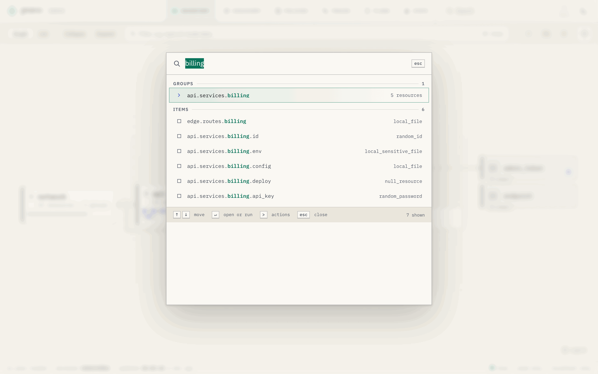
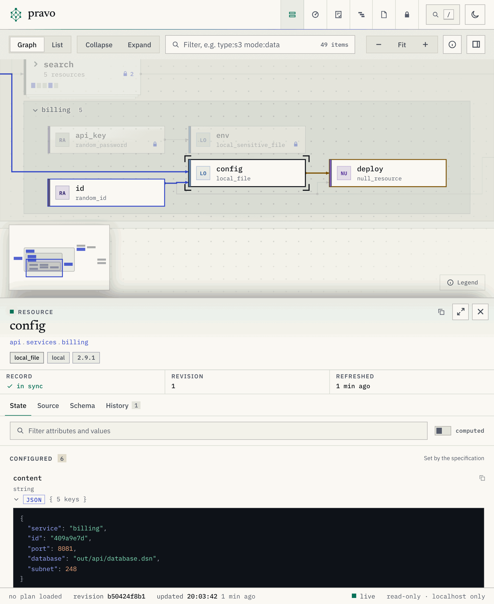

The viewer keeps its view in the fragment of the address, so that a link reproduces it, and most of what the mouse does has a key. [The sections of the viewer](viewer-sections.md) say what each view holds.

## The address of a view

A fragment looks like `#/?sel=api.services.billing.config&tab=source&collapse=network,edge&theme=dark`. Values are URL-encoded, and a list is comma separated. The page rewrites the fragment as you use it, so the address in the bar is always a link to what you see. The action `Copy a link to this view` of the palette copies it.

| Parameter | Value | Meaning |
|---|---|---|
| `view` | `graph`, `list`, `plans`, `discovery`, `policies`, `traces`, `secrets` or `state` | The section, and for the Inventory whether the graph or the list is shown. `table` and `access` are older names of `list` and `state`, and a link that has them still opens. |
| `sel` | An address, or the path of a group | The selected node or group. It opens the groups and the cluster that hide the node, unless `collapse` names a group that holds it. |
| `tab` | `state`, `source`, `schema`, `history` or `change` | The tab of the inspector. `change` shows what the plan over the graph does to the node. |
| `collapse` | Group paths, or `all` | Groups drawn as one card, on top of the first view. |
| `expand` | Group paths, `c:GROUP\|MODE\|TYPE` or `all` | Groups drawn open, on top of the first view, and the clusters that are open. `c:eu.prod.nodes\|managed\|null_resource` is the cluster of the managed resources of that type in `eu.prod.nodes`. |
| `q` | Text | The filter box above the graph: words, and terms of the form `column:value` ([the columns](viewer-sections.md#filters)). The list cells and the menu write their terms in it. |
| `filter` | `resources`, `data`, `ephemeral`, `plan`, `drifted`, `sensitive`, `orphans`, `declared`, `outputs` or `env` | An older form of a filter. A link that has it opens with the term of that filter in `q`, so `filter=drifted` is `q=status:drifted` and `filter=data` is `q=entity:data`, and the viewer does not write it. |
| `plan` | `plan-` and the hexadecimal digits of an id, or `none` | A stored plan laid over the graph, by its whole id. The page writes it when you choose a plan, and leaves it out when the plan is the one that `--plan ID` laid. `none` takes off the plan that `--plan ID` laid. An id that the state does not hold is told in a notice and ignored. |
| `plq` | Text | The finder of the Plans section: words, and terms of the form `column:value`. About the plan: `status`, `by`, `id`, `reason`, `created`, `expires`, `overlap`. About its changes: `action`, `resource`, `ns`, `type`, `provider`, `change`. |
| `dq` | Text | The filter box of the Discovery section: words, and terms of the form `column:value` ([the columns](viewer-sections.md#filtering-the-objects)). |
| `pol` | Text | The policy that is open in the Policies section, by its name. |
| `ps` | `1` | The policy studio, the second page of the Policies section. |
| `trace` | A run id: 32 hexadecimal digits, a hyphen and 16 more | The recorded run that the Traces section opens. Without it the newest is open. A run that is not in the directory is told in a notice and ignored. |
| `span` | A span id of 16 hexadecimal digits | The selected span of that run. |
| `tv` | `table` | The Traces section shows the slowest spans as a table and not as a timeline. |
| `tz` | `START-END` | The part of the run that the timeline shows, in microseconds from its start. |
| `tq` | Text | The filter box of the Traces section. |
| `zoom` | `fit`, or a scale such as `1.2` | `fit`, the default, fits the whole graph in the window. When a link selects a resource and the whole graph would be drawn below 80 percent of full size, the view goes to the resource instead. A scale shows the graph at that size, centred on the selection when there is one. |
| `theme` | `light` or `dark` | The theme. Without it the viewer follows the system and the last choice made in the page. |
| `motion` | `off` | Every animation and transition off. The system setting for reduced motion has the same effect. |
| `palette` | `1` | The command palette open. |
| `pq` | Text | The text typed into the palette. |
| `help` | `1` | The sheet of shortcuts open. |

A view of the Inventory with a resource selected is the usual link to share: `#/?sel=api.services.billing.config&tab=history`. A view of another section needs `view`: `#/?view=plans&plq=by:ben`, `#/?view=policies&pol=approve_deletes`, `#/?view=traces&trace=ID&span=ID`.

## The command palette

The palette opens with `/`, Ctrl-K or Cmd-K, or with the search button in the bar. It searches in groups, and the resources come first: groups, resources and outputs. After them come the stored plans (by id, author or status), the transactions and the runs that pravo recorded (by command line, reason, actor or transaction id), the objects that discoveries found (by id, name, status or discovery), and the actions of the page. A plan opens in the Plans section, a run or a transaction in the Traces section with that run open, and an object in the Discovery section with the filter on it.

An action runs at once and shows its shortcut, so that the key is learned: go to a section, switch between the graph and the list, fit the graph, zoom, collapse or expand the groups, switch the theme, open the sheet of shortcuts, open the policy studio, clear the selection or the filter, and copy a command, the address of the selection or a link to the view. A leading `>` lists the actions alone, in groups. With no text the palette offers the sections first, then the groups and the resources that the plan changes. An action appears only where it applies: the graph actions are not offered in the Plans section.

:::figure The palette with a word typed: one group and six resources match.

:::

In the palette, the arrows and Page Up and Page Down move, Enter goes to the result or runs the action, and Esc closes it. Each search that moves the picture of the resources adds an entry to the history of the browser, which keeps the open groups, the selection and the camera of the picture it left: the button Back to where you were, Esc and the browser's Back return to it.

## Keyboard

The sheet of shortcuts in the viewer opens with `?`. Keys other than Ctrl-K and Esc do nothing while a text field has the focus.

| Key | Action |
|---|---|
| `/`, Ctrl-K, Cmd-K | Open the command palette. |
| `?` | Open the sheet of shortcuts. |
| `t` | Switch the theme. |
| `g` | Switch the resources between the graph and the list. |
| `a` | Switch between the Inventory and the State sections. |
| `p` | Switch between the Inventory and the Plans sections. |
| `d` | Switch between the Inventory and the Discovery sections. |
| `o` | Switch between the Inventory and the Policies sections. |
| `s` | Open the policy studio, or go back to the register when it is open. |
| `r` | Switch between the Inventory and the Traces sections. |
| `e` | Switch between the Inventory and the Secrets sections. |
| `c` | Open or close the Ask panel, when the viewer was started with [the assistant](serve.md#the-assistant). |
| Esc | Close the palette, the sheet, a drawer or the Ask panel. In a text field, leave it. Otherwise clear the reach, then go back to where a search began while its result is selected, then close the group that a click opened, then clear the selection. |

### In the graph

| Key | Action |
|---|---|
| Left arrow | Move to a dependency of the selection. |
| Right arrow | Move to a dependent. |
| Up arrow, Down arrow | Move to the sibling above or below. |
| Enter | Open the selected card or cluster. On an open group or one of its resources, close the group. |
| `f` | Fit the graph to the window. |
| `i` | Show the project in the inspector, or take it away. Escape takes it away too. The button at the right of the toolbar does the same. |
| `0` | Go back to the first view: the groups that were open when the page loaded, no cluster open and the whole graph in the window. The selection stays when it still shows, and the filter stays. |
| `+`, `-` | Zoom in or out. |
| `[` and `]` | Close or open every group. |
| Drag | Pan the graph. |
| Wheel or pinch | Zoom the graph. Shift and the wheel pan sideways. |
| Click a card | Open the group, move the view to it and select it. |
| Click a disc of an author | Go to the Plans section and open that plan under its row. |
| Click a cluster | Open the cluster. |
| Double-click the title of a lane | Close or open the group. |

### In the list

With the focus in the list:

| Key | Action |
|---|---|
| Up arrow, Down arrow, Page Up, Page Down, Home, End | Select the row above or below, or the first or last. |
| Left arrow | Close an open group, or go to the row of the group that holds it. |
| Right arrow | Open a closed group, or go to the next row. |
| Enter, Space | Close or open the group. |
| `*` | Open every group of this level. |

### In the list of stored plans

| Key | Action |
|---|---|
| Up arrow, Down arrow, Home, End | Move between rows. |
| Enter, Space | Lay the plan of the row over the graph, or take it off when it is laid. |
| Esc | Take the plan off the graph. |

### In the timeline

| Key | Action |
|---|---|
| Up arrow | Move to the span that holds the selection. |
| Down arrow | Move to the first part of the selection. |
| Left arrow, Right arrow | Move to the neighbour of the selection. |
| Shift and Left arrow or Right arrow | Move along the run. |
| `+`, `-` | Zoom the timeline. |
| `0` | Fit the whole run. |
| Enter | Fit the timeline to the selection. |
| Esc | Clear the selection. |
| Click a bar | Select the span. A double click fits the timeline to it. |
| Drag | Move along the run. |
| Ctrl or Cmd and the wheel | Zoom the timeline. |

### In the policy studio

| Key | Action |
|---|---|
| `Ctrl+Space` | List what the plan document has at the cursor. The list also opens as you type. |
| `Tab`, `Enter` | Take the choice in the list. `Tab` indents when no list is open. |
| `Ctrl+Shift+[`, `Ctrl+Shift+]` | Fold or unfold the block at the cursor (`Cmd` on a Mac). |
| Esc | Leave the editor. |

## A narrow window

The page fits a phone or a narrow pane. The sections stay in the bar, the graph fills the top of the window, and the inspector becomes a panel under the graph when something is selected. The State section stacks the role and the badge of a member under the name.

:::figure The viewer in a narrow window, with a resource selected.

:::
